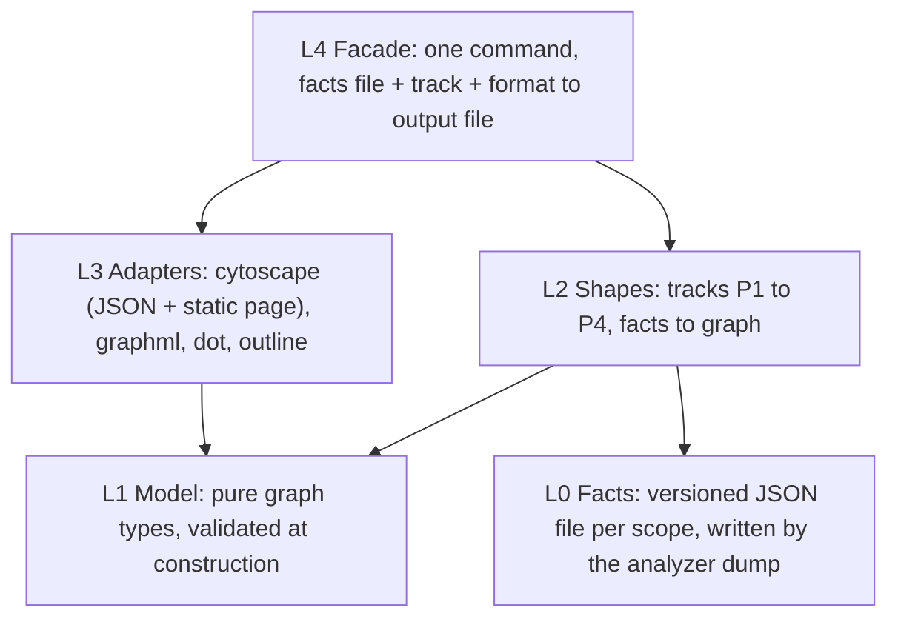

# Abstraction graph: 03 Design

> **Status: ALPHA / EXPERIMENTAL — Active Investigation & Design** (subject to change at any time). Next: execution (Phase 4), results in 04_prototypes.md.

References: [01_understand.md](01_understand.md) (goals G1–G6, decisions D1–D14), [02_references.md](02_references.md) (references RI/RT/RL, critical points CP1–CP9, decisions D15–D17).

Markers: **[V]** verified; **[U]** to verify when building the benchmark.

## 1. Definition of Done (Independent of Any Solution)

### 1.1 Reader Journeys (CUJs)

Each journey is something a reader does with the output. The primary reader is a newcomer onboarding onto a module (D6). The journeys follow the question groups developers ask (RL5): find focus points, expand a focus point, understand a subgraph, and relate subgraphs.

| ID | Journey | Acceptance criteria |
| :--- | :--- | :--- |
| CUJ1 | **First overview.** The reader learns which public abstractions a module offers (entrypoints and public types) without reading any helper. | Every public item appears; no private item appears by default (D12). Every item links to its file and line (CP6). Public items are ordered by abstraction level (D7). |
| CUJ2 | **Drill into one abstraction.** The reader expands a public item to see what it is built from: the exclusive private helpers and the types it encapsulates. | Expanding a public item `p` shows exactly the items whose only public root is `p` (ADR 011 §3.1), in abstraction order. Each relation shown has a kind (D8). Collapsing restores the overview. |
| CUJ3 | **Find shared lower-level abstractions.** The reader sees which items are shared between several components, by which ones, and at which level. | A shared item never appears inside a single owner (D15). Each shared item states which components use it. It sits below every component that uses it. |
| CUJ4 | **Relate abstractions.** The reader sees how components relate: who calls into whom, which type is whose contract, who encapsulates what, with kinds and counts. | In the overview, relations between components summarize the relations between their members, with kind and count (CP3). No summary relation is invented or lost compared with the analyzer's facts. |
| CUJ5 | **Understand a type.** The reader sees what a type is made of, what it does, and which functions it is a contract for. | Composition (fields, variants), behavior (its methods or `impl` calls), and contract relations are distinguishable (D8). Whether methods appear in the same picture as the module is a prototype choice (D14), but the journey must be completable. |
| CUJ6 | **See where structure departs from the rules.** The reader notices misplaced items and recursion groups. | Each lint finding of the three ordering rules is attached to its item. Each recursion group appears as one unit (CP5). |
| CUJ7 | **Regenerate after a change.** The documentation follows the code (D9). | The same source gives identical output. A small code change gives a small, local change in the output. |
| CUJ8 | **Use the reader's own tools.** The reader views it with existing tools, without us building a viewer (G4, NG3). | The output opens in at least one viewer that supports folding and in at least one layered layout, preserving containment and levels (CP2, CP5). A tool without nesting still gets a usable flat view. |

### 1.2 Metrics

| ID | Metric | How it is measured | Target |
| :--- | :--- | :--- | :--- |
| M1 | **Fidelity** | Every node, relation, and grouping is checked against the analyzer's facts for the same scope. | 100%: nothing invented, nothing lost. |
| M2 | **Level consistency** | Relations pointing upward against the exported levels, outside recursion groups. | 0. |
| M3 | **Overview size** | Number of items and relations in the default view, per benchmark module. | Reported, not a threshold (D16). |
| M4 | **Agent answers from the graph** | An agent answers a fixed question set (§1.3) from the graph alone, and separately from the source alone. | Graph-only accuracy close to source-only accuracy on structural questions. |
| M5 | **Context cost** | Size of the graph output versus the source, as an agent's input. | Reported; the graph should be much smaller. |
| M6 | **Walkthrough verdict** | The user reviews each benchmark module's output: useful, partly useful, or not useful, with notes. | Useful on most modules. |
| M7 | **Determinism** | Regenerating twice and after a one-line change. | Identical; local diff. |

### 1.3 Question Set for M4

Asked per benchmark module, each answer checkable against the analyzer's facts:

1. What are the module's public entrypoints and public types?
2. Which private items serve only entrypoint `X`?
3. Which items are shared, and by which components?
4. What is type `T` made of, what does it do, and which functions is it a contract for?
5. If helper `h` changes, which public items can be affected?
6. Which items are at the lowest level, depending on nothing else in the module?
7. Which items call each other in a cycle?
8. Which items does the linter consider misplaced, and why?

### 1.4 Stage B Gate

Stage B (whole project) starts if, on the benchmark:

- CUJ1–CUJ5 are met on every module, and CUJ6–CUJ8 on most;
- M1 = 100% and M2 = 0;
- M4 shows the graph answers structural questions about as well as the source;
- M6 is "useful" on most modules.

Otherwise the findings say which journeys failed and why, and the recommendation is to stop or to change the approach.

## 2. Benchmark Modules

Chosen to exercise every case the journeys rely on. Each feature listed must be confirmed when the benchmark is built [U].

| Module | Language | Why it is in the benchmark |
| :--- | :--- | :--- |
| `playground/src/lib.rs` | Rust | Small; public entrypoint with private request/response types and several helpers. |
| [src/code_lint/suppression.rs](../../../src/code_lint/suppression.rs) | Rust | Public type owning private types and helpers; type containment (`ParsedDirective` holds `DirectivePlacement`); `impl` methods (D14). |
| [src/code_lint/rules/uninherited_protocol.rs](../../../src/code_lint/rules/uninherited_protocol.rs) | Rust | Rule file: encapsulation in a body and signature contracts (`check_file` → `LocalProtocol` → helpers). |
| [src/rule_selection.rs](../../../src/rule_selection.rs) | Rust | Several public entrypoints, so likely shared helpers (D15). |
| [src/code_lint/ast/rust.rs](../../../src/code_lint/ast/rust.rs) | Rust | Large module: scale stress (M3). |
| `target/bench-corpora/ripgrep/crates/globset/src/glob.rs` | Rust | External code: type containment (`Parser` holds `Tokens`). |
| `target/bench-corpora/cargo/src/ops/cargo_fix/mod.rs` | Rust | External code: large, signature types placed far from their functions (`FixArgs`). |
| `target/bench-corpora/cpython/Lib/zoneinfo/_zoneinfo.py` | Python | Python module with private classes and helpers. |
| One Python class scope from cpython (to pick) | Python | A class scope: methods, constructors, private methods. |
| One module with a recursion group (to find) | Rust or Python | CUJ6 and question 7. |

## 3. Open Questions

| ID | Question |
| :--- | :--- |
| Q17 | ~~Right journeys?~~ Validated as written. |
| Q18 | ~~Gate strictness?~~ Validated as written. |
| Q19 | ~~Benchmark changes?~~ Validated as written. |

## 4. Prototype Plan (Draft)

The prototypes are investigation code: they live in a dedicated Jujutsu workspace (`target/workspaces/abstraction-graph`), outside the commit stack, and only their results come back into these docs (D3).

### 4.1 Step 0: Extract the Facts

Every prototype needs the same input: the analyzer's facts for one scope, which today are discarded after the lint runs (§2.1 of 01). Step 0 adds a temporary dump in the workspace:

- per scope: items (name, kind, visibility, position, file and line), relations with their kind, `Roots(h)`, recursion groups, levels, and findings;
- the gaps from 01 §2.1 closed in the dump only, to measure what closing them costs: composition versus behavior for types, parameter versus return for methods, and the link between a type and its `impl` or `class` methods.

Output: one raw facts file per benchmark module, and confirmation of the features each module was chosen for (§2 [U]).

### 4.2 Competing Tracks

Each track turns the raw facts into a graph. They differ on the questions the CUJs leave open.

| Track | Grouping (CUJ2, CUJ3) | Type and methods (CUJ5, D14) |
| :--- | :--- | :--- |
| **P1: Flat** | No nesting; ownership and level are only attributes. | Module scope only. |
| **P2: Ownership tree** | Public items contain their exclusive helpers. Shared items form their own lower-level groups, one per set of components that share them (D15). | Module scope only. |
| **P3: Ownership tree with members** | As P2. | Each type also contains its methods, so composition, behavior, and contract relations sit in one picture. |
| **P4: Level bands** | Items nested in level bands (from entrypoints down to leaves); ownership as attributes. | As P3. |

P1 is the baseline: it shows what plain graph tools already give. P2 and P3 test D12 and D15 directly. P4 tests whether levels are a better first grouping than ownership (D7).

### 4.3 Outputs per Track

Each track is emitted in the formats needed to check CUJ8 and M4/M5:

- one format for a viewer that folds groups (Cytoscape JSON is the current candidate, RT3);
- one format for a layered layout (ELK JSON or Graphviz with rank constraints, RT4);
- a plain DOT fallback for tools without nesting;
- a compact text outline for the agent questions (M4) and context size (M5).

### 4.4 Comparison

Each track is scored on every benchmark module against CUJ1–CUJ8 and M1–M7. Code complexity of each track's transformation is recorded too. Losing tracks are archived with the reason.

### 4.5 Open Questions on the Plan

| ID | Question |
| :--- | :--- |
| Q20 | ~~Right tracks?~~ Validated as written. |
| Q21 | ~~Temporary dump in a workspace?~~ Validated. |
| Q22 | ~~Which viewer and format first?~~ Answered (D20), see [02_references.md](02_references.md) §8. |

### 4.6 Decisions on the Plan

| ID | Decision | Source |
| :--- | :--- | :--- |
| D18 | We emit data only and never implement rendering, layout, or viewing: existing tools do all of it. Format adapters only map our model onto an existing format. The text outline for agents is a serialization of the same data, not a rendering. | User |
| D19 | If Stage A works, the graph model and its format adapters may move to a dedicated crate that `omnicoach` uses. Prototypes therefore keep the graph model independent of `omnicoach` internals: the analyzer only produces facts, and everything after that depends on the model alone. | User |
| D20 | Walkthroughs use Cytoscape JSON viewed with Cytoscape.js plus its expand-collapse and ELK layout extensions, through a small static page that only loads and configures them. GraphML is emitted alongside as the standard export. | User (Q22) |
| D21 | No coupling to any tool: the graph model knows nothing about Cytoscape, ELK, GraphML, or any viewer. Each tool is reached through exactly one adapter that depends on the model, never the reverse, so a tool can be swapped or dropped by deleting its adapter. | User |

## 5. Prototype Design (Draft)

### 5.1 Abstraction Layers

Dependencies only point down. Each layer is a separate module; the boundary between the analyzer and everything else is a file format, so the model never depends on `omnicoach` internals (D19).

| Layer | Contents | Depends on |
| :--- | :--- | :--- |
| L0 Facts | Per scope: items (name, kind, visibility, source position, file and line), relations with their kind, public roots of each item, recursion groups, levels, findings. Written by a temporary dump inside the analyzer, in the workspace only. | the analyzer (producer side only) |
| L1 Model | Pure types: nodes, a containment tree, typed relations, node attributes. Constructors reject invalid graphs (D21 keeps tool concepts out). | nothing |
| L2 Shapes | One function per track (P1–P4) turning facts into a model graph, plus the derived summary relations between groups (CP3). | L0, L1 |
| L3 Adapters | One per tool or format, each mapping the model onto that format and nothing else (D18, D21). | L1 only |
| L4 Facade | One entry point that wires a facts file, a track, and a format. | L2, L3 |

### 5.2 Model Invariants (Pit of Success)

The model's constructors reject, so no adapter ever sees:

- duplicate node identifiers, or a relation whose ends don't exist;
- a containment structure that is not a tree (an item in two groups, or a cycle);
- a private item placed inside a group other than its single owner, or a shared item placed inside any single owner (D12, D15);
- a relation pointing upward against the levels outside a recursion group (M2);
- a relation without a kind (D8).

Relation kinds and node kinds are closed enumerations, not strings.

### 5.3 Language and Location

| Option | For | Against |
| :--- | :--- | :--- |
| **Rust** (recommended) | Same toolchain and verification as the repo; closed enums and validated constructors are natural; a separate Cargo package in the workspace enforces D19/D21 at the crate boundary and is the shape of the possible future crate. | Slower to iterate than a scripting language. |
| Python | Faster iteration on graph shapes. | The repo has no Python lint, type-check, or test setup; adding one for a prototype is new tooling, and loosely typed dicts work against §5.2. |

Location: Jujutsu workspace `target/workspaces/abstraction-graph`. The fact dump is a temporary change to the analyzer there; L1–L4 form a separate Cargo package under `prototypes/abstraction_graph/` in that workspace. Nothing is committed to the main stack; results are recorded in `04_prototypes.md` (D3).

### 5.4 Standard Verification (After Every Task)

1. `cargo fmt` for the touched packages.
2. `cargo clippy --all-targets` with the repo's lints.
3. `cargo test` for the touched packages.
4. `omnicoach code` on the prototype package (dogfooding the repo's own rules).

### 5.5 Ordered Tasks

Each task follows Audit (read what it touches) → RED (a failing test) → GREEN (minimal code) → Verify (§5.4).

| # | Task | RED test |
| :--- | :--- | :--- |
| T1 | Create the workspace and an empty prototype package. | Package builds and its single smoke test fails until wired. |
| T2 | Fact dump for one scope: items, relations, roots, recursion groups, levels, findings. | A small fixture module dumps exactly the expected facts. |
| T3 | Close the three data gaps in the dump only: composition versus behavior for types, parameter versus return for methods, the link from a type to its methods. | One fixture per gap, each failing before its change. |
| T4 | Dump every benchmark module; confirm each module's features (§2 [U]); pick the Python class and the recursion-group module. | A check that each module shows the features it was chosen for. |
| T5 | L1 model with validated constructors. | One test per invariant in §5.2, each expecting rejection. |
| T6 | Track P1 (flat). | Fixture: every item present, no containment, CUJ1 attributes present. |
| T7 | Track P2 (ownership tree, shared groups per set of components). | Fixture: exact exclusive helpers under each owner (CUJ2); shared items grouped by their set of components, below all of them (CUJ3); summary relations with counts (CUJ4). |
| T8 | Track P3 (P2 plus each type's methods). | Fixture: composition, behavior, and contract relations distinguishable for one type (CUJ5). |
| T9 | Track P4 (level bands). | Fixture: bands match levels; recursion groups as one unit (CUJ6). |
| T10 | Adapters: outline, then Cytoscape (JSON plus static page), GraphML, DOT. | Golden-file test per adapter on one fixture; byte-identical on rerun (M7). |
| T11 | Metrics harness: M1 fidelity, M2 upward relations, M3 overview size, M5 context size, M7 determinism. | Each metric computed on a fixture with a known answer. |
| T12 | Agent evaluation (M4): the §1.3 questions per benchmark module, answered from the outline alone and from the source alone, by agents that did not write the code. | Answer keys derived from the facts. |
| T13 | **Manual checkpoint (M6):** user walkthrough in the browser through the static page. The demo set must exercise every case: exclusive and shared helpers, a type with composition and behavior, a recursion group, findings. | Checklist of cases confirmed visible. |
| T14 | Compare tracks on all CUJs and metrics plus code complexity; archive losers with reasons in `04_prototypes.md`. | — |

### 5.6 Open Questions

| ID | Question |
| :--- | :--- |
| Q23 | ~~Prototype language?~~ Answered (D22). |
| Q24 | ~~Walkthrough order?~~ Answered (D23). |

### 5.7 Decisions on the Design

| ID | Decision | Source |
| :--- | :--- | :--- |
| D22 | Prototypes are written in Rust: a separate Cargo package in the workspace, with no dependency on `omnicoach`; the fact dump is the only change inside `omnicoach`. | User (Q23) |
| D23 | Build several tracks first, then iterate on all of them using what each one teaches; the walkthrough (T13) comes once the tracks exist, followed by further iterations. | User (Q24) |
