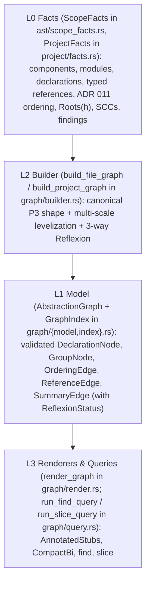

# Abstraction graph: 05 Decisions and Learnings

> **Status: VALIDATED IN PRODUCTION (Stages A, B, C, D & E Complete)**
> Inputs: [01_understand.md](01_understand.md), [02_references.md](02_references.md), [03_design.md](03_design.md), [04_prototypes.md](04_prototypes.md), [06_stage_b_design.md](06_stage_b_design.md), [07_stage_b_results.md](07_stage_b_results.md), [08_stage_c_agent_formats.md](08_stage_c_agent_formats.md), [09_stage_d_understand.md](09_stage_d_understand.md), [10_stage_d_references.md](10_stage_d_references.md), [11_stage_d_design.md](11_stage_d_design.md), [12_stage_d_results.md](12_stage_d_results.md), [13_stage_e_diagnostic_placement_design.md](13_stage_e_diagnostic_placement_design.md).

## 1. Stage A Verdict Against Goals (G1–G6)

| Goal | Verdict | Evidence from [04_prototypes.md](04_prototypes.md) |
| :--- | :--- | :--- |
| **G1** (Does the linter's module view give a useful overview of its abstractions?) | **Validated on cohesive modules; bounded by F10 on flat utility hubs** | On 8 of 9 benchmark scopes (`playground_lib`, `suppression`, `uninherited_protocol`, `rule_selection`, `ripgrep_glob`, `cargo_fix`, `cpython_zoneinfo`, `cpython_ZoneInfo_class`), the collapsed overview fits within the `<= 20`-node comprehension threshold (`M3 = 1–17` nodes). On `ast/rust.rs` (`116` declarations, `29` public items), distinct caller subsets produce `18` `Shared(S)` buckets (`M3 = 47` groups, F10). In the **M4** blind agent evaluation, `Outline-only` scored **`32 / 32 (100%)`** vs. **`23 / 32 (72%)`** for `Source-only` at **`14%–50%`** (`2.7×` smaller total) of raw source bytes. |
| **G2** (How to separate public abstractions from private implementation and fold?) | **Validated (`P3_members` with 3-level progressive zoom)** | One canonical containment tree (`Owner(p)` / `Shared(S)` / `Unowned` → `RecursionGroup` / `TypeMembers`) supports three progressive zoom levels without storing UI collapse state in `L1`: **Level 0** (component overview with `SummaryEdge`s and singleton pills), **Level 1** (intra-owner declarations ordered `L_k .. L_0`, with `TypeMembers` folded), and **Level 2** (`impl` / `class` methods expanded). |
| **G3** (Which facts are needed and which analyzer gaps must close?) | **Validated (3 analyzer gaps closed + two-level levelization)** | Closing the three `01_understand.md` §2.1 gaps in `L0` (`Composition` vs. `Behavior` on types [F5], `Parameter` vs. `Return` on callables [F4], and `Impl`/`Class` scope labels [F6]) plus **two-level levelization** (inter-group `GroupNode.level` + intra-owner `DeclarationNode.level` [F9, F12]) achieved **`M1 = 100%` fidelity** and **`M2 = 0 / 0` upward edges** across every benchmark scope. |
| **G4** (How can external tools consume the graph without building a custom viewer?) | **Validated across 4 formats (`M7 = 100%` deterministic)** | `L3` maps `AbstractionGraph` (`L1`) deterministically to Markdown Outlines (`outline.md`), Cytoscape.js + `elkjs` + `cytoscape-expand-collapse` (`cytoscape.json` / `viewer.html`), `GraphML` (`graphml`), and Graphviz (`dot`), with five adapter-level invariants documented in F13. |
| **G5** (Evaluate on real Rust and Python modules from `omnicoach` and reference corpora) | **Validated on 9 scopes across 8 files (`315–3,485` lines)** | Tested on 5 `omnicoach` Rust modules (`playground`, `suppression`, `uninherited_protocol`, `rule_selection`, `ast/rust`) and 4 external scopes (`ripgrep` `glob.rs`, `cargo` `cargo_fix`, `cpython` `_zoneinfo.py` module and `ZoneInfo` class). |
| **G6** (Whether and how to generalize to Stage B) | **Validated in Stage B** (see §4 and [07_stage_b_results.md](07_stage_b_results.md)) | Stage B generalized the same `AbstractionGraph` model to whole projects (`Component → Module → Owner/Shared → Declarations → TypeMembers`) across `omnicoach`, `ripgrep/crates/ignore`, `cpython/Lib/zoneinfo`, and `cpython/Lib/urllib` with `M1 = 100%`, `M2 = 0/0`, and a `7.4×` reduction in `M4` agent tool calls. |

## 2. Final Stage A Architecture and Decisions

| ID | Decision | Rationale & Evidence |
| :--- | :--- | :--- |
| **D24** | **Consolidate on `P3_members` as the single canonical graph shape**; retire `P1_flat`, `P2_ownership`, and `P4_bands`. | `P1_flat` and `P2_ownership` are strictly collapse states of `P3_members` (Expand All and Zoom Level 1, respectively). `P4_bands` (`GroupKind::LevelBand`) adds redundant box-in-box borders in visual compound-graph viewers for vertical layering that ELK (`DOWN`) + `[L_k]` node labels already convey (T14, [04_prototypes.md](04_prototypes.md) §7). |
| **D25** | **Use two-level levelization (`GroupNode.level` across components, `DeclarationNode.level` locally within each owner bucket).** | Global module-wide DAG levels compare unrelated owners and produce `17` upward intra-owner edges (`M2`) on benchmark modules (F9). Computing declaration levels locally within each ownership bucket (`Owner(p)`, `Shared(S)`, `Unowned`) and group levels over the `SummaryEdge` DAG reduces `M2` to **`0 / 0` everywhere** (F12). |
| **D26** | **Keep viewer collapse/zoom policy strictly in `L3` (`render.rs`), decoupled from `L1` (`model.rs`).** | `L1` represents only structural containment (`Owner`, `Shared`, `Unowned`, `TypeMembers`, `RecursionGroup`). Viewer policies—collapsing multi-item owners and `TypeMembers` by default, keeping 1-item `is_singleton` owners as pills, auto-opening single-component scopes (`M3 = 1/0`), and hiding `SummaryEdge`s when endpoints expand—live entirely in `L3` (F13). |
| **D27** | **Treat the Markdown Outline (`OutputFormat::Outline`) and Interactive Compound Graph (`OutputFormat::CytoscapeJson`) as dual primary outputs (superseded for agents in Stage C by `D34`).** | The text outline is the highest-signal, lowest-token medium for AI agents, CLI inspection, and diffs (`M4 = 100%` accuracy at `14%–50%` of source bytes), while Cytoscape + ELK provides progressive interactive visual exploration for humans. |

## 3. Phase 7: Learnings That Feed Back into `omnicoach` (Stages A, B & C)

1. **L1 — Monotonicity of `Roots(h)` across shared intermediate types (`u -> v ⇒ Roots(u) ⊆ Roots(v)`) is required for rule satisfiability (F11)**:
   - *Observation*: In `ripgrep_glob`, `Glob` contains a `Tokens` field (`Containment`), while `GlobBuilder::build` calls `Tokens::to_regex_with`, whose `impl Tokens` body calls the private helper `char_to_escaped_literal`. Because module-scope behavior of `impl Tokens` rolls up onto the `Tokens` type node (F6), `Roots(char_to_escaped_literal)` traverses `Glob -> Tokens -> char_to_escaped_literal` and assigns `owners = [Glob, GlobBuilder]`.
   - *Why current behavior is correct*: Because `Tokens` is referenced by both `Glob` and `GlobBuilder`, `Tokens` must be placed in Place 2 (the trailing shared section after both `Glob` and `GlobBuilder`). Since `Tokens` calls `char_to_escaped_literal`, `callee-before-caller` requires `pos(Tokens) < pos(char_to_escaped_literal)`, which forces `char_to_escaped_literal` into Place 2 below `Tokens` as well. If `Roots(char_to_escaped_literal)` were `{GlobBuilder}` (`|Roots| = 1`) instead of `{Glob, GlobBuilder}`, (a) `uncolocated-helper` and `callee-before-caller` would contradict each other whenever `GlobBuilder` precedes `Glob` and has Place 1 helpers, and (b) `Shared(Glob, GlobBuilder)` (`Tokens`) would depend upward on `Owner(GlobBuilder)` (`char_to_escaped_literal`). Thus `u -> v ⇒ Roots(u) ⊆ Roots(v)` is an essential invariant of ADR 011.
2. **L2 — Multi-scale levelization mirrors ADR 006 + ADR 011's actual reading order (F9, F12)**:
   - *Observation*: Computing Lakos levels globally across a flat graph conflates distinct containment scales. Levelizing independently at each scale (`Component` DAG $\to$ intra-component `Module` DAG $\to$ intra-module `Owner` DAG $\to$ intra-owner `Declaration` DAG) achieves `M2 = 0 / 0` across every module and project benchmark.
   - *Implication*: Any future diagnostic, auto-fixer, or documentation export that reports abstraction levels should compute levels locally within each parent container.
3. **L3 — Shared-bucket fragmentation signals when a module is a flat utility hub (F10)**:
   - *Observation*: When `#{Shared(S) buckets}` approaches or exceeds `#{Owner(p) groups}` (as in `ast/rust.rs`: `18` shared buckets across `29` public functions), the module does not decompose into independent vertical components—it is a horizontal utility hub serving many entrypoints.
   - *Implication*: The ratio `shared_groups / owner_groups` is a direct cohesion metric for whether a file benefits from intra-module component folding vs. module-level decomposition.
4. **L4 — Blind `Outline` vs. `Source-only` subagent evaluation across 24 questions and 4 conditions (`M4`)**:
   - *Observation*: Under an unlimited budget on `QB1`–`QB5`, `Outline-only` and `Source-only` both scored `5 / 5 (100%)`, but `Outline-only` required **5 tool calls (~65s)** vs. **37 tool calls (~300s)** (`7.4×` fewer tool calls).
   - *24-Question Equal-Budget Matrix (`6 categories × 4 projects`, `≤12` read calls)*:
     - `Outline: ModuleOnly` (`0.8%–4%` bytes, `5` calls): **`12.0 / 12 (100%)`** on macro architecture, reflexion, cycles, and cross-module blast radius (`Q1`–`Q3`); `12.0 / 24 (50.0%)` overall.
     - `Outline: PublicSurface` (`3%–12%` bytes, `7` calls): **`15.5 / 16 (96.9%)`** on macro + public API surface questions (`Q1`–`Q4`); `16.5 / 24 (68.8%)` overall.
     - `Outline: Full` (`22%–57%` bytes, `10` calls): **`24.0 / 24 (100.0%)`** across all 6 question categories (`Q1`–`Q6`).
     - `Source-Only (≤12-call budget)` (`11` calls): **`18.5 / 24 (77.1%)`** overall — collapsing to **`31.3% (1.25 / 4)`** on cross-module blast radius (`Q3`) due to file-count/size limits and losing points on non-local invariants (`Q5.omnicoach` private-only ownership reachability and `Q6.cpython_zoneinfo` class-method placement findings).
5. **L5 — 3-Way Reflexion Model (`D30`) catches unused architecture declarations (`Absent` edges, F14)**:
   - *Observation*: Comparing `define_architecture!` in `src/architecture.rs` against actual cross-module references in `src/` surfaced that `CodeLintSuppression => [CodeLintContract, ...]` declares a dependency on `CodeLintContract` with `0` actual references in `src/code_lint/suppression.rs`.
   - *Decision*: Kept as an informational insight in the graph export only; `define_architecture!` expresses *allowed* conceptual dependencies rather than mandatory edges.
6. **L6 — Module-level SCCs expose intra-component module cycles invisible to component conformance (F15)**:
   - *Observation*: Even when component dependencies form a strict DAG, intra-component modules can form cycles (such as `rule_declaration <-> rule_declaration::options` in `omnicoach`, or the 7-module SCC in `ripgrep/crates/ignore`).
   - *Implication*: Added to `ROADMAP.md` (`## Architecture & Conformance`) as a future enhancement.
7. **L7 — `PublicSurface` mode should project `Owner(p) -> Owner(q)` summary edges onto public declarations (`F18`)**:
   - *Observation*: In `Q4.cpython_zoneinfo`, `reset_tzpath` encapsulates `InvalidTZPathWarning` transitively through private helper `_parse_python_tzpath`. Dropping private items in `PublicSurface` without projecting `Owner(p) -> Owner(q)` summary edges hid that indirect public-to-public dependency (`3.5 / 4` on `Q4`).
   - *Resolution*: Implemented in `src/code_lint/graph/builder.rs` (`extract_public_surface_module`), closing `F18`.
8. **L8 — Bidirectional edges (`->` and `<-`) + `:start..end` spans reduce token count (`-14.8%` bytes, `-38.8%` lines) while raising 1-step refactoring accuracy from `56.3%` to `100.0%` ([08_stage_c_agent_formats.md](08_stage_c_agent_formats.md))**:
   - *Observation*: `F1_Outline` omits `end_line` and incoming `<-` edges. When planning 1-step ADR 011 edits (`T2`), the `F1_Outline` agent was off by `1–17` lines on 7 of 8 tasks (`4.5 / 8 = 56.3%`) because doc comments, `impl` blocks, and EOF cannot be inferred from the next item's start line. Adding `:start..end` and `<- used_by` in `F2_CompactBi` raised `T2` accuracy to **`8.0 / 8 (100%)`** and halved agent search steps (`6` steps / `11` tool calls vs. `13` steps / `21` tool calls) while shrinking total byte count by `14.8%`.
9. **L9 — Inline language signatures & field summaries (`F3_AnnotatedStubs`) are essential for Zero-Read API Synthesis on non-stdlib code (`100%` vs. `25%` on `omnicoach`)**:
   - *Observation*: On project-specific APIs (`omnicoach` `T3.1` and `T3.2`) where LLM pretraining cannot supply signatures, symbol-only graph formats (`F1_Outline` and `F2_CompactBi`) scored only **`25% (0.5 / 2.0)`**, hallucinating parameter counts, parameter order, and struct fields. Embedding 1-line Rust/Python signatures and struct/enum/class fields in `F3_AnnotatedStubs` raised `T3` accuracy to **`8.0 / 8 (100%)`** (`24.0 / 24 = 100%` overall) at `27.2%` of source bytes (`21%` fewer lines than `F1_Outline`).
10. **L10 — Machine-oriented YAML (`F4_StructuredYaml`) adds `+45.6%` byte overhead (`+91.8%` lines) over `F3_AnnotatedStubs` with zero accuracy gain**:
    - *Observation*: Both `F3_AnnotatedStubs` and `F4_StructuredYaml` scored **`24.0 / 24 (100%)`**, but `F4_StructuredYaml` required `903 KB` (`13,028` lines) vs. `620 KB` (`6,792` lines) for `F3_AnnotatedStubs` across the 4 projects due to repeated key names and quoting.
11. **L11 — Method-level attribution (`Type::method`) on both source and target endpoints is a mandatory prerequisite for query slices ([12_stage_d_results.md](12_stage_d_results.md) §2)**:
    - *Observation*: Prior to Stage D, `collect_intra_file_references` and `enclosing_scope_symbol` attributed references inside `impl Type { fn method() }` to the outer `Type`, and `longest_module_prefix` / `resolve_rust_target` matched only full module paths (`m::Type`), dropping two-segment associated calls (`Type::method()`) to `0.0%` (`0/136`) cross-module recall. Fixing both endpoints raised Rust SCIP exact symbol-to-symbol recall from **`71.5%` to `86.6%` (`+15.1 pp`)**, cross-module `Type::method` recall from **`0.0%` to `100.0%` (`136/136`)**, and literal precision from **`84.6%` to `98.4%`** in `0.46 s` full-repo build time.
12. **L12 — Task-shape crossover between single-file hierarchy (`omnicoach graph <file>`) and cross-module queries (`find`/`slice`/`place`/`impact`) ([12_stage_d_results.md](12_stage_d_results.md) §4.2)**:
    - *Observation*: Across `84` controlled live subagent runs, single-file `omnicoach graph <file>` beat 1-hop `slice` on intra-file multi-hop bugfixes where the target file was named in the prompt (Tarjan SCC bugfix in `ast.rs`: `-76.0%` vs. `-48.6%` tokens; `ripgrep` bugfix in `dir.rs`: `-67.0%` vs. `-60.5%` tokens) because `omnicoach graph <file>` renders the full 4-hop intra-file hierarchy in 1 turn (`4–12 KB`). Conversely, `find`/`slice`/`place`/`impact` beat File/Directory Graph on cross-module bugfixes (`-8.1%`), multi-file ADR 012 refactors (`-16.3%` to `-25.1%`), ADR 011 placement (`-15.9%` tokens, `-22.5%` wall time, `-40.6%` fewer post-lint retries), and repository-wide comprehension (`-30.2%` on `inherit`, `-65.4%` to `-74.8%` on `flash`).
    - *Tool surface since*: `place` and `impact` were removed before landing (`D63`); pre-edit placement is now served by the conflict-free anchor in `omnicoach code` diagnostics, and `find` and `slice` remain.
13. **L13 — Closed-loop compiler/linter oracles mask binary pass/fail differences on code edits; open-ended comprehension exposes accuracy gains ([12_stage_d_results.md](12_stage_d_results.md) §5.1)**:
    - *Observation*: When `cargo test` and `omnicoach code` are available, Baseline agents eventually reach `100%` pass rate via `15`–`30` brute-force search/read calls and `10`–`15` edit-lint-move retries, making **trajectory efficiency** (`-38.4%` to `-45.0%` cost-weighted tokens, `-52.5%` fewer pre-edit search/read calls) the primary gain on code tasks. On open-ended **Architectural Comprehension** (no test oracle), Query Subcommands raised rubric accuracy from `91.7%` (`inherit`) / `83.3%` (`flash`) to **`100.0%`**, and enabled **`flash` + Turn-1 Query CLI (`473K` tokens, `374 s`) to beat `inherit` + Baseline (`579K` tokens, `429 s`) by `-18.2%` in tokens and `-12.8%` in wall time**.
14. **L14 — The `10 KB` agent-harness inline stdout truncation boundary is the hard budget ceiling for CLI graph tools ([12_stage_d_results.md](12_stage_d_results.md) §5.3 & §6.3)**:
    - *Observation*: When an agent runs a command whose stdout exceeds `~10 KB` (`10,240` bytes)—such as bare `omnicoach graph .` (`307–700 KB`) or unguarded multi-symbol slices—the agent harness truncates the middle of the output inline and spills to a step log file, causing `flash` in the initial File/Directory Graph comprehension condition to consume **`+14.7%` more tokens than Baseline (`1.88M` vs. `1.64M`)**. Guarding multi-file full graphs at `8 KB` (`MAX_MULTI_FILE_FULL_GRAPH_BYTES = 8_192`) with `2`-peer module edge capping (`7,085` bytes inline) eliminated the regression and reduced `flash` comprehension tokens by **`-72.2%` (`1.88M → 523K`)** and wall time by **`-50.5%` (`816 s → 404 s`)** (`L14`).
    - *Tool surface since*: The size-triggered `8 KB` guard was replaced by a target-dependent default depth (`D65`): a directory renders at module depth by default (`omnicoach graph src` is `8.9 KB` on this repository), so the module overview the guard fell back to is now the default, while an explicit `--depth` is always honored.
15. **L15 — Single-rule anchor selection (`best_anchor`) causes 2-move ADR 011 lint cascades unless scored against all of the moved item's own constraints ([12_stage_d_results.md](12_stage_d_results.md) §6.1)**:
    - *Observation*: Scoring candidate insertion slots by `(broken_held, distance, pos)` for a single violated rule (`private-before-public`) can recommend a slot above a private caller/type where `callee-before-caller` is violated on the moved item itself, forcing a second move. Scoring by the 4-tuple `(broken_held, unfixed_own, distance, pos)` guarantees single-move convergence whenever a conflict-free slot exists.
16. **L16 — Identifier-token overlap fallback (`MatchRank::TokenOverlap`) prevents 20-turn search spirals when prompt/agent symbol names drift from source identifiers ([12_stage_d_results.md](12_stage_d_results.md) §6.2 & §6.5)**:
    - *Observation*: When a prompt or agent refers to a concept by a composite camelCase/snake_case name (`RuleSelectionConfig`) whose source struct is named slightly differently (`rule_selection::RawSelection`), contiguous substring matching returns `(0 matches)` and triggers `20+` exploratory search turns. Splitting unmatched queries into camelCase/snake_case identifier tokens (`len > 2`) and ranking declarations matching `>= 2` qualified tokens and `>= 1` symbol token resolves the target module's declarations on the first call.
    - *Tool surface since*: `MatchRank::TokenOverlap` was removed before landing (`D64`); the evidence came from a single task and the token split returns noisy hits.

## 4. Finalized Stage B & Stage C Decisions (`D28`–`D37`)

| ID | Decision | Rationale & Evidence ([07_stage_b_results.md](07_stage_b_results.md), [08_stage_c_agent_formats.md](08_stage_c_agent_formats.md)) |
| :--- | :--- | :--- |
| **D28** | **Unify Stage B and Stage A in a single 5-level containment hierarchy** (`Component` → `Module` → `Owner`/`Shared`/`Unowned` → `Declaration`/`RecursionGroup` → `TypeMembers`). | Reuses the exact same `GroupNode` and `SummaryEdge` primitives in `L1` (`model.rs`), with level invariants enforced between sibling groups (`parent_of(higher) == parent_of(lower)`). |
| **D29** | **Support configurable hierarchy depth via `ProjectDepth`** (`ModuleOnly`, `PublicSurface`, `Full`). | Allows stopping at `Component → Module` (`0.8%–4%` of source bytes, `100%` on `Q1`–`Q3`), `Component → Module → Public API` (`3%–12%` of source bytes, `96.9%` on `Q1`–`Q4`), or full intra-module implementation (`22%–57%` of source bytes, `100%` on `Q1`–`Q6`). |
| **D30** | **Emit 3-way Reflexion status (`Convergent`, `Absent`, `Divergent`, plus `Inferred`) on `SummaryEdge`.** | Distinguishes verified architectural edges (`Convergent`), stale/unused declared edges (`Absent`, `count == 0`), and architecture violations (`Divergent`) in both text outlines and visual graphs (F14). |
| **D31** | **Fall back to crate/package hierarchy with `ReflexionStatus::Inferred` when `define_architecture!` is absent (`Q10`).** | Validated on `ripgrep/crates/ignore`, `cpython/Lib/zoneinfo`, and `cpython/Lib/urllib`; single-component packages auto-expand to their module overview (`M3 = 4–8` nodes). |
| **D32** | **Default project-scale exports to `ProjectDepth::PublicSurface` for high-level onboarding, and `ProjectDepth::Full` for module refactoring.** | Captures all components, modules, public entrypoints, and transitive `Owner(p) -> Owner(q)` contracts (`F18`) at `3%–12%` of source bytes while keeping private implementation folded (`F17`). |
| **D33** | **Deduplicate retargeted compound meta-edges in `L3` (`syncEdgeVisibility`) using `orig_source` / `orig_target`.** | Prevents `cytoscape-expand-collapse` from rendering hundreds of redundant module summary meta-edges between collapsed components (`68` edges instead of `653` on `omnicoach`, `F16`) while preserving mixed-depth edges when individual components are expanded. |
| **D34** | **Adopt `F3_AnnotatedStubs` (`OutputFormat::AnnotatedStubs`, `.stubs.md`) as the primary AI agent format.** | Combines `[Lk]` topological hierarchy, `Owner(p)` / `Shared(S)` colocation, bidirectional `->` / `<-` edges, `:start..end` spans, and 1-line Rust/Python signatures & type fields. Achieves **`24.0 / 24 (100%)`** across `T1` (reverse blast radius), `T2` (1-step refactoring), and `T3` (zero-read API synthesis) at **`27.2%` of raw source bytes** (`-21%` lines vs. `F1_Outline`). |
| **D35** | **Keep `F2_CompactBi` (`OutputFormat::CompactBi`, `.compact.md`) as the signature-free (`--no-signatures`) topological mode.** | Strictly dominates `F1_Outline` (`-14.8%` bytes, `-38.8%` lines, `21.4%` of raw source bytes) while achieving **`16.0 / 16 (100%)`** on `T1` (impact analysis) and `T2` (refactoring/placement) with the fewest agent steps (`6` steps / `11` tool calls). |
| **D36** | **Retire `F1_Outline` and `F4_StructuredYaml` as agent target formats.** | `F1_Outline` (`75.0%` overall; `56.3%` on `T2`, `25%` on `omnicoach` `T3`) is strictly dominated by `F2_CompactBi` and `F3_AnnotatedStubs`; `F4_StructuredYaml` (`100%`) costs `+45.6%` more bytes and `+91.8%` more lines than `F3_AnnotatedStubs` for identical information. |
| **D37** | **Extract `CodeLintProject` below `CodeLintGraph` and `CodeLintRunner` once cross-file architecture rules and shared project indexing land (`src/code_lint/project/facts.rs`).** | `CodeLintAst` stays strictly per-file (`collect_scope_facts`, `ast::python::collect_path_references`, and `ast::rust::summarize_rust_file`). When `Topic::ARCHITECTURE` rules, `ProjectIndex`, and shared module/path resolution landed, multi-file `ProjectFacts` and cross-module symbol resolution moved into `CodeLintProject` ([src/code_lint/project/facts.rs](../../../src/code_lint/project/facts.rs) and [src/code_lint/project/index.rs](../../../src/code_lint/project/index.rs)), below both `CodeLintGraph` and `CodeLintRunner`. |

## 5. Finalized Stage D Decisions (`D52`–`D59`)

> Note: Provisional Phase 1/2 design options `D38`–`D51` are recorded in [09_stage_d_understand.md](09_stage_d_understand.md) and [10_stage_d_references.md](10_stage_d_references.md).

| ID | Decision | Rationale & Evidence ([11_stage_d_design.md](11_stage_d_design.md), [12_stage_d_results.md](12_stage_d_results.md)) |
| :--- | :--- | :--- |
| **D52** | **Attribute references inside `impl Type { fn method() }` and Python class methods to `Type::method` (`collect_intra_file_references` and `enclosing_scope_symbol`), and resolve two-segment `Type::method` / `Self::method` paths across modules and re-exports.** | Raises Rust exact symbol-to-symbol SCIP recall from **`71.5%` to `86.6%` (`+15.1 pp`)**, cross-module `Type::method` target recall from **`0.0%` (`0/136`) to `100.0%` (`136/136`)**, and literal precision from **`84.6%` to `98.4%`** while keeping full-repository graph build time at **`0.46 s`** (`L11`). |
| **D53** | **Ship bounded query subcommands alongside single-file `omnicoach graph <file>` (`L3` CLI query layer in `src/code_lint/graph/query.rs`).** `find` and `slice` ship; the benchmarked `place` and `impact` were removed before landing (`D63`). | Validated across `84` live subagent runs (`6` tasks, `7` task-tiers) with four subcommands (`find`, `slice`, `place`, `impact`): Voluntary Query Subcommands reduce cost-weighted tokens by **`-38.4%` (`95% CI [-50.5%, -25.0%]`)** on the 6 primary tasks (`-42.2%` across all 84 runs) and Turn-1 Query Subcommands reduce tokens by **`-45.0%` (`95% CI [-58.9%, -25.3%]`)** across all 84 runs (`-52.4%` tokens and `-36.6%` wall time on `flash`). |
| **D54** | **Keep receiver-typed method calls (`x.method()`) handled via an explicit `rg '\.<method>\s*\(' src/` fallback hint in `slice` rather than heuristic bare method-name matching.** | Unqualified method-name matching across a repository introduces false-positive edges on common names (`new`, `build`, `parse`, `fmt`), whereas printing the exact `rg` fallback command on `Type::method` targets preserves **`98.4%` graph precision** while giving the agent a 1-step command for receiver-typed call sites. |
| **D55** | **Support multi-symbol batching (`omnicoach graph slice <sym1> <sym2>...`), `--hops <1..4>` (with `25%` hop-2 budget reservation), and a shared `8 KB` (`2,000`-token) per-invocation budget in `slice`.** | Eliminates sequential 1-hop / 1-symbol CLI round-trips while guaranteeing stdout never crosses the `10 KB` agent-harness inline truncation cliff. Reduced planner turns by an additional **`-39.8%` (`31.0 → 18.7` turns)** on the Tarjan SCC bugfix (`inherit`) and by **`-24.1%` (`30.3 → 23` turns, `-21.4%` tokens)** on the Architectural Comprehension Audit (`flash`). |
| **D56** | **Superseded by D65.** **Enforce an automatic `8 KB` (`MAX_MULTI_FILE_FULL_GRAPH_BYTES = 8_192`) multi-file full-graph guard with `2`-peer module edge capping (`MAX_MODULE_EDGE_PEERS = 2`).** | When `omnicoach graph <dir>` is invoked without `--depth` across multiple files and the full graph exceeds `8 KB`, automatically render the `ModuleOnly` architectural summary (`7,085` bytes for all `166` files in `omnicoach`) plus a navigation footer. Eliminated the `+14.7%` whole-repo dump regression on `flash`, reducing comprehension tokens by **`-72.2%` (`1.88M → 523K`)** and wall time by **`-50.5%` (`816 s → 404 s`)** (`L14`). |
| **D57** | **Score ADR 011 candidate insertion anchors in `best_anchor` by the 4-tuple `(broken_held, unfixed_own, distance, pos)`.** The second half, scoping `impact --diff` ordering findings to modified seed declarations, is **superseded by D63** (`impact` removed). | Prevents `2`-move ADR 011 lint cascades (`private-before-public` $\to$ `callee-before-caller`) by preferring candidate slots that satisfy *all* of the moved item's own ordering constraints on the first move (`L15`). |
| **D58** | **Superseded by D64.** **Fall back to camelCase/snake_case identifier-token overlap (`MatchRank::TokenOverlap`) in `find` and `slice` when exact, prefix, and contiguous substring matching return zero hits.** | Prevents `20+`-turn exploratory search spirals when a task prompt or agent refers to a declaration by a composite name (`RuleSelectionConfig`) whose source identifier (`rule_selection::RawSelection`) shares identifier tokens (`L16`). |
| **D59** | **Adopt a scope-disjoint, task-conditional `AGENTS.md` routing rule (`< 150` tokens): when a task needs the structure of code the agent has not read yet, run `omnicoach graph` before multi-step `rg` or `read_file` exploration, using `omnicoach graph <file>` for known single-file hierarchy, `omnicoach graph <dir>` for the component and module map, `find` to locate a symbol, and `slice` for cross-module callers.** The current wording lives in [`AGENTS.md`](../../../AGENTS.md). | Captures the task-shape crossover (`L12`), avoids paying uncached input tokens twice by running both `graph <file>` and `slice` on the same file's internal functions, and makes `flash`-tier models invoke `omnicoach graph` before exploring (`-16.1%` additional token savings and `-9.9%` wall-time savings for a Turn-1 call over delayed voluntary adoption). The trigger is conditional on the task because every benchmarked task was structural; a forced graph call on a task that needs no unread structure only adds output. Pre-edit placement and post-edit verification moved to `omnicoach code` (`D63`). |

## 6. Finalized Stage E Decisions (`D60`–`D62`)

| ID | Decision | Rationale & Evidence ([13_stage_e_diagnostic_placement_design.md](13_stage_e_diagnostic_placement_design.md)) |
| :--- | :--- | :--- |
| **D60** | **Propagate `roots: Vec<String>` (`Roots(item)`) on `CallOrderFinding` and render ownership-aware `[uncolocated-helper]` diagnostics (`Shared` vs. `Exclusive`).** | Previously, `uncolocated-helper` formatted both `Ownership::Owner(caller)` and `Ownership::Shared` findings with the same template claiming the helper was separated from `caller`'s inline cluster. Distinguishing `roots.len() > 1` (`"shared across `a`, `b` and declared before the trailing helper section..."`) from single-owner helpers eliminates contradictory placement instructions in `omnicoach code`. |
| **D61** | **Superseded by D63.** **Remap sibling reference indices and preserve AST edges when `simulate_item_placement` (`omnicoach graph place <file> --name <existing>`) targets an existing declaration.** | Removing an existing declaration at `removed_idx` shifts subsequent items' indices by `-1`; remapping `target > removed_idx` to `target - 1` (and `target == removed_idx` to `new_idx` when `--called-by` is omitted) prevents off-by-one graph corruption on downstream declarations and lets agents query placement for an already-written declaration without re-specifying its AST edges. |
| **D62** | **Superseded by D63.** **Unify `evaluate_candidate_slots` (`omnicoach graph place`) with `best_anchor`'s conflict-minimizing model `(own_violations, broke_existing, related_violations)` and scope `impact --diff` ordering findings strictly to `seed_ids`.** | Ensures `omnicoach graph place` and `omnicoach code` always recommend the same conflict-free insertion slot even in files with pre-existing sibling lint debt, and ensures `omnicoach graph impact --diff` never flags untouched sibling declarations whose `related` target happens to be a modified seed symbol. |

## 7. Landing Decisions (`D63`–`D66`)

| ID | Decision | Rationale |
| :--- | :--- | :--- |
| **D63** | **Remove `omnicoach graph place` and `omnicoach graph impact`**, together with the placement simulator in `src/code_lint/ast/call_clusters.rs` (`simulate_item_placement`, `HypotheticalItem`, `SimulatedPlacement`, `InsertionSlot`, `evaluate_candidate_slots`) and `impact`'s `render_divergent_edges` in `src/code_lint/graph/query.rs`. ADR 011 placement has one engine: `best_anchor`, surfaced through `omnicoach code` diagnostics. The remaining graph queries are `find` and `slice`. | `place` was a second ADR 011 placement engine duplicating `best_anchor`. The two diverged: the index-shift and slot-scoring defects recorded in [13_stage_e_diagnostic_placement_design.md](13_stage_e_diagnostic_placement_design.md) §5 are that divergence, and `D61`/`D62` patched the copy instead of removing it. Every agent runs `omnicoach code` after editing, so ownership-aware diagnostics (`CallOrderFinding::roots`, `D60`) and the 4-tuple `best_anchor` (`D57`) deliver the conflict-free anchor in one place, with one engine. The measured placement gains (`L12`) came from the agent having a conflict-free target line, which `omnicoach code` now prints. `impact --diff` duplicated `omnicoach code --diff` (ordering findings) plus `slice` (callers) and had its own scoping bug (`D62`). |
| **D64** | **Remove the `MatchRank::TokenOverlap` identifier-token fallback from `find` and `slice`.** Match ranks are exact, prefix, and substring. `slice` takes required positional symbols plus a repeatable `--path <PATH>` that restricts the search, instead of guessing whether a positional argument is a directory or splitting arguments on commas. | The fallback was speculative fuzzy matching: its only evidence was one task whose prompt named a symbol that did not exist yet at the base commit (`L16`), and splitting a query into identifier tokens returns noisy hits (any declaration sharing two common tokens such as `rule` and `config`). With exact, prefix, and substring ranks only, an empty result is unambiguous, and the agent can shorten the pattern or fall back to `rg`. An explicit `--path` flag removes the ambiguity between symbols and paths. |
| **D65** | **Derive the default depth from the target instead of the `8 KB` size guard (`D56`).** Without `--depth`, a single file renders at full depth and a directory or several files render at module depth (`ProjectDepth::ModuleOnly`); an explicit `--depth` is always honored. Module-depth graphs with more than `20` modules omit per-module edges and say so in a notice line under the title (`// Module edges omitted for N modules; graph a single component's directory to see them.`); component edges are always shown. Peer lists stay visibly capped (`... (+N more)`, `2` peers per module, `6` per component), and so do empty modules per component (`... (+N more modules in X)`). | The guard rendered a full graph and silently downgraded it to module depth when the output crossed `8 KB`, so the depth an agent received depended on repository size rather than on the request. Choosing the depth from the target keeps the module overview that the guard fell back to (`L14`) as the predictable directory default, and every omission is stated in the output. Measured on this repository: `omnicoach graph src` (module depth, with the notice) `8.9 KB` / `133` lines, `omnicoach graph src/code_lint` `2.2 KB`, `omnicoach graph src/code_lint/graph` `516 B`, `omnicoach graph src/config.rs` `3.5 KB`, all below the `10 KB` inline truncation boundary. |
| **D66** | **Drop `**/*_test.rs` from the default Rust test patterns (`DEFAULT_TEST_PATTERNS` in `src/code_lint/project/config.rs`).** | The default pattern classified production rule files such as `src/code_lint/rules/multi_phase_test.rs` and `src/code_lint/rules/test_calls_test.rs` as tests, so neither `omnicoach code` nor `omnicoach graph` covered them. Rust tests live in `tests/`, `tests.rs`, or inline `#[cfg(test)]` modules, which the remaining defaults and the AST already handle. The earlier graph-only special case (`ContextConfig::has_custom_test_patterns` and an `is_excluded_test_path` exception in `src/code_lint/graph.rs`) was not kept: the default itself was wrong, so the fix belongs in the default. Projects that name test files `*_test.rs` can add the pattern to `[context] test-patterns`. |
