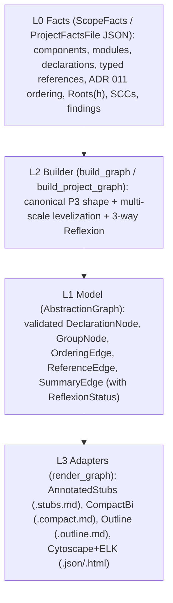

# Abstraction graph: 05 Decisions and Learnings

> **Status: ALPHA / EXPERIMENTAL — Active Investigation & Design** (Stage A, Stage B & Stage C prototypes evaluated; all models, formats, and working decisions below are provisional and may change at any time).
> Inputs: [01_understand.md](01_understand.md), [02_references.md](02_references.md), [03_design.md](03_design.md), [04_prototypes.md](04_prototypes.md), [06_stage_b_design.md](06_stage_b_design.md), [07_stage_b_results.md](07_stage_b_results.md), [08_stage_c_agent_formats.md](08_stage_c_agent_formats.md).

## 1. Stage A Verdict Against Goals (G1–G6)

| Goal | Verdict | Evidence from [04_prototypes.md](04_prototypes.md) |
| :--- | :--- | :--- |
| **G1** (Does the linter's module view give a useful overview of its abstractions?) | **Validated on cohesive modules; bounded by F10 on flat utility hubs** | On 8 of 9 benchmark scopes (`playground_lib`, `suppression`, `uninherited_protocol`, `rule_selection`, `ripgrep_glob`, `cargo_fix`, `cpython_zoneinfo`, `cpython_ZoneInfo_class`), the collapsed overview fits within the `<= 20`-node comprehension threshold (`M3 = 1–17` nodes). On `ast/rust.rs` (`116` declarations, `29` public items), distinct caller subsets produce `18` `Shared(S)` buckets (`M3 = 47` groups, F10). In the **M4** blind agent evaluation, `Outline-only` scored **`32 / 32 (100%)`** vs. **`23 / 32 (72%)`** for `Source-only` at **`14%–50%`** (`2.7×` smaller total) of raw source bytes. |
| **G2** (How to separate public abstractions from private implementation and fold?) | **Validated (`P3_members` with 3-level progressive zoom)** | One canonical containment tree (`Owner(p)` / `Shared(S)` / `Unowned` → `RecursionGroup` / `TypeMembers`) supports three progressive zoom levels without storing UI collapse state in `L1`: **Level 0** (component overview with `SummaryEdge`s and singleton pills), **Level 1** (intra-owner declarations ordered `L_k .. L_0`, with `TypeMembers` folded), and **Level 2** (`impl` / `class` methods expanded). |
| **G3** (Which facts are needed and which analyzer gaps must close?) | **Validated (3 analyzer gaps closed + two-level levelization)** | Closing the three `01_understand.md` §2.1 gaps in `L0` (`Composition` vs. `Behavior` on types [F5], `Parameter` vs. `Return` on callables [F4], and `Impl`/`Class` scope labels [F6]) plus **two-level levelization** (inter-group `GroupNode.level` + intra-owner `DeclarationNode.level` [F9, F12]) achieved **`M1 = 100%` fidelity** and **`M2 = 0 / 0` upward edges** across every benchmark scope. |
| **G4** (How can external tools consume the graph without building a custom viewer?) | **Validated across 4 formats (`M7 = 100%` deterministic)** | `L3` maps `AbstractionGraph` (`L1`) deterministically to Markdown Outlines (`outline.md`), Cytoscape.js + `elkjs` + `cytoscape-expand-collapse` (`cytoscape.json` / `viewer.html`), `GraphML` (`graphml`), and Graphviz (`dot`), with five adapter-level invariants documented in F13. |
| **G5** (Evaluate on real Rust and Python modules from `omnicoach` and reference corpora) | **Validated on 9 scopes across 8 files (`315–3,485` lines)** | Tested on 5 `omnicoach` Rust modules (`playground`, `suppression`, `uninherited_protocol`, `rule_selection`, `ast/rust`) and 4 external scopes (`ripgrep` `glob.rs`, `cargo` `cargo_fix`, `cpython` `_zoneinfo.py` module and `ZoneInfo` class). |
| **G6** (Whether and how to generalize to Stage B) | **Validated in Stage B** (see §4 and [07_stage_b_results.md](07_stage_b_results.md)) | Stage B generalized the same `AbstractionGraph` model to whole projects (`Component → Module → Owner/Shared → Declarations → TypeMembers`) across `omnicoach`, `ripgrep/crates/ignore`, `cpython/Lib/zoneinfo`, and `cpython/Lib/urllib` with `M1 = 100%`, `M2 = 0/0`, and a `7.4×` reduction in `M4` agent tool calls. |

## 2. Final Stage A Architecture and Decisions

| ID | Decision | Rationale & Evidence |
| :--- | :--- | :--- |
| **D24** | **Consolidate on `P3_members` as the single canonical graph shape**; retire `P1_flat`, `P2_ownership`, and `P4_bands`. | `P1_flat` and `P2_ownership` are strictly collapse states of `P3_members` (Expand All and Zoom Level 1, respectively). `P4_bands` (`GroupKind::LevelBand`) adds redundant box-in-box borders in visual compound-graph viewers for vertical layering that ELK (`DOWN`) + `[L_k]` node labels already convey (T14, [04_prototypes.md](04_prototypes.md) §7). |
| **D25** | **Use two-level levelization (`GroupNode.level` across components, `DeclarationNode.level` locally within each owner bucket).** | Global module-wide DAG levels compare unrelated owners and produce `17` upward intra-owner edges (`M2`) on benchmark modules (F9). Computing declaration levels locally within each ownership bucket (`Owner(p)`, `Shared(S)`, `Unowned`) and group levels over the `SummaryEdge` DAG reduces `M2` to **`0 / 0` everywhere** (F12). |
| **D26** | **Keep viewer collapse/zoom policy strictly in `L3` (`adapters.rs`), decoupled from `L1` (`model.rs`).** | `L1` represents only structural containment (`Owner`, `Shared`, `Unowned`, `TypeMembers`, `RecursionGroup`). Viewer policies—collapsing multi-item owners and `TypeMembers` by default, keeping 1-item `is_singleton` owners as pills, auto-opening single-component scopes (`M3 = 1/0`), and hiding `SummaryEdge`s when endpoints expand—live entirely in `L3` (F13). |
| **D27** | **Treat the Markdown Outline (`OutputFormat::Outline`) and Interactive Compound Graph (`OutputFormat::CytoscapeJson`) as dual primary outputs (superseded for agents in Stage C by `D34`).** | The text outline is the highest-signal, lowest-token medium for AI agents, CLI inspection, and diffs (`M4 = 100%` accuracy at `14%–50%` of source bytes), while Cytoscape + ELK provides progressive interactive visual exploration for humans. |

## 3. Phase 7: Learnings That Feed Back into `omnicoach` (Stages A, B & C)

1. **L1 — Monotonicity of `Roots(h)` across shared intermediate types (`u -> v ⇒ Roots(u) ⊆ Roots(v)`) is required for rule satisfiability (F11)**:
   - *Observation*: In `ripgrep_glob`, `Glob` contains a `Tokens` field (`Containment`), while `GlobBuilder::build` calls `Tokens::to_regex_with`, whose `impl Tokens` body calls the private helper `char_to_escaped_literal`. Because module-scope behavior of `impl Tokens` rolls up onto the `Tokens` type node (F6), `Roots(char_to_escaped_literal)` traverses `Glob -> Tokens -> char_to_escaped_literal` and assigns `owners = [Glob, GlobBuilder]`.
   - *Why current behavior is correct*: Because `Tokens` is referenced by both `Glob` and `GlobBuilder`, `Tokens` must be placed in Place 2 (the trailing shared section after both `Glob` and `GlobBuilder`). Since `Tokens` calls `char_to_escaped_literal`, `callee-before-caller` requires `pos(Tokens) < pos(char_to_escaped_literal)`, which forces `char_to_escaped_literal` into Place 2 below `Tokens` as well. If `Roots(char_to_escaped_literal)` were `{GlobBuilder}` (`|Roots| = 1`) instead of `{Glob, GlobBuilder}`, (a) `uncolocated-helper` and `callee-before-caller` would contradict each other whenever `GlobBuilder` precedes `Glob` and has Place 1 helpers, and (b) `Shared(Glob, GlobBuilder)` (`Tokens`) would depend upward on `Owner(GlobBuilder)` (`char_to_escaped_literal`). Thus `u -> v ⇒ Roots(u) ⊆ Roots(v)` is an essential invariant of ADR 011.
2. **L2 — Multi-scale levelization mirrors ADR 006 + ADR 011's actual reading order (F9, F12)**:
   - *Observation*: Computing Lakos levels globally across a flat graph conflates distinct containment scales. Levelizing independently at each scale (`Component` DAG $\to$ intra-component `Module` DAG $\to$ intra-module `Owner` DAG $\to$ intra-owner `Declaration` DAG) achieves `M2 = 0 / 0` across every module and project benchmark.
   - *Implication*: Any future diagnostic, auto-fixer, or documentation export that reports abstraction levels should compute levels locally within each parent container.
3. **L3 — Shared-bucket fragmentation signals when a module is a flat utility hub (F10)**:
   - *Observation*: When `#{Shared(S) buckets}` approaches or exceeds `#{Owner(p) groups}` (as in `ast/rust.rs`: `18` shared buckets across `29` public functions), the module does not decompose into independent vertical components—it is a horizontal utility hub serving many entrypoints.
   - *Implication*: The ratio `shared_groups / owner_groups` is a direct cohesion metric for whether a file benefits from intra-module component folding vs. module-level decomposition.
4. **L4 — Blind `Outline` vs. `Source-only` subagent evaluation across 24 questions and 4 conditions (`M4`)**:
   - *Observation*: Under an unlimited budget on `QB1`–`QB5`, `Outline-only` and `Source-only` both scored `5 / 5 (100%)`, but `Outline-only` required **5 tool calls (~65s)** vs. **37 tool calls (~300s)** (`7.4×` fewer tool calls).
   - *24-Question Equal-Budget Matrix (`6 categories × 4 projects`, `≤12` read calls)*:
     - `Outline: ModuleOnly` (`0.8%–4%` bytes, `5` calls): **`12.0 / 12 (100%)`** on macro architecture, reflexion, cycles, and cross-module blast radius (`Q1`–`Q3`); `12.0 / 24 (50.0%)` overall.
     - `Outline: PublicSurface` (`3%–12%` bytes, `7` calls): **`15.5 / 16 (96.9%)`** on macro + public API surface questions (`Q1`–`Q4`); `16.5 / 24 (68.8%)` overall.
     - `Outline: Full` (`22%–57%` bytes, `10` calls): **`24.0 / 24 (100.0%)`** across all 6 question categories (`Q1`–`Q6`).
     - `Source-Only (≤12-call budget)` (`11` calls): **`18.5 / 24 (77.1%)`** overall — collapsing to **`31.3% (1.25 / 4)`** on cross-module blast radius (`Q3`) due to file-count/size limits and losing points on non-local invariants (`Q5.omnicoach` private-only ownership reachability and `Q6.cpython_zoneinfo` class-method placement findings).
5. **L5 — 3-Way Reflexion Model (`D30`) catches unused architecture declarations (`Absent` edges, F14)**:
   - *Observation*: Comparing `define_architecture!` in `src/architecture.rs` against actual cross-module references in `src/` surfaced that `CodeLintSuppression => [CodeLintContract, ...]` declares a dependency on `CodeLintContract` with `0` actual references in `src/code_lint/suppression.rs`.
   - *Decision*: Kept as an informational insight in the graph export only; `define_architecture!` expresses *allowed* conceptual dependencies rather than mandatory edges.
6. **L6 — Module-level SCCs expose intra-component module cycles invisible to component conformance (F15)**:
   - *Observation*: Even when component dependencies form a strict DAG, intra-component modules can form cycles (such as `rule_declaration <-> rule_declaration::options` in `omnicoach`, or the 7-module SCC in `ripgrep/crates/ignore`).
   - *Implication*: Added to `ROADMAP.md` (`## Architecture & Conformance`) as a future enhancement.
7. **L7 — `PublicSurface` mode should project `Owner(p) -> Owner(q)` summary edges onto public declarations (`F18`)**:
   - *Observation*: In `Q4.cpython_zoneinfo`, `reset_tzpath` encapsulates `InvalidTZPathWarning` transitively through private helper `_parse_python_tzpath`. Dropping private items in `PublicSurface` without projecting `Owner(p) -> Owner(q)` summary edges hid that indirect public-to-public dependency (`3.5 / 4` on `Q4`).
   - *Resolution*: Implemented in `shapes.rs` (`extract_public_surface_module`), closing `F18`.
8. **L8 — Bidirectional edges (`->` and `<-`) + `:start..end` spans reduce token count (`-14.8%` bytes, `-38.8%` lines) while raising 1-step refactoring accuracy from `56.3%` to `100.0%` ([08_stage_c_agent_formats.md](08_stage_c_agent_formats.md))**:
   - *Observation*: `F1_Outline` omits `end_line` and incoming `<-` edges. When planning 1-step ADR 011 edits (`T2`), the `F1_Outline` agent was off by `1–17` lines on 7 of 8 tasks (`4.5 / 8 = 56.3%`) because doc comments, `impl` blocks, and EOF cannot be inferred from the next item's start line. Adding `:start..end` and `<- used_by` in `F2_CompactBi` raised `T2` accuracy to **`8.0 / 8 (100%)`** and halved agent search steps (`6` steps / `11` tool calls vs. `13` steps / `21` tool calls) while shrinking total byte count by `14.8%`.
9. **L9 — Inline language signatures & field summaries (`F3_AnnotatedStubs`) are essential for Zero-Read API Synthesis on non-stdlib code (`100%` vs. `25%` on `omnicoach`)**:
   - *Observation*: On project-specific APIs (`omnicoach` `T3.1` and `T3.2`) where LLM pretraining cannot supply signatures, symbol-only graph formats (`F1_Outline` and `F2_CompactBi`) scored only **`25% (0.5 / 2.0)`**, hallucinating parameter counts, parameter order, and struct fields. Embedding 1-line Rust/Python signatures and struct/enum/class fields in `F3_AnnotatedStubs` raised `T3` accuracy to **`8.0 / 8 (100%)`** (`24.0 / 24 = 100%` overall) at `27.2%` of source bytes (`21%` fewer lines than `F1_Outline`).
10. **L10 — Machine-oriented YAML (`F4_StructuredYaml`) adds `+45.6%` byte overhead (`+91.8%` lines) over `F3_AnnotatedStubs` with zero accuracy gain**:
    - *Observation*: Both `F3_AnnotatedStubs` and `F4_StructuredYaml` scored **`24.0 / 24 (100%)`**, but `F4_StructuredYaml` required `903 KB` (`13,028` lines) vs. `620 KB` (`6,792` lines) for `F3_AnnotatedStubs` across the 4 projects due to repeated key names and quoting.

## 4. Finalized Stage B & Stage C Decisions (`D28`–`D36`)

| ID | Decision | Rationale & Evidence ([07_stage_b_results.md](07_stage_b_results.md), [08_stage_c_agent_formats.md](08_stage_c_agent_formats.md)) |
| :--- | :--- | :--- |
| **D28** | **Unify Stage B and Stage A in a single 5-level containment hierarchy** (`Component` → `Module` → `Owner`/`Shared`/`Unowned` → `Declaration`/`RecursionGroup` → `TypeMembers`). | Reuses the exact same `GroupNode` and `SummaryEdge` primitives in `L1` (`model.rs`), with level invariants enforced between sibling groups (`parent_of(higher) == parent_of(lower)`). |
| **D29** | **Support configurable hierarchy depth via `ProjectDepth`** (`ModuleOnly`, `PublicSurface`, `Full`). | Allows stopping at `Component → Module` (`0.8%–4%` of source bytes, `100%` on `Q1`–`Q3`), `Component → Module → Public API` (`3%–12%` of source bytes, `96.9%` on `Q1`–`Q4`), or full intra-module implementation (`22%–57%` of source bytes, `100%` on `Q1`–`Q6`). |
| **D30** | **Emit 3-way Reflexion status (`Convergent`, `Absent`, `Divergent`, plus `Inferred`) on `SummaryEdge`.** | Distinguishes verified architectural edges (`Convergent`), stale/unused declared edges (`Absent`, `count == 0`), and architecture violations (`Divergent`) in both text outlines and visual graphs (F14). |
| **D31** | **Fall back to crate/package hierarchy with `ReflexionStatus::Inferred` when `define_architecture!` is absent (`Q10`).** | Validated on `ripgrep/crates/ignore`, `cpython/Lib/zoneinfo`, and `cpython/Lib/urllib`; single-component packages auto-expand to their module overview (`M3 = 4–8` nodes). |
| **D32** | **Default project-scale exports to `ProjectDepth::PublicSurface` for high-level onboarding, and `ProjectDepth::Full` for module refactoring.** | Captures all components, modules, public entrypoints, and transitive `Owner(p) -> Owner(q)` contracts (`F18`) at `3%–12%` of source bytes while keeping private implementation folded (`F17`). |
| **D33** | **Deduplicate retargeted compound meta-edges in `L3` (`syncEdgeVisibility`) using `orig_source` / `orig_target`.** | Prevents `cytoscape-expand-collapse` from rendering hundreds of redundant module summary meta-edges between collapsed components (`68` edges instead of `653` on `omnicoach`, `F16`) while preserving mixed-depth edges when individual components are expanded. |
| **D34** | **Adopt `F3_AnnotatedStubs` (`OutputFormat::AnnotatedStubs`, `.stubs.md`) as the primary AI agent format.** | Combines `[Lk]` topological hierarchy, `Owner(p)` / `Shared(S)` colocation, bidirectional `->` / `<-` edges, `:start..end` spans, and 1-line Rust/Python signatures & type fields. Achieves **`24.0 / 24 (100%)`** across `T1` (reverse blast radius), `T2` (1-step refactoring), and `T3` (zero-read API synthesis) at **`27.2%` of raw source bytes** (`-21%` lines vs. `F1_Outline`). |
| **D35** | **Keep `F2_CompactBi` (`OutputFormat::CompactBi`, `.compact.md`) as the signature-free (`--no-signatures`) topological mode.** | Strictly dominates `F1_Outline` (`-14.8%` bytes, `-38.8%` lines, `21.4%` of raw source bytes) while achieving **`16.0 / 16 (100%)`** on `T1` (impact analysis) and `T2` (refactoring/placement) with the fewest agent steps (`6` steps / `11` tool calls). |
| **D36** | **Retire `F1_Outline` and `F4_StructuredYaml` as agent target formats.** | `F1_Outline` (`75.0%` overall; `56.3%` on `T2`, `25%` on `omnicoach` `T3`) is strictly dominated by `F2_CompactBi` and `F3_AnnotatedStubs`; `F4_StructuredYaml` (`100%`) costs `+45.6%` more bytes and `+91.8%` more lines than `F3_AnnotatedStubs` for identical information. |
