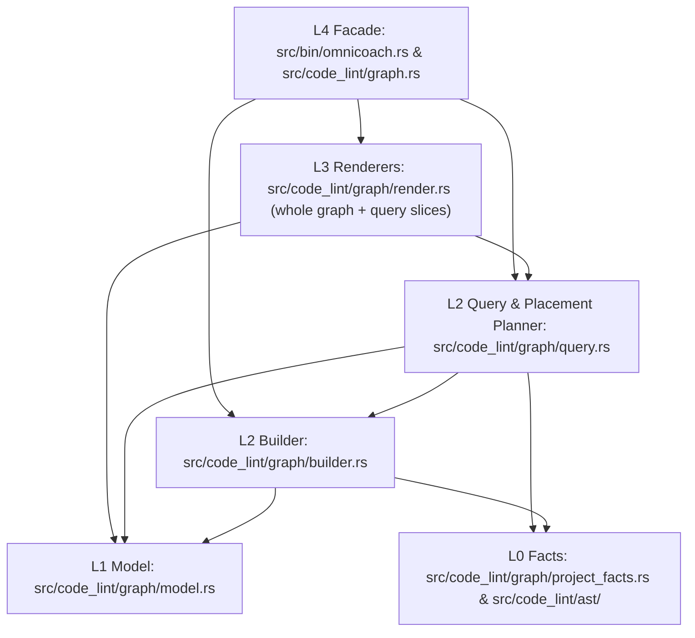

# Abstraction graph: 11 Stage D Design and Plan

> **Status: ALPHA / EXPERIMENTAL — Active Investigation & Design** (subject to change at any time). Next: execution (Phase 4), results in [12_stage_d_results.md](12_stage_d_results.md).

References: [03_design.md](03_design.md) (layers L0–L4, model invariants, decisions D18–D23), [08_stage_c_agent_formats.md](08_stage_c_agent_formats.md) (`F2_CompactBi` and `F3_AnnotatedStubs`), [09_stage_d_understand.md](09_stage_d_understand.md) (flaws E1–E6, goals G7–G12, decisions D38–D43), [10_stage_d_references.md](10_stage_d_references.md) (references RI5–RI10, RC1–RC28, RE1–RE16, measurements S1–S7, critical points CPD1–CPD14, ideas I1–I10, decisions D44–D51).

Markers: **[V]** verified in Phase 2 measurements; **[U]** to verify in Phase 4 execution.

## 1. Definition of Done (Independent of Any Solution)

### 1.1 Agent Journeys (CUJs)

Each journey is a concrete workflow step an AI coding agent performs during an end-to-end task in a repository where source files, `rg`, and `omnicoach` are all available (D38, D39, E4).

| ID | Journey | Acceptance criteria |
| :--- | :--- | :--- |
| CUJ9 | **Locate a symbol without grep cascades.** Given a symptom, error, or concept, the agent finds the matching declaration, its signature, `[Lk]`, `file:start..end`, and its owning public entrypoint (`roots`) in one call. | Returns ranked declarations matching a substring or path token, capped at 20 lines with a narrowing hint when truncated (CPD6, CPD8). |
| CUJ10 | **Inspect a 1-hop typed neighborhood with call sites.** Given a symbol, the agent sees its `F3` signature stub, enclosing `Owner`/`Shared` group, direct callers (`<-`) with call-site line numbers and source snippets, direct callees and contract/body types (`->`), and what static resolution may miss. | Output stays within 2–3 KB (~500–1,000 tokens) by default, well below inline tool limits (CPD2, CPD3). Every `<-` edge includes its 1-indexed call-site line and trimmed source text (CPD7, RC15). Ends with a completeness footer giving the exact `rg` fallback command for receiver-typed `x.f()` calls (D46, I3). |
| CUJ11 | **Check blast radius, architecture conformance, and tests.** Before or after an edit, the agent inspects the changed declarations (from VCS diff or a target symbol), their transitive `<- used_by` callers, any component-level Reflexion violations (`Divergent`), and which test targets cover them. | Identifies every declaration touched by `detect_vcs_diff`, lists 1-hop and 2-hop callers, flags any `Divergent` edge against `define_architecture!`, and names affected test modules/files (I2, I5, RI7). |
| CUJ12 | **Place a new or moved declaration in one step.** When adding a helper/type or fixing an ordering violation in a file, the agent obtains `Roots(item)`, the target `Owner`/`Shared`/`Unowned` section, and the exact valid line span satisfying ADR 011. | Given `<file>` and the item's intended `--calls` and `--called-by` symbols (or an existing misplaced symbol in `<file>`), computes the exact insertion anchor (`after <symbol> at line <end_line>`) that yields zero `constructor-after-method`, `private-before-public`, `uncolocated-helper`, and `callee-before-caller` findings (I1, RI8). |
| CUJ13 | **Answer multi-hop structural questions under realistic conditions.** With full access to source files, `rg`, and the graph, the agent answers cross-module blast-radius, ownership, and placement questions accurately and faster than without the graph. | Achieves non-inferior or higher rubric accuracy against the compiler/SCIP ground truth while reducing cost-weighted tokens (`MD1`) and wall-clock time (`MD2`) compared to baseline `rg` + file reads (D39, E4). |

### 1.2 Hypotheses Under Test

| ID | Hypothesis | Grounding |
| :--- | :--- | :--- |
| H1 | **Fidelity prerequisite:** Resolving qualified method paths (`T::f`, `Self::f`), attributing method-body references to `T::f`, orienting `sig` edges along usage direction, and keeping `*_test.rs` production rule files raises exact edge recall against `rust-analyzer scip` from `71.5%` to `≥ 83%` (`0% -> ≥ 85%` on cross-module associated functions and method sources) and literal precision from `84.6%` to `≥ 94%`. | D46, S2, CPD7 |
| H2 | **Slices beat whole-graph dumps:** Focused query subcommands (`find`, `slice`, `impact`, `place` — Arm C) achieve lower cost-weighted tokens (`MD1`) and wall-clock time (`MD2`) than whole-file/project `omnicoach graph` dumps (Arm B) and baseline tools (Arm A), because whole-project dumps exceed inline tool limits (117–723 KB) and every extra KB in context is re-billed on subsequent cache reads (92% of tokens). | D40, CPD2, CPD3, S1 |
| H3 | **Adoption vs. intrinsic value:** Short conditional triggers at the end of `AGENTS.md` yield `≥ 60%` voluntary adoption in Arm C on structural tasks; comparing Arm D (forced initial query) against Arm C isolates how much of the remaining gap comes from tool skipping versus slice content. | D47, CPD4, RC9, RC15 |
| H4 | **Task stratification:** Efficiency gains concentrate on tasks requiring facts that `rg` and standard LSP navigation lack—ADR 011/012 placement, ownership clustering, cross-module blast radius, and multi-hop comprehension—while simple local bug fixes show near-zero difference (`±10%`). | CPD1, CPD9 |
| H5 | **Model tier interaction:** A smaller, faster model tier (`flash`) achieves at least as large a relative reduction in tokens, tool calls, and placement errors from structured slices (`place`, `slice`) as the primary model (`inherit`). | D48, Q35, CPD14 |

### 1.3 Metrics

| ID | Role | Metric | Formula / Measurement | Target |
| :--- | :--- | :--- | :--- | :--- |
| MD1 | **Primary** (D45) | **Cost-weighted token ratio** | Per-run cost-equivalent tokens `C = input_tokens + 0.1 * cache_read_tokens + 4.0 * output_tokens` from the conversation transcript (S7), plus raw `input_tokens`, `cache_read_tokens`, and `output_tokens` reported separately. Summarized as paired within-task geometric mean ratio `Arm / Arm A` with 95% bootstrap CI over tasks (CPD11). | `≤ 0.85` (`≥ 15%` saving) on placement, refactor, and comprehension strata; `≤ 1.00` overall. |
| MD2 | **Primary** (D45) | **Wall-clock time ratio** | Active turn duration from task prompt to final response (`created_at` delta in transcript), split into model/exploration time vs. `cargo` build/test time. Paired geometric mean ratio `Arm / Arm A`. | `≤ 0.90` on placement, refactor, and comprehension strata; `≤ 1.00` overall. |
| MD3 | **Guard** (D41, D45) | **Task success & quality** | Edit tasks: (1) all `FAIL_TO_PASS` tests pass, (2) all `PASS_TO_PASS` tests pass, (3) `cargo clippy --all-targets` exits 0, (4) zero net-new `omnicoach code` findings vs. commit `C` (S4), (5) `architecture_conformance` passes. Comprehension tasks: rubric score `[0.0..1.0]` against the `rust-analyzer scip` / compiler oracle. | Non-inferiority (`Arm ≥ Arm A`); higher first-try lint cleanliness on placement tasks. |
| MD4 | **Diagnostic** (CPD1) | **Behavioral trajectory** | (1) Exploration tool calls before first file edit (`pre_edit_explore_calls`), (2) total tool calls, (3) failed `cargo test`/`check` invocations, (4) lint-fix iterations after first edit, (5) context compactions. | Fewer pre-edit explore calls and fewer failed build/lint loops than Arm A. |
| MD5 | **Diagnostic** (CPD3, CPD4) | **Adoption & payload size** | (1) Fraction of runs calling `omnicoach graph` at least once, (2) breakdown by subcommand (`find`, `slice`, `impact`, `place`, whole-graph), (3) median output bytes per call, (4) fraction of outputs truncated by tool output caps. | `≥ 60%` voluntary adoption in Arm C on structural tasks; `0%` truncated outputs in Arm C. |
| MD6 | **Pre-trial Gate** (D46) | **Graph edge fidelity** | Exact and type-level recall and precision of `omnicoach graph --depth full .` against the 3,934-edge `rust-analyzer scip` ground truth on this repository (`S2`) and the `jedi` ground truth on `urllib`/`zoneinfo`. | Exact recall `≥ 83%` (up from `71.5%`); xmod assoc-fn recall `≥ 85%` (up from `0%`); xmod method-source recall `≥ 85%` (up from `0%`); literal precision `≥ 94%` (up from `84.6%`); `736 / 736` free functions covered. |

### 1.4 Stage D Decision Gates

1. **Gate 1 — Pre-Trial Fidelity Gate (after `TD1`–`TD3`):** Run the SCIP ground-truth comparison (`MD6`). Do not start live agent trials until `MD6` meets all targets and every existing test plus new unit tests pass.
2. **Gate 2 — Pilot Gate (after `TD7`, 54 runs):** Evaluate `MD1`–`MD5` across the 6 pilot tasks (`3` arms `A`, `B`, `C` × `3` repeats = `54` runs; plus `6` forced-use `D` runs if Arm C voluntary adoption is `< 60%`). If voluntary adoption in Arm C is `< 50%` while forced use (Arm D) improves `MD1`/`MD2`, refine the `AGENTS.md` trigger phrasing once before sizing the main run (D50).
3. **Gate 3 — Final Recommendation Gate (after `TD8`, `12_stage_d_results.md`):** Recommend promoting to production (`omnicoach` main branch) only the subcommands and `AGENTS.md` triggers that demonstrate measurable efficiency (`MD1`/`MD2`) or quality (`MD3`) gains without regressions, and recommend dropping or keeping internal any mode that fails to earn its token cost (G12).

---

## 2. Prototype Architecture & Layer Boundaries

All prototype changes live in the dedicated `graph-dev` workspace (`../custom_lints-graph`, D44) and preserve the downward-only layer DAG from [03_design.md](03_design.md) §5.1 and ADR 006:



| Layer | Module | Responsibility in Stage D | Depends on |
| :--- | :--- | :--- | :--- |
| **L0 Facts** | `src/code_lint/ast/`, `src/code_lint/graph/project_facts.rs` | Per-file `ScopeFacts` and multi-file `ProjectFacts`, upgraded with method-level `enclosing_symbol`, two-segment `Type::method` target resolution, and call-site line retention. | `CodeLintAst`, `Diagnostic` |
| **L1 Model** | `src/code_lint/graph/model.rs` | Validated `AbstractionGraph` (`DeclarationNode`, `GroupNode`, `OrderingEdge`, `ReferenceEdge`, `SummaryEdge`). `ReferenceEdge` gains an optional 1-indexed `line: Option<usize>` so call sites carry their source line without coupling `L1` to source text. | `CodeLintAst` (enums only) |
| **L2 Builder & Query** | `src/code_lint/graph/builder.rs`, `src/code_lint/graph/query.rs` | `builder.rs` constructs the `AbstractionGraph` (indexing `DeclarationKind::Method` in `decl_by_mod_and_name` and attaching intra-module method reference edges). `query.rs` implements pure query evaluators: `find_symbols`, `build_symbol_slice`, `compute_impact`, and `compute_placement`. | `L0`, `L1` |
| **L3 Renderers** | `src/code_lint/graph/render.rs` | Formats whole graphs (`AnnotatedStubs`, `CompactBi` with usage-directed `sig` edges) and formats query results (`FindReport`, `SliceReport`, `ImpactReport`, `PlacementReport`) with call-site snippets and completeness footers. | `L1`, `L2` (`query` result types) |
| **L4 Facade** | `src/code_lint/graph.rs`, `src/bin/omnicoach.rs` | Resolves paths, `Config`, and VCS diff (`crate::diff::detect_vcs_diff`) once at the boundary, dispatches whole-graph or query subcommands, and writes to stdout. | `L0`–`L3`, `Config`, `Diff` |

In `src/architecture.rs`, `CodeLintGraph` adds `Diff` to its allowed dependencies (`CodeLintGraph => [CodeLintAst, Config, Diagnostic, Diff]`), which satisfies the compile-time topological order assertion because `Diff` is declared in the foundation layer at the top of `define_architecture!`.

---

## 3. Graph Fidelity & Representation Improvements (`D46`, `G11`)

Measurement `S2` ([10_stage_d_references.md](10_stage_d_references.md) §5.2) identified five concrete defects in `project_facts.rs`, `builder.rs`, `render.rs`, and `graph.rs` that account for `> 600` of the `1,122` exact recall misses and all `264` inverted `sig` edges.

### 3.1 Fix 1 — Method-Level `enclosing_symbol` (`project_facts.rs`)

- **Current flaw:** `enclosing_symbol(scopes, line)` checks `scopes[0]` (`DeclarationScopeKind::Module`) first. Because `rust_decl_end_line` extends a `Type` item's `end_line` to cover its contiguous `impl` blocks, any reference inside an inherent `impl` method matches the `Type` in `scopes[0]` before the loop ever reaches `DeclarationScopeKind::Impl`. Even when `Impl` or `Class` is reached, `enclosing_symbol` returns `Some(name.clone())` (the type name) instead of `Type::method` (161 cross-module misses in Rust, 43 in Python).
- **Fix:** Check `DeclarationScopeKind::Impl { type_name: name }` and `DeclarationScopeKind::Class { name }` scopes *before* `DeclarationScopeKind::Module`. When `line` falls within a method item `item.line..=item.end_line`, return `Some(format!("{name}::{}", item.name))`. Fall back to `DeclarationScopeKind::Module` only when no method span contains `line`.

### 3.2 Fix 2 — Full Path Resolution to `Type::method` (`project_facts.rs`, `builder.rs`)

- **Current flaw:**
  1. `longest_module_prefix` splits `remainder` (the path after the module prefix) on `::` or `.` and keeps only the first segment (`SuppressionTracker::from_file` $\to$ `SuppressionTracker`, 118 cross-module misses).
  2. When a type is re-exported (`pub use self::tree::{AstNode, ParsedFile}` in `code_lint::ast`), `resolve_rust_target` resolves `AstNode` to `code_lint::ast::tree::AstNode` after discarding `::from_span` (61 callers of `AstNode::from_span` lost).
  3. `extract_full_module` in `builder.rs` skips `DeclarationKind::Method` when populating `acc.decl_by_mod_and_name`.
- **Fix:**
  1. In `project_facts.rs`, index both top-level items (`"SuppressionTracker"`) and inherent/class methods (`"SuppressionTracker::from_file"`) in `module_symbols` (for both Rust and Python).
  2. In `longest_module_prefix`, extract up to two trailing segments after the module prefix (`first` and optional `second`). When `format!("{first}::{second}")` exists in `module_symbols[target_module]`, set `symbol = Some(format!("{first}::{second}"))`.
  3. In `resolve_rust_target`, preserve the optional `member` segment (`second`) across `reexports` lookup: when `(target.module, first)` re-exports `canonical_type`, resolve `canonical_type` to `(real_module, real_type)` and check if `format!("{real_type}::{second}")` is in `module_symbols[real_module]`.
  4. In `builder.rs` (`extract_full_module`), insert all declarations—including `DeclarationKind::Method`, whose `decl.name` is already `"Type::method"`—into `decl_by_mod_and_name`.

### 3.3 Fix 3 — Intra-Module Method Reference Edges and Call-Site Lines (`project_facts.rs`, `builder.rs`, `model.rs`)

- **Current flaw:** Within a single file, references inside `impl Type` to module-level functions/types are rolled up to `Type` (`231` misses), and intra-module calls to `Type::method` from functions or other `impl` blocks are not connected to the `DeclarationKind::Method` node (`66 + 30 = 96` misses). In addition, `ReferenceEdge` does not record the 1-indexed call-site line needed by `slice` (`CPD7`).
- **Fix:**
  1. Record 1-based call-site lines on `IntraFileReference` (`scope_facts.rs`)
     and `CrossModuleRefFact` (`project_facts.rs`) and index them in
     `IndexedProjectGraph` (`query.rs`).
  2. In `project_facts.rs`, record same-module resolved path references (`target.module == entry.module_path`) alongside cross-module references (or in `intra_module_refs: Vec<IntraModuleRefFact>`), capturing `(source_symbol, target_symbol, line)` where `source_symbol` and `target_symbol` can be `"Type::method"` or a top-level symbol. Also extract unqualified calls from each `Impl`/`Class` method body to same-module top-level functions/types with their line numbers.
  3. In `builder.rs`, emit `ReferenceEdge { source, target, kind: RelationKind::Body, line: Some(line) }` for these method-level intra-module and cross-module edges. Keep `OrderingEdge` between top-level module items (`ImplBehavior`) unchanged so Layer L1 level-consistency invariants (`UpwardOrderingRelation`, `M2 = 0`) continue to hold without conflating method-scope levels and module-scope levels.

### 3.4 Fix 4 — Usage-Directed Rendering of `SignatureContract` (`render.rs`)

- **Current flaw:** In `ScopeGraph` (ADR 011 §3.4), `OrderingReason::SignatureContract` has `higher = Type` and `lower = Callable` because contract types read above the functions that use them. However, `render.rs` emits `higher -> lower[sig]` in `decl_out_edges`, which renders on `Type` as `-> Callable[sig]` ("Type uses Callable") and on `Callable` as `<- Type[sig]` ("Callable is used by Type"), inverting all 264 `sig` edges and leaving duplicate `[ref:param]`/`[ref:ret]` edges in the opposite direction (`S2` §3).
- **Fix:** In `GraphEdgeIndex::build` (`render.rs`), orient `EdgeReason::SignatureContract` along its reference direction `(source = &edge.lower, target = &edge.higher)`:
  - `ordering_pairs.insert((&edge.lower, &edge.higher))` (suppressing the redundant `ref:param`/`ref:ret` edge on the same pair),
  - `Callable` (`edge.lower`) emits `-> Type[sig]`,
  - `Type` (`edge.higher`) emits `<- Callable[sig]`.
  Layer L1 `OrderingEdge` stays `higher = Type, lower = Callable` so topological levels are unaffected.

### 3.5 Fix 5 — Preserve Production Rule Files Matching `*_test.rs` (`config.rs`, `graph.rs`)

- **Current flaw:** `collect_directory_source_files` skips any path matching `config.is_test_path(entry_path)`. Because `DEFAULT_TEST_PATTERNS` includes `"**/*_test.rs"`, two production rule files (`src/code_lint/rules/multi_phase_test.rs` and `src/code_lint/rules/test_calls_test.rs`, named after the lint rules `multi-phase-test` and `test-calls-test`) are dropped from the project graph (`S2` §5).
- **Fix:** Track `ContextConfig::has_custom_test_patterns` in `src/config.rs` and update `is_excluded_test_path` in `src/code_lint/graph.rs` so `.rs` files under `src/` outside `tests/` directories and `tests.rs` are retained as production source when default test patterns are active, while honoring custom `test-patterns`.

---

## 4. Query Subcommands & Slice Design (`D40b`, `G11`, `I1`–`I7`)

### 4.1 CLI Surface (`src/bin/omnicoach.rs`)

`omnicoach graph` retains all existing flags (`[PATHS...]`, `--depth`, `--no-signatures`) for whole-file and whole-project dumps (Arm B) and adds four optional subcommands for focused slices (Arm C and Arm D):

```text
omnicoach graph [PATHS...] [--depth <module|public|full>] [--no-signatures]
omnicoach graph find <PATTERN> [PATHS...] [--limit <N>]
omnicoach graph slice <SYMBOL> [PATHS...] [--budget <TOKENS>]
omnicoach graph impact [--diff | --diff-rev <REV> | --symbol <SYMBOL>] [PATHS...]
omnicoach graph place <FILE> [--name <NAME>] [--vis <priv|pub>] [--kind <fn|type|method>]
                             [--calls <SYM,...>] [--called-by <SYM,...>]
```

Because clap supports an optional subcommand alongside positional `paths` on `GraphArgs` (`#[command(subcommand)] query: Option<GraphQueryCommand>`), existing invocations such as `omnicoach graph src/config.rs` or `omnicoach graph --depth module .` continue to work unchanged.

### 4.2 `omnicoach graph find <PATTERN> [PATHS...]` (`CUJ9`, `CPD6`)

Searches all declarations in the project graph (`ProjectDepth::Full`) by case-insensitive substring and path-segment matching against `module_path::name` and `name`.

- **Ranking:**
  1. Exact unqualified name match (`name == pattern`) or exact `Type::method` match;
  2. Prefix match on `name` or `method`;
  3. Substring match on `name`, `module_path::name`, or signature text;
  4. Tie-breakers: `Visibility::Public` before `Private`, higher `[Lk]` first, then deterministic `file:line`.
- **Output format (default `--limit 20`):**

```text
# Graph Find: "from_file" (2 matches)
- [L1 pub method] code_lint::suppression::SuppressionTracker::from_file (src/code_lint/suppression.rs:76..101, roots=[SuppressionTracker])
  pub fn from_file(file: &ParsedFile, source: &str) -> Self
  <- 4 callers | -> 5 callees/types
- [L1 pub method] code_lint::semantic::comments::CommentIndex::from_file (src/code_lint/semantic/comments.rs:21..39, roots=[CommentIndex])
  pub fn from_file(file: &ParsedFile, source: &str) -> Self
  <- 2 callers | -> 3 callees/types
# Hint: run `omnicoach graph slice <symbol>` to inspect callers, call sites, and callees.
```

### 4.3 `omnicoach graph slice <SYMBOL>... [PATHS...] [--hops <1..4>] [--budget <TOKENS>]` (`CUJ10`, `CPD3`, `CPD7`, `CPD8`, `I3`, `I6`)

Builds a bidirectional neighborhood around one or more `<SYMBOL>` targets in a single project graph build (default shared per-invocation budget `2,000` tokens $\approx 8.0\text{ KB}$, configurable via `--budget`, with `--hops 1..4` for multi-hop expansion).

- **Disambiguation:** If `<SYMBOL>` matches multiple declarations and none is an exact unique path match, prints the matching candidates in `find` format and asks for the qualified `module::Symbol` or `Type::method`.
- **Sections of a `slice` output:**
  1. **Target Declaration (`F3` stub + context):** Component name (with `depends_on`), Module path and file, enclosing `Owner(root)` or `Shared(...)` group, `[Lk vis kind]`, `file:start..end`, full signature, and any ADR 011 `! [rule]` findings.
  2. **`<- used_by` (Incoming Edges with Call-Site Snippets and Optional Hop-2+ Frontier, `CPD7`, `RC15`):** Each direct caller/referencer ordered by same-module first, then cross-module, showing its `[Lk vis kind]`, canonical symbol name, declaration span `file:start..end`, edge reason (`[call]`, `[xmod]`, `[sig]`, `[contain]`, `[encap]`), and each recorded 1-indexed call-site line `@ file:line: <trimmed source line>`. When `--hops >= 2`, appends `<- used_by (hop k, ...)` with `[reason via intermediate_symbol]` annotations, reserving `25%` of the symbol budget for hop-2+ entries.
  3. **`-> uses` (Outgoing Edges with Stubs and Optional Hop-2+ Frontier):** Each direct callee or referenced type with edge reason, `[Lk vis kind]`, `file:start..end`, and its 1-line `F3` signature stub so the agent can call or inspect it without opening its file, followed by `-> uses (hop k, ...)` when `--hops >= 2`.
  4. **Enclosing Cluster Siblings (within budget):** Compact 1-line list of sibling declarations in the same `Owner(root)` or `TypeMembers` group (`[Lk vis kind] name :start..end`) so the agent sees the local ordering and helper neighborhood.
  5. **Completeness Footer (`I3`, `D46`):**
     - If the target is a `method` (`&self` / `&mut self`):
       `# Completeness: <- lists static path references (T::m, Self::m, self.m). Receiver-typed calls (x.m()) are not resolved statically; run: rg '\.<method_name>\s*\(' src/`
     - If the target is an associated function, free function, or type:
       `# Completeness: <- lists static direct and qualified path references across src/ (excluding #[cfg(test)]). For macro or test references, run: rg '\b<name>\b' src/ tests/`

### 4.4 `omnicoach graph impact [--diff | --diff-rev <REV> | --symbol <SYMBOL>] [PATHS...]` (`CUJ11`, `I2`, `I5`)

Computes the blast radius and architectural conformance of a work-in-progress change or target symbol:

1. **Changed / Seed Declarations:** Maps changed file lines from `detect_vcs_diff(diff_rev)` (or `--symbol`) to enclosing declarations (`DeclarationNode`) and modules.
2. **Direct (1-hop) and Transitive (2-hop) Callers (`<- used_by`):** Lists affected callers across the project with their module, component, `file:start..end`, and call-site lines.
3. **Architecture Reflexion & Seed-Scoped Ordering Check (`I2`):** Reports any component-to-component summary edge with `ReflexionStatus::Divergent` (violating `define_architecture!`) and any intra-scope ADR 011 placement findings (`! [rule]`) on the modified seed declarations (or sibling items whose `related` target is a modified seed declaration, ignoring pre-existing lint debt on untouched items).
4. **Candidate Verification Targets (`I5`):** Lists touched modules that contain inline `#[cfg(test)]` blocks (`cargo test --lib <module_path>`) and integration test files under `tests/` that reference the touched modules or symbols.

### 4.5 `omnicoach graph place <FILE> ...` (`CUJ12`, `I1`)

Solves ADR 011 placement deterministically so the agent never has to guess line numbers or iterate through lint-fix loops:

- **Mode A — Audit & Fix Existing Misplaced Items (`omnicoach graph place <FILE>`):**
  - Parses `<FILE>` into `ScopeFacts` and `ScopeGraph`, lists each scope's current declaration order (`[Lk vis kind] name :start..end roots=[...]`), and for any misplaced declaration prints the exact move (`move <name> (lines start..end) -> insert after <anchor> at line <anchor_line>`) and the resulting conflict-free order (`graph_layout`).
- **Mode B — Place a New or Updated Item (`omnicoach graph place <FILE> --name <NAME> [--vis priv|pub] [--kind fn|type|method] [--calls a,b] [--called-by c,d]`):**
  - Resolves `--calls` and `--called-by` against `<FILE>`'s module scope (or `Impl`/`Class` scope when `<NAME>` is `Type::method`).
  - Synthesizes a virtual `ScopeItem` for `<NAME>` with those references, runs `ScopeGraph::new` and `generate_placements` from `src/code_lint/ast/call_clusters.rs`, and tests every candidate insertion slot `0..=items.len()` using `Layout::new`.
  - Prints:
    - Computed `Roots(<NAME>)`, ownership region (`Owner(root)`, `Shared(a, b)`, or `Unowned`), and abstraction level `[Lk]`;
    - Every valid insertion slot that satisfies all four ADR 011 rules (`constructor-after-method`, `private-before-public`, `uncolocated-helper`, `callee-before-caller`), highlighting the primary recommended slot:
      `Recommended insertion: after <prev_name> at line <prev_end_line> (before <next_name> at line <next_start_line>)`.

---

## 5. Instruction Surface Design (`D40`, `G10`, `CPD4`, `I9`)

Per `CPD4` and `RC9`, passive tool availability has high skip rates (`42%–56%`), whereas concise conditional triggers at the end of `AGENTS.md` naming exact commands drive consistent adoption without bloating every turn's prompt cache.

### 5.1 Arm B Trigger Block (Appended to `AGENTS.md`, `78` words / `~105` tokens)

```markdown
## Structural Navigation with `omnicoach graph`

When working on unfamiliar modules, tracing cross-module callers, or placing helpers under ADR 011/012:
- **Inspect one file's ownership clusters, `[Lk]` levels, signatures, and `<-` / `->` edges**: `omnicoach graph <path/to/file.rs>`
- **Inspect project component and module topology**: `omnicoach graph --depth module .`
- **Inspect public API surface across a subtree**: `omnicoach graph --depth public <dir>`
```

### 5.2 Arm C & Arm D Trigger Block (Appended to `AGENTS.md`, `102` words / `~135` tokens)

```markdown
## Structural Queries with `omnicoach graph`

Before running multi-step `rg` searches, reading whole files for signatures, or guessing where a helper belongs under ADR 011/012:
- **Locate a symbol's module, signature, span, and owner**: `omnicoach graph find <pattern>`
- **Inspect a symbol's 1-hop callers (`<-` with call-site lines), callees (`->`), and cluster**: `omnicoach graph slice <symbol>`
- **Compute exact ADR 011 insertion lines before adding or moving a declaration**: `omnicoach graph place <file> --name <item> --calls <a,b> --called-by <c,d>`
- **Check blast radius, architecture conformance, and affected tests for your edits**: `omnicoach graph impact --diff`
```

In **Arm D (Forced First Query, `D47`)**, the task prompt additionally includes one sentence: *"Begin your investigation by running the relevant `omnicoach graph` query (`find`, `slice`, `place`, or `impact`) before reading or editing files."* Comparing Arm C and Arm D on the same tasks separates adoption rate from the intrinsic utility of the subcommands (`CPD4`).

---

## 6. Benchmark Suite & Experimental Protocol (`D43`, `D47`–`D51`)

### 6.1 Experimental Conditions (`D47`)

| Arm | Condition | Tools Available | `AGENTS.md` Trigger Block | Initial Query Required? | What It Measures |
| :--- | :--- | :--- | :--- | :--- | :--- |
| **Arm A** | **Baseline (No Graph)** | Shell (`cargo`, `rg`, `omnicoach code`), file read/edit tools | Standard repo `AGENTS.md` (no graph section) | No | Baseline agent efficiency and quality (`S1`). |
| **Arm B** | **File / Directory Graph (`omnicoach graph <path>`)** | Baseline + `omnicoach graph` (`--depth module/public/full`, file paths) | §5.1 block | No | Value of Stage C whole-file/project graph views with `AGENTS.md` triggers. |
| **Arm C** | **Query Subcommands — Voluntary** | File/Directory Graph + `find`, `slice`, `impact`, `place` | §5.2 block | No | Real-world value (adoption $\times$ utility) of focused slices and placement queries. |
| **Arm D** | **Query Subcommands — Turn-1 First Step** | Identical to Voluntary Query Subcommands | §5.2 block | **Yes** (must run a graph query first) | Intrinsic value of query slices when Turn-1 adoption is 100%. |

### 6.2 Benchmark Task Suite (`6` Tasks, `D39`, `D49`, `D50`)

Selected from the verified Phase 2 commit-replay pool (`S4`, [10_stage_d_references.md](10_stage_d_references.md) §5.4) and external Rust corpus (`ripgrep`, `D49`) to cover all three task categories of `D39`:

| ID | Task Name | Category (D39) | Repo / Base `P` (Commit `C`) | Task Description (Symptom-Level, No Fix Leakage) | Files / Lines in `C` | Verification Oracle (`MD3`) |
| :--- | :--- | :--- | :--- | :--- | :---: | :--- |
| **P1** | **Tarjan SCC Call-Order Bugfix** | 1. Bug fix (intra-file call hierarchy) | `omnicoach` `2fb94bcfe2~1` (`2fb94bcfe2`) | `callee-before-caller` false positive when a private helper calls back into a public entrypoint (cycle through a public boundary). | 2 / 53 | 1 F2P + 2,157 P2P + clippy + lint delta $\le 0$ |
| **P2** | **Unreadable-File Batch-Linting Bugfix** | 1. Bug fix (cross-module callers) | `omnicoach` `792d24eed2~1` (`792d24eed2`) | `omnicoach code` aborts the entire run when one target file is unreadable instead of reporting the unreadable file and continuing to lint the remaining files. | 2 / 110 | 1 F2P (CLI) + 1,472 P2P + clippy + lint delta $\le 0$ |
| **P3** | **Python Base-Class Resolution Refactor** | 2. Refactor & placement (ADR 011/012) | `omnicoach` `992377a4fa~1` (`992377a4fa`) | Extract structural marker base-class classification in `code_lint::ast` and move `fake-without-protocol`-specific policy into its rule module (`code_lint::rules::fake_without_protocol`), satisfying ADR 006, 011, and 012. | 2 / 58 | Compile + 51 P2P + `architecture_conformance` + `omnicoach code` zero findings |
| **P4** | **Config & Rule-Selection `[context]` Feature** | 2. Feature & placement (ADR 011) | `omnicoach` `52abc474b5~1` (`52abc474b5`) | Reject unknown top-level keys and unknown `[context]` keys when deserializing `.omnicoach.toml`, placing any new helpers in `config` / `rule_selection` in valid ADR 011 order. | 2 / 92 | 2 F2P + 646 P2P + clippy + `omnicoach code` zero findings |
| **P5** | **4-Question Architectural Comprehension Audit** | 3. Realistic comprehension Q&A (`omnicoach`) | `omnicoach` (`HEAD` of `graph-dev`) | With full access to source, `rg`, and `omnicoach`, answer 4 multi-part questions: (a) all cross-module and intra-module callers of `SuppressionTracker::from_file` and `AstNode::from_span` with call-site lines; (b) exclusive vs. shared helpers in `src/rule_selection.rs`; (c) exact valid line range to insert a new private helper in `src/code_lint/suppression.rs` called by `SuppressionTracker::parse_comment_text` and `SuppressionTracker::audit`; (d) which components would become `Divergent` if `CodeLintAst` imported from `CodeLintRules`. | Read-only | 16-point exact answer key verified against `rust-analyzer scip` and `ScopeGraph`. |
| **P6** | **`ripgrep` Ancestor-Ignore Bugfix** | 3. External validity (`ripgrep`, `D49`) | `ripgrep` (`target/bench-corpora/ripgrep`) | In `crates/ignore`, with full access to source, `rg`, and `omnicoach`: trace `Ignore::add_parents` / `add_child` in `crates/ignore/src/dir.rs` and add `Ignore::is_custom_ignore_empty(&self) -> bool` with unit tests. | Read + test | Unit tests + `cargo test -p ignore` passes. |

### 6.3 Pilot Budget & Main Run Sizing (`D48`, `D50`)

1. **Pilot Run (`54`–`72` runs):**
   - `6` tasks (`P1`–`P6`) × `3` core arms (`A`, `B`, `C`) × `3` repeats = `54` runs on the primary model (`inherit`), plus `6` tasks × `1` arm (`D`) × `3` repeats = `18` runs (`72` total) so Arm D is measured alongside Arm C from the start.
   - Concurrency: at most `3` trial subagents running `cargo` builds simultaneously (`S5` showed 3 parallel seeded clones take `7.5 GB` disk and avoid CPU thrashing).
2. **Main Run Expansion (up to `~270` runs, `D50`):**
   - Based on the pilot's paired log-ratio standard deviation $\sigma_\Delta$ (`MD1`, `MD2`) and adoption rate (`MD5`), expand the task pool from the remaining verified candidates in `S4` (`0e061a3e7f`, `4ab1094677`, `788568dc6a`, `9dca5ad9fd`, `a32329917e`, `3c54e2482d`, `e1f3a79af8`, `ab7cc2d10e`, `66dbf5fc9f`, `c103ea78c2`, `45cdd8b6de`, `d1296f0ae2`), additional comprehension tasks, and 2 native `ripgrep` bug-fix/refactor tasks, plus run the 6-task subset on the secondary model tier (`flash`, `D48`).

### 6.4 Isolation, Contamination, and Hook Controls (`CPD12`, `S5`, `D51`)

Every trial run executes under five strict controls:

1. **Truncated History-Free Clone in `/tmp` (`S5`, `D51`):**
   - Created via `setup_trial.sh` in `/tmp/omnicoach_stage_d_trials/<task>_<arm>_r<k>`:
     - `git clone --ref-format=files --no-local --single-branch --no-tags` from a bare mirror ref at parent commit `P`, then `git remote remove origin`. Commit `C` and all later history are unreachable.
     - Living under `/tmp/...` places the clone outside the session's `workspace_paths`, so the background `PreToolUse` file-edit hook (`D51`) does not fire asynchronously mid-turn in any arm.
2. **Pre-Seeded Private `target/` Directory (`S5`):**
   - Each base commit `P` has a warm template `target/` built once at `P`. `setup_trial.sh` copies it with `cp -a` into the trial clone and resets tracked source mtimes to `2000-01-01` so the agent's first `cargo test` takes `0.35 s` instead of `134 s`, and parallel trials never share `CARGO_TARGET_DIR`.
3. **Hidden Verification Tests (`CPD12`, `S4`):**
   - During the agent's run on edit tasks (`P1`–`P4`), the clone is at pure parent commit `P` (without commit `C`'s new tests, which would otherwise leak function names or exact inputs). After the agent finishes, the grading script applies commit `C`'s test diff and runs `FAIL_TO_PASS`, `PASS_TO_PASS`, `cargo clippy --all-targets`, and `omnicoach code`.
4. **Prebuilt Release `omnicoach` Binary (`S3`):**
   - Built once with `cargo build --release` in `custom_lints-graph` after `TD1`–`TD5` pass (`~0.46 s` full-repo latency) and placed on the trial's `PATH`.
5. **Post-Run Transcript Audit (`CPD12`, `S7`):**
   - The grading script parses the subagent's `transcript.jsonl` to extract exact `input_tokens`, `cache_read_tokens`, `output_tokens`, step timestamps, tool calls, and `omnicoach graph` commands, and verifies that no `read_file` or `run_command` accessed paths outside `/tmp/omnicoach_stage_d_trials/<trial_id>`.

---

## 7. Ordered Execution Plan (TDD Tasks & Atomic Commit Chain)

Every implementation task in `custom_lints-graph` follows **Audit → RED (failing test) → GREEN (minimal implementation) → Verify**:

### 7.1 Standard Verification Checklist (After Every Task)

1. `cargo fmt --check`
2. `cargo clippy --all-targets`
3. `cargo test`
4. `omnicoach code` (zero findings on modified/new code, including ADR 006, 011, and 012)
5. `rumdl check docs/dev/abstraction_graph/` (for documentation tasks)

### 7.2 Ordered Tasks (`TD1`–`TD9`)

| Task | Scope | RED Test | GREEN Implementation | Verification Gate |
| :--- | :--- | :--- | :--- | :--- |
| **TD1** | **Graph Fidelity: Method Attribution & Two-Segment Path Resolution** (`project_facts.rs`, `builder.rs`, `graph.rs`) | Unit tests in `project_facts.rs` and `builder.rs` asserting: (1) a cross-module reference inside `impl Foo { fn bar() }` has `source_symbol == Some("Foo::bar")`; (2) a cross-module call `SuppressionTracker::from_file` and re-exported `AstNode::from_span` resolve to `target_symbol == Some("SuppressionTracker::from_file")` and `Some("AstNode::from_span")` and create `ReferenceEdge`s to the `DeclarationKind::Method` nodes; (3) `multi_phase_test.rs` and `test_calls_test.rs` are included when collecting `src/`. | Implement §3.1 (method-first `enclosing_symbol`), §3.2 (`Type::method` in `module_symbols`, `longest_module_prefix`, re-export preservation, and `decl_by_mod_and_name`), and §3.5 (keep rule files under `src/`). | Standard checklist (§7.1). |
| **TD2** | **Graph Fidelity: Intra-Module Method Edges, Call-Site Lines & `sig` Direction** (`model.rs`, `project_facts.rs`, `builder.rs`, `render.rs`) | Unit tests asserting: (1) intra-module `Type::method -> helper_fn` and `caller_fn -> Type::method` appear in `reference_edges` with 1-indexed `line`; (2) `SignatureContract` renders on `Callable` as `-> Type[sig]` and on `Type` as `<- Callable[sig]` without duplicate `ref:param`/`ref:ret` tags. | Add `line: Option<usize>` to `ReferenceEdge` (§3.3), attach intra-module method reference edges with lines, and orient `EdgeReason::SignatureContract` along usage direction in `render.rs` (§3.4). | Standard checklist (§7.1). |
| **TD3** | **Gate 1 Verification: SCIP & Jedi Fidelity Benchmark (`MD6`)** | Run the Phase 2 SCIP/jedi evaluation harness (`compare.py`) against the new `omnicoach graph --depth full .` output. | Fix any remaining edge cases uncovered by the SCIP diff until all `MD6` targets pass (`≥ 83%` exact recall, `≥ 85%` xmod assoc-fn & method-source recall, `≥ 94%` literal precision, `736 / 736` free fns). | **Gate 1 (`MD6`) passed.** |
| **TD4** | **Query Subcommands: `find` and `slice`** (`query.rs`, `render.rs`, `graph.rs`, `omnicoach.rs`) | Unit + CLI tests for `omnicoach graph find <pattern>` (ranking, cap, span/roots output) and `omnicoach graph slice <symbol>` (1-hop `<-` callers with `@ file:line: <snippet>`, `->` callees with `F3` stubs, cluster siblings, and completeness footer with `rg` fallback for methods). | Implement `find_symbols` and `build_symbol_slice` in `src/code_lint/graph/query.rs`, slice rendering in `render.rs`, and `find`/`slice` subcommands in `graph.rs` and `src/bin/omnicoach.rs`. | Standard checklist (§7.1). |
| **TD5** | **Query Subcommands: `place` and `impact`** (`architecture.rs`, `call_clusters.rs`, `query.rs`, `render.rs`, `graph.rs`, `omnicoach.rs`) | Unit + CLI tests for: (1) `omnicoach graph place <file> --name <h> --calls ... --called-by ...` returning exact `Roots(h)`, `[Lk]`, and conflict-free insertion lines verified against `collect_call_cluster_findings`; (2) `omnicoach graph impact --symbol <s>` and `--diff` returning 1/2-hop callers, `Divergent` component status, and test targets. | Expose placement simulation helper in `call_clusters.rs`, implement `compute_placement` and `compute_impact` in `query.rs`, add `Diff` to `CodeLintGraph` in `architecture.rs`, and wire `place` and `impact` in `omnicoach.rs`. | Standard checklist (§7.1) + `cargo build --release`. |
| **TD6** | **Trial Harness & Dry-Run Verification** (scratch runner scripts, outside repo) | Dry-run verification on 1 task (`P1`): `setup_trial.sh` creates isolated `/tmp` clone at `P`, verifies `C` is unreachable, runs grading oracle (`F2P` fails at `P`, passes at `C`), and parses transcript metrics (`MD1`–`MD5`). | Build automated trial setup, prompt generator (Arms A–D), and post-run grading/transcript-audit scripts in the conversation scratch directory. | Dry run succeeds end-to-end with zero leakage. |
| **TD7** | **Gate 2 Execution: Pilot Benchmark (`72` runs: `6` tasks × `4` arms `A`–`D` × `3` repeats)** | Execute the pilot across `P1`–`P6` (max 3 concurrent build trials), grade all runs with the automated oracle, and compute paired `MD1`–`MD5` tables. | Analyze pilot results at **Gate 2**: check voluntary adoption (`Arm C`), forced-use delta (`Arm D`), and within-task variance; tune `AGENTS.md` triggers if needed and size the main run (`D50`). | **Gate 2 passed.** |
| **TD8** | **Main Benchmark Execution (`D48`, `D50`)** | Execute the sized main run across the expanded task pool on the primary model (`inherit`) plus the 6-task subset on the secondary model tier (`flash`). | Aggregate paired ratios, bootstrap 95% CIs, per-stratum breakdowns, and behavioral diagnostics (`MD1`–`MD6`). | All runs graded and audited for zero leakage. |
| **TD9** | **Stage D Results & Final Recommendation (`12_stage_d_results.md`, Phase 5–7)** | Write `docs/dev/abstraction_graph/12_stage_d_results.md` with complete `MD1`–`MD6` evidence tables, hypothesis verdicts (`H1`–`H5`), and concrete recommendations on what to promote to production vs. drop (`G12`), then clean up scratch clones and run Phase 6 independent review. | Complete `12_stage_d_results.md`, fold any prototype fixups cleanly in `graph-dev`, and run Phase 6 review + Phase 7 lessons. | **Gate 3 passed.** |

### 7.3 Planned Atomic Commit Chain in `graph-dev` (`reviewable-commits`)

1. `docs(graph): add Stage D understand, references, and design docs (09–11)`
2. `fix(graph): resolve Type::method paths, method-body sources, and sig edge direction` (`TD1`–`TD3`)
3. `feat(graph): add experimental find, slice, impact, and place query subcommands` (`TD4`–`TD5`)
4. `docs(graph): record Stage D benchmark results and production recommendations (12)` (`TD7`–`TD9`)

---

## 8. Open Questions and Decisions

| ID | Question / Decision | Status |
| :--- | :--- | :--- |
| D51 | Place all trial clones in `/tmp/omnicoach_stage_d_trials/` (outside `workspace_paths`) so the background `PreToolUse` file-edit hook does not fire mid-turn and confound the arms, while keeping end-of-task `omnicoach code` checks active in all arms. | Resolved (answers Q44) |
| Q45 | ~~Does the Phase 3 design and execution plan (`TD1`–`TD9`, query subcommands `find`/`slice`/`impact`/`place`, and the 6-task pilot `P1`–`P6`) look good to proceed to Phase 4 execution?~~ | Resolved (approved by user; executed in [12_stage_d_results.md](12_stage_d_results.md), `D52`–`D56`) |
