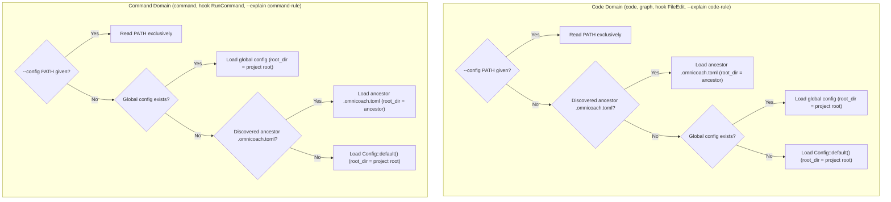

# Phase 3: Design & Plan — Global & Domain-Scoped Configuration

## 1. Concrete Use Cases (CUJs)

1. **CUJ 1: Developer in Monorepo without Local `.omnicoach.toml`**:
   A developer works in a team branch or virtual monorepo workspace without repo-level write access to place `.omnicoach.toml`. They define `$XDG_CONFIG_HOME/omnicoach/config.toml` (or `~/.config/omnicoach/config.toml`) with custom rules and test patterns.
   `omnicoach code` and `omnicoach hook` automatically pick up their personal configuration.

2. **CUJ 2: Repo Restricts Code Rules Without Disabling Command Guardrails**:
   A repository's `.omnicoach.toml` has `select = ["python"]`. When the user or coding agent executes shell commands (`jj edit main`), `omnicoach command` and `omnicoach hook` evaluate `RunCommand` under the user's global config (or default command rules), keeping `edit-of-described-commit` active.

3. **CUJ 3: Subdirectory Invocations & Relative Paths**:
   A developer runs `cd tests && omnicoach code cli.rs`. `omnicoach` discovers the parent repository's `.omnicoach.toml`, anchors `per-file-ignores` (such as `"tests/**"`) to the repository root, and correctly classifies `cli.rs` as a test file.

4. **CUJ 4: Hermetic Testing and CI Automation**:
   A test harness or CI runner sets `XDG_CONFIG_HOME` to an isolated temporary directory. `omnicoach` runs hermetically, ignoring any user-global config file on the host machine.

---

## 2. Architecture & Data Flow

### Domain Resolution Hierarchy

---

## 3. Component Design & Changes

### A. `src/config.rs`

- Add `pub root_dir: Option<PathBuf>` to `pub struct Config`.
- Implement `normalize_path_for_glob(&self, path: &Path) -> String`:
  - Lexically collapse `.` and `..` components via `lexical_normalize`.
  - If `path.is_absolute()`: strip `root_dir` (if present) or `cwd`.
  - If `path.is_relative()`: if `root_dir` is present and `cwd` is a subdirectory of `root_dir`, resolve `cwd.join(path)` and strip `root_dir`.
  - Format with `/` forward slashes for glob matching.

### B. `src/rule_selection.rs`

- Define `default_global_config_path() -> Option<PathBuf>`:
  - In `#[cfg(test)]`, returns `None` so in-process unit tests run hermetically.
  - In non-test, calls boundary helper `load_env()` reading `XDG_CONFIG_HOME` and `HOME`.
- Pure helper `resolve_global_config_path(xdg_config_home: Option<&OsStr>, home: Option<&OsStr>) -> Option<PathBuf>`.
- Domain-specific loaders:
  - `load_config(overrides: &ConfigOverrides) -> Result<Config, ConfigError>` (Code domain from `current_dir()`)
  - `load_command_config(overrides: &ConfigOverrides) -> Result<Config, ConfigError>` (Command domain from `current_dir()`)
  - `load_config_from_root(project_root: &Path, overrides: &ConfigOverrides) -> Result<Config, ConfigError>` (Code domain from `project_root`)
  - `load_command_config_from_root(project_root: &Path, overrides: &ConfigOverrides) -> Result<Config, ConfigError>` (Command domain from `project_root`)
  - Update `load_rule_status`: routes to Command domain resolution when `rule.matches(Selector::Tag(Tag::Derived(Derived::Command)))`, else Code domain resolution.

### C. `src/bin/omnicoach.rs` & `src/hook/runner.rs`

- `src/bin/omnicoach.rs`: `DomainCommand::Command` calls `load_command_config`.
- `src/hook/runner.rs`: `check_command` calls `load_command_config_from_root`.

### D. `tests/cli.rs`

- In `run_cli`, `run_hook_stdin`, and `test_self_dogfooding_code_lint`, isolate subprocess runs via `.env("XDG_CONFIG_HOME", isolated_xdg_config_home())`.
- Add integration tests for global config fallback, command rule precedence, and subdirectory glob matching.
