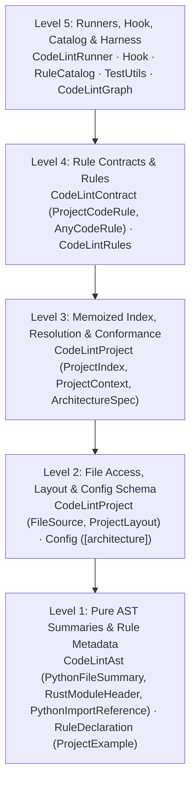

# Project-Aware Linting & Architectural Conformance — Phase 3: Design and Plan

> Phase 3 (Design and Plan) of the project-aware linting cycle, building on
> [01_understand.md](01_understand.md) (problem model, critical user journeys, goals) and
> [02_references.md](02_references.md) (ecosystem surveys, Stage F audit, cost measurements). Every design
> choice below was validated empirically across three competing prototypes on CPython `Lib`,
> `gauge-sh/tach`, and `omnicoach` itself before committing to production code.

## TL;DR

- **Project Model (`CodeLintProject`):** **Hybrid Seeded On-Demand Indexing** over body-free module
  summaries (`PythonFileSummary` and `summarize_rust_module_header`) backed by a `FileSource` trait
  (`DiskFileSource`, `MemoryFileSource`, `OverlayFileSource`) keeps `omnicoach code` wall time at
  `0.98x` and peak memory at `1.01x` of the single-file baseline on CPython `Lib` (well inside the
  `1.2x` ceiling), guarantees identical verdicts regardless of CLI target paths, and adds only
  `11 ms` at the 90th percentile in `omnicoach hook` (`3x` inside the `35 ms` budget).
- **Architecture Model (`ArchitectureSpec`):** A single language-agnostic ordered component DAG
  loaded from `.omnicoach.toml` `[architecture]` (canonical default) or syntactically from Rust
  `define_architecture!` / `architecture_component!` (rejecting projects that declare both) achieves
  `0` violations on clean `omnicoach` `src/`, `100%` reproduction of `tests/architecture_conformance.rs`
  guard fixtures, `0` violations on `tach`'s production repository, and differential parity across
  `tach`'s curated example suites.
- **Rule Contract & Multi-File Testing (`ProjectCodeRule`):** A typed
  `ProjectCodeRule<Options, Examples>` paired with `ProjectExample` and
  `AnyCodeRule::check_file_in_project(...) -> Option<Vec<Diagnostic>>` modifies **zero** of the 67
  existing single-file code rules, eliminates false `unused-suppression` diagnostics when project
  context is absent by construction, and lets cross-file rules keep inline `{ "path" => "code" }`
  `rule_test!` cases and executable `--explain` examples inside their own rule files.
- **Consumers Validated Together:** Eight native architecture conformance rules
  (`Topic::ARCHITECTURE`), cross-file `uninherited-protocol`, and cross-file C3 MRO docstring
  inheritance (`copied-base-docstring`, `partial-override-docstring`, `deferral-docstring`) share
  one resolver with `omnicoach graph`.

---

## 1. Definition of Done & Acceptance Benchmarks

| User Journey | Acceptance Criterion | Verification Gate |
| :--- | :--- | :--- |
| **Command-line invariance** | A file's diagnostics are identical whether linting the whole repository, a subdirectory, or the file alone, using relative or absolute paths. | Multi-entrypoint integration tests on Python and Rust packages |
| **Command-line cost** | Enabling all default cross-file rules adds minimal time and memory overhead, and costs zero when no cross-file rule is enabled. | `omnicoach code` on CPython `Lib` and `omnicoach`: wall time and peak RSS `<= 1.2x` single-file baseline |
| **Diff linting** | `omnicoach code --diff` emits the exact subset of full-project findings whose spans intersect changed lines. | Runner unit and integration tests |
| **Real-time agent hook** | `omnicoach hook` evaluates cross-file rules on the edited buffer overlaid onto the on-disk project and reports findings on modified lines. | Added latency `<= 35 ms` at the 90th percentile across CPython `Lib`, `tach`, and `omnicoach` |
| **Pit-of-success rule authoring** | Multi-file `rule_test!` cases and documented examples live inside the rule file; a cross-file rule cannot silently run as evaluated without project context, report on sibling files, or bypass `RuleTarget`, `EnforcementMode`, suppressions, or `--diff`. | Compile-time `ProjectCodeRule` / `TestableCodeRule` bounds + `tests/registry.rs` |
| **Architecture conformance** | Native rules report zero findings on clean `omnicoach` `src/`, catch every seeded breach in `tests/architecture_conformance.rs`, and match reference verdicts on Python (`tach` and curated fixtures). | Self-hosting `tests/architecture_conformance.rs` + Python conformance suite |
| **Abstraction graph** | `omnicoach graph` shares `ProjectLayout` and module/import resolution without changing output except documented resolution bug fixes. | Existing `omnicoach graph` test suite and snapshot checks |

---

## 2. SOTA Lineage: What We Reuse vs. Where We Diverge

To avoid reinventing established mechanisms, every subsystem in this design maps directly to the
surveys in [02_references.md](02_references.md) and direct source inspection of `gauge-sh/tach`,
Ruff (`ruff_python_ast` / `ty`), `rust-analyzer`, `oxlint` (`oxc`), `Biome 2`, `import-linter`, and
`zoning`:

| Design Subsystem | SOTA Pattern Reused | Existing Crate / Primitive Reused | Deliberate Divergence & Why |
| :--- | :--- | :--- | :--- |
| **Body-free module summaries** (`PythonFileSummary`, `summarize_rust_module_header`) | `rust-analyzer` `ItemTree`, Ruff `ty` module export table, `oxlint` `ModuleRecord`, Go `analysis.Fact` | `ruff_python_ast`, `ra_ap_syntax` (already in `Cargo.toml`) | Includes top-level class bases, `Protocol` markers, and `OwnedDocstring`s so `uninherited-protocol` and docstring rules never re-parse ancestor bodies. |
| **Hybrid seeded on-demand index** (`ProjectIndex`) | `oxlint` import plugin (`ModuleRecord` seeded from linted AST + lazy `OnceLock` dependency load) | `std::sync::OnceLock`, `rayon` (zero new dependencies; no `salsa` or `dashmap`) | Rejects `salsa` (editor-only incremental revision overhead) and `tach`/`Biome` eager whole-repo scans (which failed the `1.2x` CPython `Lib` budget and `35 ms` hook budget). |
| **Virtual file-system overlay** (`FileSource`, `OverlayFileSource`) | Ruff `ty` `System` / `MemoryFileSystem`, `rust-analyzer` `Vfs`, `Pyright` open-file overlay | Pure 4-method trait (`read_to_string`, `is_file`, `is_dir`, `read_dir`) | Serves CLI (`DiskFileSource`), `rule_test!` (`MemoryFileSource`), and `omnicoach hook` (`OverlayFileSource`) through one code path without an LSP daemon. |
| **Python import & stub resolution** (`ProjectLayout`, `PythonImportReference`) | `tach` (`processors/import.rs`, `filesystem.rs`) & Pyright / PEP 561 (`.pyi` before `.py`, `TYPE_CHECKING` guard) | `ruff_python_ast::statement_visitor::{StatementVisitor, walk_stmt}`, `ignore`, `globset` | Adds bounded 8-hop `__init__.py` re-export, `__all__`, and `*` import chasing plus cross-module C3 MRO linearization (`tach` stops at direct file imports). |
| **Language-agnostic component DAG** (`ArchitectureSpec`) | `tach` (`source_roots`, `depends_on`, `interfaces`/`expose`, `ignore_type_checking_imports`), `import-linter` (`independence`, `protected`), `zoning` (ordered zones) | `toml`, `serde` (`[architecture]` in `.omnicoach.toml`) + syntactic Rust macro extraction | Unifies layered tiers (`transitive-dependencies = true`), direct edges (`false`), sibling isolation (`isolate-children`), and external package ownership (`owns-external`) in one ordered list. |
| **Opt-in project rule contract** (`ProjectCodeRule`) | `Biome 2` `RuleDomain::Project` & `oxlint` import plugin (zero cost when disabled) | `Declaration<Options, Examples>` generic over `Examples` | `AnyCodeRule::check_file_in_project` returns `Option<Vec<Diagnostic>>` (`None` when project context is absent), preventing false `unused-suppression` findings by construction. |
| **Inline multi-file tests & docs** (`rule_test!`, `ProjectExample`) | `Error Prone` inline multi-file builder, `rust-analyzer` / `ty` all-file verification, `Biome 2` `file=` doc blocks | `rstest`, `indoc` macro arms (`{ "path" => "code" }`) | Enforces compile-time Rust macro syntax, mandatory `(target_path, snippet)` pairs, zero findings on sibling files, and repeat-twice checks on the target file. |

**Context, Analysis & Interpretation:**

- **What was audited:** The implementation crates and internal pipelines of `tach` v0.35.3
  (`tach/Cargo.toml`, `tach/src/processors/import.rs`, `tach/src/filesystem.rs`,
  `tach/src/modules/tree.rs`, `tach/src/commands/check/check_internal.rs`) alongside the SOTA
  surveys in [02_references.md](02_references.md) §§1–3.
- **Why zero new Cargo dependencies are needed:** `omnicoach` already depends on the exact same
  foundational crates that power Ruff and `tach` (`ruff_python_ast`, `ruff_python_parser`,
  `ruff_text_size`, `ra_ap_syntax`, `rayon`, `ignore`, `globset`, `toml`, `serde`). By reusing
  `ruff_python_ast::statement_visitor::{StatementVisitor, walk_stmt}` for Python import/scope walks
  and `tach`'s PEP 561 four-candidate probe order (`__init__.pyi`, `__init__.py`, `.pyi`, `.py`), we
  get battle-tested Python resolution without adding `pyo3`, `cached` disk stores, `petgraph`, or
  `salsa`.
- **Action:** Reuse `ruff_python_ast::statement_visitor::StatementVisitor` and PEP 561 stub-first
  probing directly in `CodeLintAst` / `CodeLintProject` with zero additions to `Cargo.toml`.

---

## 3. Empirical Prototype Findings & Design Selections

Three isolated prototypes (`prototype(project-linting): project model loading`,
`architecture model`, and `rule contract and tests`) evaluated competing designs across four tracks.

### 3.1 Track 1: Project Model Loading & Hook Overlay

| Indexing Strategy | CPython `Lib` Wall Ratio | CPython `Lib` Peak RSS | `tach` Wall Ratio | `omnicoach` Wall Ratio | Hook Overlay p90 (CPython / `tach` / `omnicoach`) | Decision |
| :--- | :--- | :--- | :--- | :--- | :--- | :--- |
| Single-file baseline | `1.00x` (`1.46 s`) | `85 MB` (`1.00x`) | `1.00x` (`40 ms`) | `1.00x` (`197 ms`) | — | Reference |
| Eager parallel indexing | `1.39x` (`2.02 s`) | `116 MB` (`1.36x`) | `1.87x` (`75 ms`) | `1.36x` (`269 ms`) | Exceeds budget (`~200 ms` on CPython) | Rejected |
| Pure on-demand indexing | `0.87x`–`1.00x` | `89 MB` (`1.05x`) | `1.19x` (`48 ms`) | `0.99x` (`196 ms`) | `11 ms` / `2.3 ms` / `3.4 ms` | Superseded |
| **Hybrid seeded on-demand** | **`0.98x` (`1.42 s`)** | **`86 MB` (`1.01x`)** | **`0.80x`–`1.09x`** | **`0.71x`–`1.00x`** | **`11 ms` / `2.3 ms` / `3.4 ms`** | **Selected** |

**Context, Analysis & Interpretation:**

- **What was tested:** Five-run release medians across CPython `Lib` (`~1,900` Python files),
  `tach`, and `omnicoach` (`175` Rust files) executing all existing single-file rules alongside
  cross-file import resolution, imported `Protocol` lookup, cross-module C3 MRO linearization, and
  inherited method docstring lookup, plus cold single-file `OverlayFileSource` hook runs.
- **What moved and why:** Eager parallel indexing summarizes every repository file up front
  (including unreferenced modules and excluded trees) before `lint_file` parses target files again,
  breaching the `1.2x` ceiling on both wall time (`1.4x`–`1.9x`) and memory (`1.36x`). Pure
  on-demand indexing parses only the reachable import/inheritance closure, while **Hybrid Seeded
  On-Demand Indexing** also seeds each linted file's body-free summary directly from the
  `ParsedFile` already built by `lint_file`, eliminating `60%`–`94%` of extra index parses and
  keeping memory overhead at `1 MB` (`1.01x`) on CPython `Lib`. Splitting out body-free
  `summarize_rust_module_header` (skipping function-body walks on sibling Rust modules) eliminated a
  `53%` Rust summary overhead uncovered during prototyping.
- **Invariance & relative-path normalization:** Combining upward `__init__.py` package climbing,
  conventional source-root probing (`src`, `python`, `Lib`), and lexical normalization of relative
  CLI paths against `working_directory` in `ProjectLayout::discover` produced `100%` identical
  verdicts across repository-root, subdirectory, and single-file invocations while keeping cold
  hook overlay latency at `11 ms` p90 on CPython `Lib`.
- **Action:** Ship `ProjectLayout`, `FileSource` (`DiskFileSource`, `MemoryFileSource`,
  `OverlayFileSource`), and Hybrid `ProjectIndex` in `CodeLintProject`, and enable cross-file rules
  directly in `omnicoach hook`.

### 3.2 Track 2: Language-Agnostic Architecture Model

| Declaration Design | `omnicoach` `src/` (`175` Files) | `tests/architecture_conformance.rs` Guards | `tach` Production + `7` Example Suites | Rust Zero-Boilerplate Ergonomics | Decision |
| :--- | :--- | :--- | :--- | :--- | :--- |
| TOML-only (drop Rust macros) | `0` violations | `100%` caught | `0` violations + suite match | Loses in-file `architecture_component!` clarity in `omnicoach` | Rejected |
| Split models (Rust macros vs Python TOML) | `0` violations | `100%` caught | `0` violations + suite match | Two separate conformance engines that drift | Rejected |
| **Unified `ArchitectureSpec` (TOML canonical + Rust macros, mutually exclusive)** | **`0` violations (`100%` identical across both loaders)** | **`100%` caught at exact AST lines** | **`0` violations + suite match** | **Preserves both; rejects mixed declarations at load** | **Selected** |

**Context, Analysis & Interpretation:**

- **What was tested:** Translating `omnicoach`'s 24-component `define_architecture!` graph into
  `.omnicoach.toml` `[architecture]` and running both loaders over clean `src/` and four seeded
  guard suites, plus differential testing against `tach`'s 38-file codebase and seven curated
  example repositories (`valid`, `distributed_config`, `layers_explicit_depends_on`,
  `layers_Implicit_depends_on`, `visibility_error`, `monorepo_namespace`, `many_features`).
- **What moved and why:**
  1. **Transitive vs direct `depends-on`:** In `omnicoach`, `35%` of cross-component references rely
     on multi-hop DAG reachability (`CodeLintRules` reaching `Diagnostic` through
     `CodeLintContract`), whereas `tach`'s `depends_on` is direct-only unless `layers` are used.
     Defaulting `transitive-dependencies = true` with `false` configurable unifies layered and
     explicit-edge architectures without separate `layers` / `closed` / `utility` DSL keywords.
  2. **`.pyi` type stubs & `if TYPE_CHECKING:`:** Real-world Python repositories resolve compiled
     extensions through `.pyi` stubs (`tach/extension.pyi`) and break runtime cycles under
     `if TYPE_CHECKING:`. Supporting `.pyi` module discovery in `ProjectLayout` and
     `ignore-type-checking-imports` in `[architecture]` eliminated every false positive on `tach`.
  3. **Unified monorepo `source-roots` DAG:** Unlike `tach check` (which silently ignores edges
     crossing sub-package `pyproject.toml` directories), evaluating all `source-roots` against one
     `ArchitectureSpec` catches undeclared cross-package imports and `from ..sibling` relative
     escapes.
- **Action:** Ship `ArchitectureSpec` in `CodeLintProject` with `.omnicoach.toml` `[architecture]`
  as the canonical cross-language configuration and syntactic Rust macro loading as a mutually
  exclusive alternative.

### 3.3 Track 3 & Track 4: Rule Contract & Multi-File `rule_test!`

| Rule Contract & Test Design | Single-File Rules Touched | `unused-suppression` When Context Absent | Sibling Context File Checking | `--explain` Multi-File Rendering | Decision |
| :--- | :--- | :--- | :--- | :--- | :--- |
| Universal `&ProjectContext` on `CodeRule` + header comments | `67 / 67` (`100%`) | Safe only if dummy context passed | Runtime mini-DSL parsing | Separate example type still needed | Rejected |
| Unified `CodeRule` check enum + shared named fixtures | `67 / 67` (`100%`) | Safe if runner branches | Context hidden away from case | Separate example type needed | Rejected |
| **`ProjectCodeRule` + `Option<Vec<Diagnostic>>` + inline `{ path => code }` map** | **`0 / 67` (`0%`)** | **Impossible (`None` skips `evaluated_rules`)** | **Compile-time macro + `0` findings on siblings** | **Titled `Given` / `In` / `Use instead` blocks** | **Selected** |

**Context, Analysis & Interpretation:**

- **What was tested:** Full implementation of `ProjectCodeRule<Options, Examples>`,
  `ProjectExample`, `DeclaredExamples::Project`, `AnyCodeRule::check_file_in_project`, and inline
  multi-file `rule_test!` cases across `uninherited-protocol` (`24` single-file + `7` cross-file
  cases) and all `2,604` library, registry, and architecture tests.
- **What moved and why:** Because `Declaration<Options, Examples>` is already generic over
  `Examples`, `ProjectCodeRule` reuses `Declaration`, `RuleOptions`, `RuleTarget`, and
  `EnforcementMode` with **zero edits** to the 67 single-file rules. Returning
  `Option<Vec<Diagnostic>>` from `AnyCodeRule::check_file_in_project` ensures that if a caller runs
  without project context, the rule returns `None` and is omitted from `evaluated_rules`, preventing
  `unused-suppression` from falsely flagging valid suppressions. Inline `{ "pkg/a.py" => ..., "pkg/b.py" => ... }`
  maps keep multi-file context self-contained next to single-file cases while checking every file in
  the virtual project.
- **Action:** Adopt `ProjectCodeRule`, `ProjectExample`, and inline `{ "path" => "code" }` cases in
  `rule_test!`.

### 3.4 Resolution of Phase 1 Open Questions

| Topic | Final Design Decision |
| :--- | :--- |
| **Python source roots** | Configured `[architecture] source-roots` (or `[context] source-roots`) take precedence; otherwise `ProjectLayout::discover` climbs `__init__.py` chains from the target path and probes conventional roots (`src`, `python`, `Lib`, plus project root). Never suffix-matches unresolvable imports. |
| **Project boundary** | Nearest ancestor containing `.omnicoach.toml`, `pyproject.toml`, or `Cargo.toml` (falling back to VCS root or working directory), independent of which target paths were passed on the CLI. |
| **Summary contents** | Owned, body-free per-module summaries: Python module-level import bindings, `__all__`, `*` imports, top-level defined names, and top-level classes (ordered bases, `Protocol`/`ABC`/`Enum`/`NamedTuple` flags, public non-property method names, and `OwnedDocstring` map); Rust component declarations, `define_architecture!`, `mod` declarations with visibility, `use`/`pub use` items, `#[macro_export]`, and non-routing item spans. |
| **Hook behavior** | Cross-file rules run in `omnicoach hook` via `OverlayFileSource` (`11 ms` p90 on CPython `Lib`), reporting findings only on modified lines of the edited file. Downstream breakage in unedited callers when editing an interface remains a full CLI / pre-commit check. |
| **Generic rules vs `omnicoach`-only tests** | All eight structural invariants become generic `ProjectCodeRule`s; `tests/architecture_conformance.rs` becomes a thin self-hosting test invoking `omnicoach` on its own `src/` plus one `omnicoach`-specific house-style check (component enum variants are exact `PascalCase` of their declaring module paths). |

---

## 4. Abstraction Levels & Component Architecture (`ADR 006`)

All dependencies point strictly downward across five abstraction levels:



### Component Responsibilities & DAG Updates (`src/architecture.rs`)

1. **`CodeLintAst` (`src/code_lint/ast/`):** Sole component allowed to touch `ruff_python_ast` and
   `ra_ap_syntax`. Hosts:
   - `python/docstrings.rs`: `OwnedDocstring` (owned text + `summary`, `summary_paragraph`,
     `normalized`, `copies_owned_summary_of`, `sections`, shared with `PythonDocstring<'a>` without
     duplicating section/normalization logic).
   - `python/file_summary.rs`: `PythonFileSummary` and `summarize_python_file(&ParsedFile)`
     (strictly module-level scope — never merging function-local or nested classes).
   - `python/imports.rs`: `PythonImportReference` (module/symbol target, relative level,
     `in_function`, `in_type_checking`, AST node span) implemented with
     `ruff_python_ast::statement_visitor::{StatementVisitor, walk_stmt}` (matching `tach`'s
     `ImportVisitor`) for per-statement architecture diagnostics.
   - `rust/file_summary.rs`: body-free `summarize_rust_module_header(&ParsedFile)` alongside full
     `summarize_rust_file(&ParsedFile)` (used on the target Rust file being linted for expression
     paths inside bodies).
2. **`RuleDeclaration` (`src/rule_declaration/`):** Adds `ProjectExample`,
   `DeclaredExamples::Project(&'static [ProjectExample])`, and `Topic::ARCHITECTURE`.
3. **`Config` (`src/config.rs`):** Deserializes optional `[context] source-roots` and
   `[architecture]` (`ArchitectureConfig`) from `.omnicoach.toml` with strict `deny_unknown_fields`
   and `kebab-case` validation.
4. **`CodeLintProject` (`src/code_lint/project/`):** Depends on `Architecture`, `Diagnostic`,
   `Config`, and `CodeLintAst`. Exposes:
   - `source.rs`: `FileSource`, `DiskFileSource`, `MemoryFileSource`, `OverlayFileSource`.
   - `layout.rs`: `ProjectLayout::discover` (with PEP 561 stub-first four-candidate module probing
     `__init__.pyi`, `__init__.py`, `.pyi`, `.py` matching `tach::filesystem`, upward
     `__init__.py` root inference, Rust `src/lib.rs` / `src/main.rs` crate root mapping, and
     `working_directory` lexical path normalization).
   - `index.rs`: `ProjectIndex` (`Mutex<HashMap<ModuleId, Arc<OnceLock<Option<Arc<Summary>>>>>>`
     with `seed_from_parsed`, bounded 8-hop re-export / `__all__` / `*` resolution returning
     `Unknown` on unresolvable boundaries, cross-module C3 MRO linearization, and lazy architecture
     loading).
   - `architecture.rs`: `ArchitectureSpec`, TOML + Rust macro builders, mutual-exclusion and
     topological DAG validation, and language-specific reference evaluators.
   - `context.rs`: `ProjectContext<'a>` — the read-only query facade passed to rules.
5. **`CodeLintContract` (`src/code_lint/contract.rs`):** Adds `CodeLintProject` to its dependencies;
   defines `ProjectCodeRule<Options, Examples>` and `AnyCodeRule::{requires_project_context, check_file_in_project}`.
6. **`CodeLintRules`, `CodeLintRunner`, `Hook`, `RuleCatalog`, `TestUtils`:**
   - `CodeLintRunner` constructs one `ProjectIndex` per project root only when at least one enabled
     rule reports `requires_project_context() == true`, seeds each target `ParsedFile` before rule
     evaluation, and records a rule in `evaluated_rules` only when `check_file_in_project` returns
     `Some(...)`.
   - `Hook` (`src/hook/runner.rs`) wraps `DiskFileSource` in `OverlayFileSource` for the proposed
     in-memory edit when any enabled rule requires project context, running the exact same
     `lint_file_with_index` pipeline restricted to edited lines.
   - **`CodeLintGraph` (`src/code_lint/graph/`):** Delegates source-root discovery and cross-module
     import resolution in `ProjectFacts` to `ProjectLayout` and `ProjectIndex` (fixing the relative
     path and duplicate basename bugs identified in [02_references.md](02_references.md) §4) while
     keeping intra-file call-cluster extraction (`facts.rs`) exclusive to `omnicoach graph`.

---

## 5. Public APIs, Configuration Schema & Rule Specifications

### 5.1 `.omnicoach.toml` Configuration Schema

```toml
[context]
test-patterns = ["tests/**", "**/*_test.py"]
source-roots = ["src", "python"] # optional; inferred when omitted; relative to this file's directory

[architecture]
source-roots = ["python"]                 # optional override for architecture roots
transitive-dependencies = true            # default: true (multi-hop DAG closure)
require-component-coverage = true         # default: true (enables unmapped-architecture-module)
ignore-type-checking-imports = false      # default: false (exempts `if TYPE_CHECKING:` when true)

[[architecture.components]]
name = "Domain"
roots = ["my_app.domain"]
depends-on = []
isolate-children = false                  # default: false in TOML, true for Rust macro components
owns-external = ["pydantic"]              # external packages encapsulated by this component
public-exports = ["Order"]  # optional public interface allowlist

[[architecture.components]]
name = "Adapters"
roots = ["my_app.adapters"]
depends-on = ["Domain"]
isolate-children = true
```

**Validation invariants at configuration / architecture load:**

1. **Acyclicity by declaration order:** Every entry in `depends-on` must name an earlier component
   in `[[architecture.components]]` (or `define_architecture!`). Forward or unknown component names
   fail config loading with a descriptive error naming both components.
2. **Single source of truth:** A Rust crate declares its architecture with `define_architecture!`
   in its `architecture` module (`src/architecture.rs` or `src/architecture/mod.rs`); only that
   module is probed, so a crate without one never pays for a crate-wide header scan.
   `architecture_component!(...)` only assigns roots to components that `define_architecture!` in
   `architecture` declares, and `invalid-architecture-component` flags stray, unknown, nested,
   non-top-level, or duplicate `architecture_component!(...)` calls. If a repository declares
   `[[architecture.components]]` in `.omnicoach.toml` *and* `define_architecture!` in `architecture`,
   architecture loading reports a configuration conflict rather than silently shadowing or merging
   them.
3. **External ownership aggregation:** If package `foo` appears in `owns-external` on one or more
   components (in `.omnicoach.toml` or `define_architecture!`), only those owner components may import `foo`;
   packages not listed in any `owns-external` remain unrestricted across all components.
4. **Configuration scope:** The `[architecture]` block of an `.omnicoach.toml` applies to every
   project below that file, including sub-packages with their own `pyproject.toml`, and its
   `source-roots` (like `[context] source-roots`) are resolved against the directory that holds the
   `.omnicoach.toml`.

### 5.2 `ProjectContext` Query API

```rust
impl<'a> ProjectContext<'a> {
    pub const fn layout(&self) -> &ProjectLayout;
    pub fn python_module_of_path(&self, path: &Path) -> Option<String>;
    pub fn rust_module_of_path(&self, path: &Path) -> Option<String>;
    pub fn python_summary(&self, module: &str) -> Option<Arc<PythonFileSummary>>;
    pub fn resolve_python_class(
        &self,
        from_module: &str,
        written_base: &str,
        before_class_index: Option<usize>,
    ) -> Option<PythonClassId>;
    pub fn python_class_mro(&self, class_id: &PythonClassId) -> Vec<PythonClassId>;
    pub fn resolve_inherited_method_docstring(
        &self,
        current_module: Option<&str>,
        classes: &[PythonClassInfo<'_>],
        index: usize,
        method_name: &str,
    ) -> Option<InheritedDocstringMatch>;
    pub fn resolve_ancestor_class_names(
        &self,
        current_module: Option<&str>,
        classes: &[PythonClassInfo<'_>],
        index: usize,
    ) -> Vec<String>;
    pub fn resolve_class_ancestors(
        &self,
        current_module: Option<&str>,
        classes: &[PythonClassInfo<'_>],
        index: usize,
    ) -> ResolvedClassAncestors;
    pub fn imported_protocols_in_module(&self, module: &str) -> Vec<ImportedProtocolSummary>;
    pub fn architecture_spec(&self) -> Option<&ArchitectureSpec>;
    pub fn file_architecture_findings(
        &self,
        file: &ParsedFile,
        path: &Path,
    ) -> Option<Arc<FileArchitectureFindings>>;
}
```

### 5.3 Consumer 1: Native Architecture Conformance Rules (`Topic::ARCHITECTURE`)

New taxonomy constant in `src/rule_declaration/taxonomy.rs`:

- `Topic::ARCHITECTURE`: `label: "architecture"`, `parent: None`,
  `description: "Component ownership, module boundaries and allowed dependencies."`,
  `scope_note: "Declared architecture components, allowed module and external-package dependencies, sibling module isolation, and component public surfaces. Not intra-file declaration ordering (see `declaration-order`) or class inheritance (`static-typing`)."`

Vocabulary extensions in `docs/dev/naming_and_message_style_guide.md` and `tests/registry.rs`:

- Suggestion verb (§2.4): `"Import"` (for directing an import through a component's public root).
- Placeholders (§3):
  - `{component}`: The architecture component that owns the flagged module or item (`` `{component}` ``).
  - `{dependency}`: The target component, sibling module, or external package referenced at the flagged site (`` `{dependency}` ``).
  - `{module}`: A module path (`` `{module}` ``).
  - `{owner}`: The component(s) designated to encapsulate an external package, each in backticks (bare).
  - `{reason}`: Why an `architecture_component!` declaration has no effect, with its own backticks (bare).

All eight rules use `RuleTarget::SourceOnly` (test files and Rust `#[cfg(test)]` blocks exercise
cross-component integration freely), `RuleOptions::code_rule(())` (default `EnforcementMode::Ban`,
so exceptions require an audited `omni:ignore[<rule>] -- <reason>`), `Precision::Exact`, and
`ImpactedQuality::Maintainability`:

| Rule Name & File | Languages | Consensus | `ViolationTemplate` (`summary` / `rationale` / `suggestion`) |
| :--- | :--- | :--- | :--- |
| **`undeclared-component-dependency`** (`undeclared_component_dependency.rs`) | Python, Rust | `Unopinionated` | **Summary:** ``Module in component `{component}` references `{expression}` in `{dependency}`, which `{component}` does not depend on.``<br>**Rationale:** `Reaching across undeclared component boundaries couples layers that the architecture keeps independent and hides dependency cycles.`<br>**Suggestion (Python):** ``Move the shared logic into a lower component that `{component}` depends on, or add `{dependency}` to `depends-on` in `.omnicoach.toml`.``<br>**Suggestion (Rust):** ``Move the shared logic into a lower component that `{component}` depends on, or add `{dependency}` to the declared dependencies of `{component}`.`` |
| **`sibling-module-dependency`** (`sibling_module_dependency.rs`) | Python, Rust | `Opinionated` | **Summary:** ``Module `{module}` references sibling `{dependency}` inside isolated component `{component}`.``<br>**Rationale:** `Lateral dependencies between peer submodules turn independent vertical slices into a coupled tangle.`<br>**Suggestion:** ``Extract the shared helper into the root module of `{component}` or a lower component.`` |
| **`cross-component-relative-path`** (`cross_component_relative_path.rs`) | Python, Rust | `Opinionated` | **Summary:** ``Relative reference `{expression}` crosses out of component `{component}`.``<br>**Rationale:** `Relative references across component boundaries hide cross-component coupling from search and break when directories move.`<br>**Suggestion (Python):** ``Replace `{expression}` with an absolute import from `{replacement}`.``<br>**Suggestion (Rust):** ``Replace `{expression}` with the root-qualified path `{replacement}`.`` |
| **`unowned-external-dependency`** (`unowned_external_dependency.rs`) | Python, Rust | `Unopinionated` | **Summary:** ``Module `{module}` imports external package `{dependency}` outside its owner {owner}.``<br>**Rationale:** `Spreading direct third-party calls across the codebase leaks external types and makes library upgrades touch unrelated modules.`<br>**Suggestion:** ``Access `{dependency}` through the adapter API exposed by {owner}.`` |
| **`private-component-import`** (`private_component_import.rs`) | Python, Rust | `Unopinionated` | **Summary:** ``Import `{expression}` reaches into private internals of component `{dependency}`.``<br>**Rationale:** `Importing internal submodules bypasses the public facade of a component and couples callers to its internal file layout.`<br>**Suggestion:** ``Import `{name}` from `{module}`, or expose it in `public-exports` of `{dependency}`.`` |
| **`reexported-public-item`** (`reexported_public_item.rs`) | Rust | `Opinionated` | **Summary:** ``Item `{expression}` in `{module}` creates a second public path outside its defining module.``<br>**Rationale:** `Multiple public paths to the same item split caller imports across aliases and obscure which module owns the symbol.`<br>**Suggestion:** ``Narrow the source module to `mod ...;` so `{expression}` is the sole public path, or remove `{expression}`.`` |
| **`unmapped-architecture-module`** (`unmapped_architecture_module.rs`) | Python, Rust | `Opinionated` | **Summary:** ``Item `{name}` in `{module}` belongs to no declared architecture component.``<br>**Rationale:** `Code outside every declared component bypasses dependency conformance checks and obscures architectural ownership.`<br>**Suggestion (Python):** ``Add the package of `{module}` to `[[architecture.components]]` in `.omnicoach.toml`, or keep `{module}` as a pure package router.``<br>**Suggestion (Rust):** ``Declare `architecture_component!(...)` in `{module}` or an ancestor module, or keep `{module}` as a pure `mod` router.`` |
| **`invalid-architecture-component`** (`invalid_architecture_component.rs`) | Rust | `Unopinionated` | **Summary:** ``Declaration `{expression}` in `{module}` is ignored: {reason}.``<br>**Rationale:** ``An ignored `architecture_component!` call establishes no component boundary while making `{module}` look mapped.``<br>**Suggestion:** ``Remove `{expression}`, or add `{component}` to `define_architecture!` in `architecture` with one top-level `architecture_component!` on its root module.`` |

*Reporting granularity note for `unmapped-architecture-module`:* Flagging each non-routing top-level
item (and each orphan `mod` declaration in a router whose subtree contains no mapped components)
pinpoints the exact stray definition inside a namespace router (`src/code_lint.rs`) and ensures
`rule_test!`'s repeated-occurrence check (`{code}\n{code}`) naturally observes two diagnostics.

### 5.4 Consumer 2: Cross-File `uninherited-protocol`

- Upgrades `src/code_lint/rules/uninherited_protocol.rs` from `CodeRule<CountOption>` to
  `ProjectCodeRule<CountOption>` (keeping `RuleTarget::All`, `Topic::STATIC_TYPING`,
  `Precision::Heuristic`, `Consensus::Opinionated`, `ImpactedQuality::Reliability`).
- Matches candidate classes against both in-file `Protocol`s and `Protocol`s **explicitly imported**
  into the file (`project.imported_protocols_in_module`), never against unimported project-wide
  `Protocol`s — ensuring `uninherited-protocol` never suggests introducing a new dependency (or an
  undeclared cross-component import).
- Computes candidate class methods and already-inherited `Protocol` ancestors across both in-file
  bases and cross-module C3 MRO ancestors (`project.resolve_class_ancestors`), preserving most-derived
  `Protocol` filtering across files.
- Updates `RuleDoc` (`summary`, `what_it_does`, `known_problems`) and replaces the single-file
  `Example` with a `ProjectExample` (`pkg/interfaces.py` + `pkg/service.py`).

### 5.5 Consumer 3: Cross-File Docstring Inheritance (`docstrings` Topic)

- **`OwnedDocstring` (`src/code_lint/ast/python/docstrings.rs`):** Extracts the pure text queries
  from `PythonDocstring<'a>` (`summary`, `summary_paragraph`, `normalized`, `copies_owned_summary_of`,
  `sections`, `has_section`, `section_entry_names`) onto `OwnedDocstring`, with `PythonDocstring<'a>`
  delegating to its inner `OwnedDocstring` and retaining `AstNode<'a>` span helpers (`node`,
  `line_node`).
- **Unified C3 MRO lookup:** Both in-file and cross-module class hierarchies use Python's C3
  linearization (`project.resolve_inherited_method_docstring`, `project.resolve_ancestor_class_names`, and `project.resolve_class_ancestors`), fixing the
  in-file depth-first diamond MRO discrepancy noted in [02_references.md](02_references.md) §4 while
  preserving local/function-scoped class support via in-file fallback.
- **Upgraded rules (`ProjectCodeRule`):**
  1. `copied-base-docstring` (`src/code_lint/rules/copied_base_docstring.rs`): flags overriding
     methods that copy an in-file or cross-module ancestor's docstring verbatim.
  2. `partial-override-docstring` (`src/code_lint/rules/partial_override_docstring.rs`): flags
     overriding methods whose docstring copies the base summary or omits sections (`Args:`,
     `Returns:`, `Raises:`, `Yields:`) present on the in-file or cross-module ancestor method.
  3. `deferral-docstring` (`src/code_lint/rules/deferral_docstring.rs`): matches `{base}` deferral
     phrases (`See Base.run`, `Same as Base`) against direct bases, in-file ancestors, and
     cross-module C3 MRO ancestor class names.

### 5.6 Scope Deferred to `ROADMAP.md`

The following items uncovered during Phase 2–3 are intentionally out of scope for this cycle and
recorded in `ROADMAP.md`:

1. **PEP 263 non-UTF-8 Python source encodings** (`# -*- coding: latin-1 -*-` in legacy test files).
2. **Framework-specific string dependency plugins** (such as Django `ForeignKey("app.Model")` string
   references).
3. **Per-caller interface visibility & distributed `tach.domain.toml` files** (`public-exports` in
   root `.omnicoach.toml` covers component public facades without config sprawl).
4. **Standalone `omni-architecture` macro crate extraction** (downstream Rust projects use
   `.omnicoach.toml` `[architecture]` today without adding a Cargo dependency).

---

## 6. Ordered Implementation Plan & Atomic Commit Chain (Phase 4 — Execute)

Each step follows `Audit → RED → GREEN → Verify` and lands as a self-contained, reviewable `jj`
commit in the commit stack with zero broken intermediate states:

1. **Commit 1 — `OwnedDocstring` & Body-Free AST Summaries (`CodeLintAst`):**
   - Extract `OwnedDocstring` in `src/code_lint/ast/python/docstrings.rs`; add
     `src/code_lint/ast/python/file_summary.rs` (`PythonFileSummary`, `summarize_python_file`),
     `src/code_lint/ast/python/imports.rs` (`PythonImportReference`,
     `collect_python_import_references` using `ruff_python_ast::statement_visitor::StatementVisitor`),
     and body-free `summarize_rust_module_header` in `src/code_lint/ast/rust/file_summary.rs`.
   - *Verify:* Unit tests on scope-isolated Python class summaries, `.pyi`/docstring extraction,
     `TYPE_CHECKING` import flags, and body-free Rust module headers.
2. **Commit 2 — `[architecture]` Config Schema & `CodeLintProject` Core (`FileSource`, `ProjectLayout`, `ProjectIndex`, `ProjectContext`):**
   - Add `[context] source-roots` and `[architecture]` config types in `src/config.rs`.
   - Build `source.rs`, `layout.rs` (PEP 561 four-candidate probe order), `index.rs`,
     `architecture.rs`, and `context.rs` in `src/code_lint/project/`, and wire `ProjectFacts`
     (`omnicoach graph`) to share `ProjectLayout` module resolution.
   - *Verify:* Unit tests for `DiskFileSource` / `MemoryFileSource` / `OverlayFileSource`,
     relative-vs-absolute CLI-path invariance, 8-hop bounded re-export + `__all__` + `*` resolution,
     diamond C3 MRO linearization, TOML/macro `ArchitectureSpec` parity, cycle/coexistence errors,
     and `omnicoach graph` test invariance.
3. **Commit 3 — `ProjectCodeRule` Contract, Runner, Hook Overlay & Multi-File `rule_test!`:**
   - Update `src/architecture.rs`, `src/rule_declaration/` (`ProjectExample`,
     `DeclaredExamples::Project`), `src/code_lint/contract.rs` (`ProjectCodeRule`,
     `AnyCodeRule::check_file_in_project`), `src/code_lint/runner.rs`, `src/hook/runner.rs`
     (`OverlayFileSource` integration), `src/rule_catalog.rs`, `src/test_utils.rs`
     (`TestableCodeRule`, inline `{ "path" => "code" }` `rule_test!`), and `tests/registry.rs`.
   - *Verify:* Unit tests proving `unused-suppression` skips unevaluated `ProjectCodeRule`s when
     `project` is `None`, `--diff` line filtering works on project rules, `omnicoach hook` catches
     cross-file violations on overlaid edits, and `--explain` renders `ProjectExample`.
4. **Commit 4 — Consumer 2: Cross-File `uninherited-protocol`:**
   - Upgrade `src/code_lint/rules/uninherited_protocol.rs` to `ProjectCodeRule<CountOption>` with
     `ProjectExample` and inline multi-file `rule_test!` cases.
   - *Verify:* All single-file + multi-file `rule_test!` cases, `tests/registry.rs`, and
     diff-scoped `cargo mutants -f src/code_lint/rules/uninherited_protocol.rs -- --lib`.
5. **Commit 5 — Consumer 3: Cross-File C3 MRO Docstring Rules:**
   - Upgrade `copied-base-docstring`, `partial-override-docstring`, and `deferral-docstring` to
     `ProjectCodeRule` backed by `project.resolve_inherited_method_docstring` and `project.resolve_ancestor_class_names`
     (including diamond C3 MRO regression tests).
   - *Verify:* Rule suites, `tests/registry.rs`, and file-scoped `cargo mutants`.
6. **Commit 6 — Consumer 1: Native Architecture Conformance Rules (`Topic::ARCHITECTURE`):**
   - Add `Topic::ARCHITECTURE`, extend `docs/dev/naming_and_message_style_guide.md` and
     `tests/registry.rs` (`Import`, `{component}`, `{dependency}`, `{module}`, `{owner}`,
     `{reason}`), register all eight architecture `ProjectCodeRule`s in `src/code_lint/rules/`, and
     simplify `tests/architecture_conformance.rs` to dogfood the production rules on `omnicoach`
     `src/` plus the `omnicoach`-specific `PascalCase` variant-naming check.
   - *Verify:* `tests/architecture_conformance.rs`, `tests/registry.rs`, Python/Rust multi-file
     `rule_test!` suites, and differential `tach`-style integration tests.
7. **Commit 7 — End-to-End Benchmarks, Documentation & `ROADMAP.md` Updates:**
   - Update user-facing configuration docs and `ROADMAP.md` (marking cross-file `uninherited-protocol`,
     cross-file docstring MRO, and native `.omnicoach.toml` `[architecture]` conformance complete,
     and recording the four deferred items in §5.6).
   - Run full verification gates: `cargo fmt --check`, `cargo clippy --all-targets -- -D warnings`,
     `cargo test`, `omnicoach code`, and release CLI + hook p90
     benchmark checks on CPython `Lib`, `tach`, and `omnicoach`.
