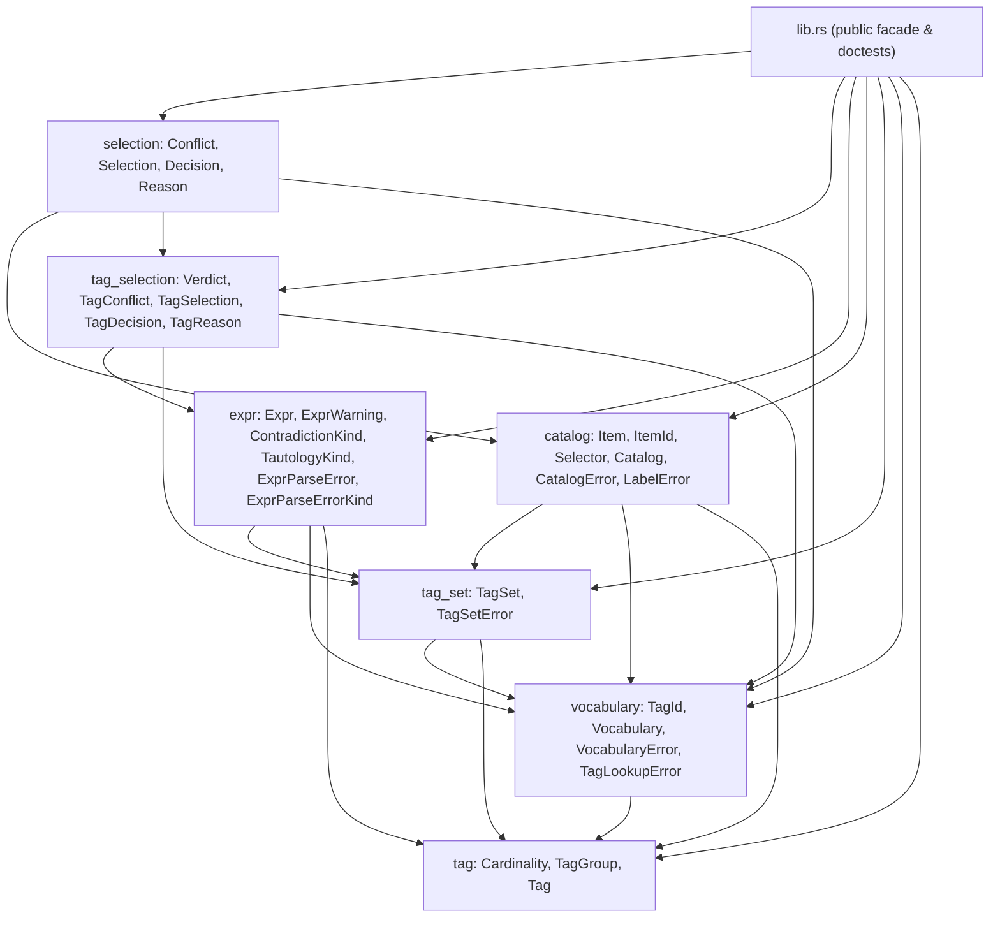

# `tagonomy` Crate: Architecture & Detailed Design

## 1. Module DAG & Layer Responsibilities

`crates/tagonomy` is split into seven focused modules ([ADR 012](../decisions/012_module_placement_by_abstraction.md)) re-exported through [crates/tagonomy/src/lib.rs](../../../crates/tagonomy/src/lib.rs):

### Layer Contracts

1. **[tag.rs](../../../crates/tagonomy/src/tag.rs) (`Tag`, `TagGroup`, `Cardinality`)**:
   - Plain compile-time value definitions. `TagGroup` equality compares both `name` and `cardinality`. Circular `const` `implies` definitions fail to compile with `rustc` `E0391`.
2. **[vocabulary.rs](../../../crates/tagonomy/src/vocabulary.rs) (`Vocabulary`, `TagId`, `VocabularyError`, `TagLookupError`)**:
   - Indexes input tags in order followed by any implied parent tags they pull in, checks that all tag labels, aliases, and group names are unique (comparing group names loosely so `"File scope"` collides with `"file-scope"`), precomputes implied-tag and strictly-narrower-tag bitsets, rejects any tag that implies two conflicting tags from an exclusive group (such as `portable` implying both `linux` and `windows`), and computes shortest parent paths (`chain`, `root_chain`, and root-through-deciding-tag `chain_through`) via breadth-first search.
   - `TagLookupError` (`Group` vs. `Unknown`) gives string-parsing callers (`Vocabulary::resolve`) a targeted hint when a user types a group name instead of a tag name, without coupling to `catalog::LabelError`.
3. **[tag_set.rs](../../../crates/tagonomy/src/tag_set.rs) (`TagSet`, `TagSetError`)**:
   - Validates one item's explicit tags against a `&Vocabulary`: rejects unknown or redefined tags, duplicates, redundant parent tags (`[ebpf, linux]` fails with `RedundantTag` when `ebpf` already implies `linux`), missing required groups (`AtLeastOne`, `ExactlyOne`), and conflicting tags in exclusive groups (`AtMostOne`, `ExactlyOne`—while allowing a single implication chain like `linux -> unix`).
4. **[catalog.rs](../../../crates/tagonomy/src/catalog.rs) (`Catalog<T>`, `Item<T>`, `ItemId`, `Selector`, `CatalogError`, `LabelError`)**:
   - `Catalog::new_with` validates every item name (against other items, tag labels, aliases, and group names) and every item `TagSet` before calling `build(id, &tag_set, data)` to create `T`, so stored values can keep their assigned `ItemId` directly.
5. **[expr.rs](../../../crates/tagonomy/src/expr.rs) (`Expr`, `ExprWarning`, `ContradictionKind`, `TautologyKind`, `ExprParseError`)**:
   - Boolean expression tree (`All`, `None`, `Tag`, `ExplicitTag`, `Not`, `And`, `Or`) with flattening helpers (`Expr::all`, `Expr::any`) and `&`, `|`, `!` operators.
   - Iterator-based tokenizer (`char_indices` + `next_if`) and slice-splitting recursive-descent parser (`split_first`) so zero-length cursor progress is impossible by construction.
   - `Expr::lint` pushes `!` inward (`!(a & b)` → `!a | !b`) and checks `AND` clauses directly while checking `OR` clauses by flipping each tag's polarity (`!(A | B) == !A & !B`) and mapping contradictions to tautologies (`ContradictionKind::into_tautology`). That keeps `AND` and `OR` diagnostics symmetric with zero duplicated check code.
6. **[tag_selection.rs](../../../crates/tagonomy/src/tag_selection.rs) (`TagSelection<'a>`, `Verdict`, `TagConflict`, `TagDecision`, `TagReason`)**:
   - Include/exclude rules over `&'a Vocabulary` with no `<T>` type parameter and no dependency on `catalog`.
   - For each explicit tag on an item (for example, `ebpf`), a directive on a parent tag `t` (such as `os`) is overridden whenever a strictly narrower tag implied by `ebpf` (such as `linux`) also has a directive. Among all winning directives across an item's explicit tags, `Exclude` beats `Include`.
   - `override_with(&self, directives)` validates an incoming directive layer and replaces only the verdicts of tags mentioned in `directives` without mutating `self` or altering `default`.
   - `to_expr(&self) -> Expr` runs that check once per vocabulary tag and builds an equivalent `Expr` using `Expr::ExplicitTag`:
     - `default == Exclude`: `Expr::any(include_sources) & !Expr::any(exclude_sources)`
     - `default == Include`: `!Expr::any(exclude_sources)`
7. **[selection.rs](../../../crates/tagonomy/src/selection.rs) (`Selection<'a, T>`, `Conflict`, `Decision`, `Reason`)**:
   - Wraps `TagSelection<'a>` plus an exact `ItemId -> Verdict` map over `&'a Catalog<T>` (with a manual `impl<T> Clone` so `T` does not need to be `Clone`), exposing `override_with` to layer higher-precedence item or tag directives on top of an existing selection.
   - `ineffective()` returns `(Selector, Verdict)` pairs for every directive whose removal leaves every catalog item's verdict unchanged, avoiding bitset cloning by masking out the skipped tag's bit inside `intersects_both_except`.

---

## 2. How `omnicoach` Integrates `tagonomy`

Inside `omnicoach`, only two architecture components depend on `tagonomy` (enforced via `owns_external: ["tagonomy"]` in [src/architecture.rs](../../../src/architecture.rs)):

- **`RuleDeclaration` ([src/rule_declaration/taxonomy.rs](../../../src/rule_declaration/taxonomy.rs))**:
  - `Topic` wraps `tagonomy::Tag` behind `Topic::root` and `Topic::sub` (`AtLeastOne` `Topic::GROUP`), preserving compile-time single-parent tree rules and mandatory `TopicDoc` fields on `omnicoach` topics while delegating runtime parent expansion to `tagonomy`.
  - Single-valued facet enums (`Consensus`, `ImpactedQuality`) expose `fn tag(self) -> Tag` over `ExactlyOne` `TagGroup`s.
- **`RuleSelection` ([src/rule_selection/taxonomy.rs](../../../src/rule_selection/taxonomy.rs), [src/rule_selection.rs](../../../src/rule_selection.rs))**:
  - Maps derived rule facets (`Language` → `LANGUAGES_GROUP` with `Any`, `AnalyzedInput` → `INPUT_GROUP` with `ExactlyOne`, and `RuleTarget` → `FILE_SCOPE_GROUP` with `AtMostOne`) and builds one `LazyLock<Catalog<RegisteredRule>>` via `Catalog::new_with`, storing each rule's `ItemId` directly on `RegisteredRule`.
  - Resolves `select` / `ignore` via `Selection<'_, RegisteredRule>` (`Verdict::Include` when `select` is omitted, `Verdict::Exclude` when `select` is present), converts `Decision` + `Reason` into `RuleStatus` for `--explain`, surfaces `selection.ineffective()` into `Config::warnings`, and evaluates `per-file-ignores` via `Catalog::resolve` + `Catalog::selects`.
- **Downstream isolation**: `RuleCatalog` ([src/rule_catalog.rs](../../../src/rule_catalog.rs)), `Config` ([src/config.rs](../../../src/config.rs)), runners, and rules have zero dependency on `tagonomy`.

## References

- **[ADR 006: Architectural DAG Specification and Conformance Checking](../decisions/006_architectural_dag_and_conformance.md)** — Governs `owns_external: ["tagonomy"]` component encapsulation in `src/architecture.rs`.
- **[ADR 011: Colocated Top-Down Abstraction Ordering](../decisions/011_colocated_abstraction_ordering.md)** — Governs caller-before-callee declaration ordering across `crates/tagonomy`.
- **[ADR 013: Standalone tagonomy Crate](../decisions/013_tagonomy_crate.md)** — Summarizes the architectural decision, public API, and deferred roadmap items.
