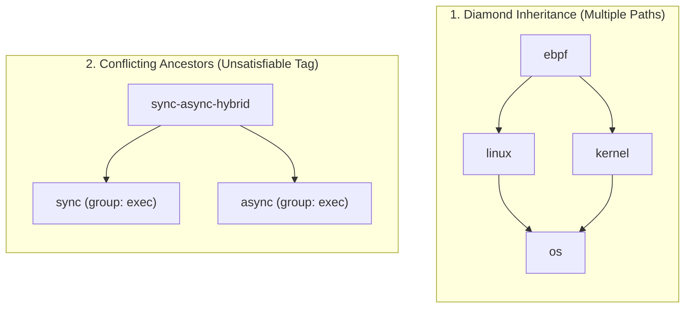
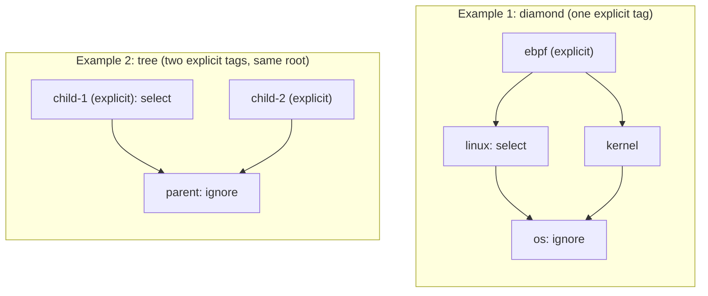

# General-Purpose Tag Crate: 03 Design & Deep-Dive Investigations

> [!NOTE]
> **Status: IN REVIEW (Phase 3)** — First-principles investigation of the three core design questions:
>
> 1. **Polyhierarchy (`implies: &'static [Tag]`) vs. Single-Parent Tree (`parent: Option<&'static Tag>`)**
> 2. **Query & Selection Models (RICR, Necessity, and Literature/SOTA Standards)**
> 3. **Compile-Time (`const`) vs. Shared Dynamic Representation**
>
> §5 records the researched-and-deferred conjunctive directive specificity. Next: [04_plan.md](04_plan.md) (API, done criteria, and commit plan).

---

## 1. Investigation 1: Polyhierarchy (`implies: &[Tag]`) vs. Single-Parent Tree (`parent: Option<&Tag>`)

### 1.1 What First Principles and Literature Say

In a single-parent tree, every tag $t \in T$ has at most one broader tag (`parent: Option<&'static Tag>`). In a **polyhierarchy** (a directed acyclic graph / poset $(T, \le)$), a tag may imply zero, one, or multiple broader tags (`implies: &'static [Tag]`).

| Source | Position on Tree vs. Polyhierarchy | Why |
| :--- | :--- | :--- |
| **ISO 25964-1:2011 (§10.2.4) & W3C SKOS** | **Polyhierarchy is standard.** `skos:broader` / `BTG` is explicitly many-to-many (acyclic). | Real concepts specialize multiple orthogonal or overlapping parents when they sit at an intersection: e.g., `ebpf` is both a `linux` mechanism and a `networking`/`observability` mechanism; `tokio-fs` implies both `async` and `filesystem`; `jj-git-colocated` implies both `jj` and `git`. |
| **Formal Concept Analysis (Ganter & Wille 1999)** | **Concept lattices are always DAGs, never trees** (except in degenerate partitions). | Whenever objects can carry combinations of attributes, the induced implication order $t_1 \to t_2$ ($\text{ext}(t_1) \subseteq \text{ext}(t_2)$) is a partial order (DAG). Forcing a tree is the *Tyranny of the Dominant Decomposition* applied to the vocabulary itself. |
| **Description Logic $\mathcal{EL}_\bot$ (Baader et al. 2005)** | Concept inclusion $A \sqsubseteq B_1 \sqcap B_2$ (`implies: &[B1, B2]`) is the core tractable fragment of OWL 2 EL. | Subsumption, upward closure, and disjointness checking remain polynomial ($O(|T|^2)$ or bitset $O(|T| \cdot W)$) for arbitrary DAGs. |

### 1.2 Do We Lose Any `const` Compile-Time Guarantees with `implies: &'static [Tag]`?

**No.** In Rust, `const` evaluation tracks cycles across static slice references (`&'static [Self]`) with the **exact same `E0391` compile error** as `Option<&'static Self>`:

```rust
pub struct Tag {
    pub label: &'static str,
    pub implies: &'static [Tag],
    // ...
}

// Direct or indirect cycle in `implies` fails at compile time with E0391!
const A: Tag = Tag { label: "a", implies: &[B] };
const B: Tag = Tag { label: "b", implies: &[A] };
```

And a single-parent tree is simply the special case `implies: &[PARENT]` (1 element) or `implies: &[]` (0 elements).

### 1.3 What Changes Mathematically When Moving from a Tree to a DAG?

Moving from a tree (`|implies| <= 1`) to a DAG (`|implies| >= 0`) introduces **three subtle phenomena** that we must analyze carefully:



#### Phenomenon A: Conflicting Ancestors ("Unsatisfiable Tag" Diamond)

- **What happens**: Suppose group `execution = {sync, async}` has cardinality `AtMostOne` ($sync \perp async$). In a single-parent tree where parents stay within a group, a tag cannot have two parents. In a general DAG, someone could define `bad` with `implies: &[SYNC, ASYNC]`.
- **Resolution**: A tag $t$ is **coherent (satisfiable)** iff its upward closure $\uparrow\! \{t\}$ satisfies all group cardinality constraints ($\forall a, b \in \uparrow\! \{t\},\; \neg(a \perp b)$). Our vocabulary hygiene validator checks $\uparrow\! \{t\}$ for every $t \in T$ in $O(|T|)$ bitset operations and rejects unsatisfiable tags immediately.

#### Phenomenon B: Where Specificity Is Evaluated — Paths, Sources, or the Whole Item

`omnicoach` implements specificity in `src/rule_selection.rs` (Model B, [ADR 007](../decisions/007_rule_taxonomy_and_selection.md) §2.3):

1. `rule.branches()` materializes one root-to-leaf path per declared topic, plus a one-tag path per other tag (`Vec<Vec<Tag>>`).
2. On each branch, the selector nearest the rule leaf decides that branch.
3. Across branches, `Ignore` beats `Select`; with no verdict, the default applies.

On a DAG, "branch" has three possible generalizations. Write $D$ for the plan's directives, $S_o$ for the item's explicit tags, and $\text{dom}(X) = X \setminus \bigcup_{t \in X} (\uparrow\! \{t\} \setminus \{t\})$ for the most specific (undominated) tags of a set $X$. The item's own identifier is below every tag, so a directive naming the item dominates every tag directive in all three:

| Semantics | Unit that decides | Verdict |
| :--- | :--- | :--- |
| **P. Path enumeration** | Each root-to-leaf path through $\uparrow\! S_o$ | Nearest directive per path, tie-breaker across paths. |
| **S. Per-source dominance** | Each explicit tag $s \in S_o$, with its whole upward closure $\uparrow\! \{s\}$ | $\text{dom}(D \cap \uparrow\! \{s\})$ per source, tie-breaker across sources (and across incomparable directives within one source). |
| **G. Global dominance** | The whole effective set $\uparrow\! S_o$ | $\text{dom}(D \cap \uparrow\! S_o)$, then tie-breaker. |

Two examples separate them:



| Example | P. Paths | S. Per source | G. Global |
| :--- | :--- | :--- | :--- |
| **1. Diamond**: item tagged `ebpf`; `ignore = ["os"]`, `select = ["linux"]` | Path `os > linux > ebpf` selects, path `os > kernel > ebpf` ignores → **ignored**. | One source `ebpf`: $\text{dom}(\{os, linux\}) = \{linux\}$ → **selected**. | $\text{dom}(\{os, linux\}) = \{linux\}$ → **selected**. |
| **2. Tree**: item tagged `child-1` and `child-2` (both under `parent`); `ignore = ["parent"]`, `select = ["child-1"]` | `child-1` path selects, `child-2` path ignores → **ignored**. | `child-1` selects, `child-2` ignores (via `parent`) → **ignored**. | $\text{dom}(\{parent, child\text{-}1\}) = \{child\text{-}1\}$ → **selected**. |

What the examples show:

- **P depends on how many paths exist, not on what the order says.** In Example 1 the item carries one explicit tag and the plan names two comparable tags (`linux < os`), yet the second path through `kernel` resurrects the dominated `os` directive. P only makes sense on trees, where each source has exactly one path.
- **G changes today's documented behavior on trees.** [tag_guide.md](../tag_guide.md) §2.1 states that a rule carrying `logging` and `error-handling` is off under `ignore = ["error-handling"]` even if `logging` is selected: each subject the item declares is a separate reason to exclude it. G would let a selector on one subject silence an ignore that only covers another subject whenever the two share an ancestor (Example 2).
- **S is the faithful generalization of Model B.** On a forest, $\uparrow\! \{s\}$ *is* the root-to-leaf path of $s$, so S reproduces every current test case; on a DAG it treats each explicit tag's closure as one unit, so a diamond cannot duplicate a dominated directive. Each explicit tag remains an independent reason (the deny-overrides intuition of XACML), and specificity is still read from the order, not from path counts.

S stays allocation-free with closure bitsets: for each source $s$, `m = plan_mask & up[s]`, then `m &= !strict_up[t]` for each `t` in `m`.

#### Phenomenon C: Witness Path Uniqueness (`via a > b > c`)

- In a tree, if an explicit tag $s \in S_o$ implies a queried ancestor $t \in \uparrow\! S_o$, there is a unique path $s = v_0 < v_1 < \dots < v_k = t$.
- In a DAG, there could be multiple paths from $S_o$ to $t$.
- **Canonical witness**: Breadth-first search (shortest implication chain, breaking ties by declaration/lexicographical order of canonical label) deterministically yields a single canonical shortest chain `[t, ..., s]` (`via parent > child`), while still allowing an iterator over all minimal chains if a caller ever wants them.

### 1.4 Verdict on Point 1

- **Use `implies: &'static [Tag]` (Polyhierarchy DAG)** as the core primitive. A root is `implies: &[]`, a single-parent tag is `implies: &[PARENT]`. A spike confirmed that a cycle through `implies` slices fails with `E0391`, like `parent: Option<&'static Tag>` does today.
- **Evaluate specificity per source (semantics S)**: undominated directives within each explicit tag's upward closure, then the tie-breaker across sources. It reproduces Model B on trees, is sound on DAGs, and needs no path enumeration. Global dominance (G) is a different policy, not a generalization; it is not adopted because it contradicts the documented "each declared subject is its own reason" behavior.

---

## 2. Investigation 2: Query & Selection Models — What Is RICR, Necessary, and Standard in Literature/SOTA?

Let's compare the **four query/selection models** found across academic literature, SOTA tools, and the subagent designs, and judge each on **Necessity** and **RICR (Robust, Idiomatic, Cohesive, Readable)**.

### 2.1 The Four Candidate Models

| Model | Formal Semantics | Literature & SOTA Precedent | Where It Shines | Where It Hurts |
| :--- | :--- | :--- | :--- | :--- |
| **M1. Poset-Specificity Directive Plan (`Plan` / `Select` & `Ignore` lists)** | Input: `(include: Option<Set<Selector>>, exclude: Set<Selector>, tie_breaker)`.<br>Per explicit tag, the matching directives are filtered to the undominated ones (semantics S, §1.3); a tie-breaker (`ExcludeWins`) resolves what remains. | Firewall ACL longest-prefix rules; CSS specificity cascades; XACML `deny-overrides` (OASIS 2013); Ruff / `omnicoach` `select` & `ignore`. | **Declarative config files (`.toml`, `.yaml`)**: users write flat lists `select = ["vcs"]`, `ignore = ["jj"]` (or `ignore = ["vcs"]`, `select = ["jj"]`) and get "broad category + narrow exception" without writing nested boolean parentheses. | Cannot express **conjunctive intersection** of two broad tags on the fly (e.g. *"give me items that are BOTH `python` AND `testing`"*). In `Plan`, `select = ["python", "testing"]` is a *union* (`python OR testing`). |
| **M2. Boolean Tag Expressions (`Expr`)** | Propositional algebra over $\uparrow\! S_o$: `All`, `None`, `Tag(t)`, `ExplicitTag(t)`, `Group(g)`, `And`, `Or`, `Not`. | **Universal CLI standard**: `pytest -m "python and testing and not slow"`, Cucumber Tag Expressions (`@a and not @b`), Bazel, Bevy ECS `With<A>, Without<B>`, FCA conjunctive queries. | **Ad-hoc CLI filtering & programmatic queries**: intersecting orthogonal axes (`python & testing & !heuristic`) is natural, unambiguous, and 1-line. | Awkward for declarative override tables if you want a narrow positive exception (`jj`) to override a broad negative exclusion (`!vcs`): in pure boolean logic, `!vcs & jj` is **false** ($\emptyset$) because $jj \le vcs$! |
| **M3. Static Expression / Plan Hygiene Analysis (`lint_expr` / `lint_plan`)** | Static checks on a `Plan` or `Expr` using only vocabulary $\mathcal{V} = (T, \le, \perp)$ (and optionally catalog $C$). | Description Logic $\mathcal{EL}_\bot$ concept satisfiability; compiler dead-branch / shadowed-pattern warnings (`rustc` unreachable pattern lint). | Catches silent user mistakes in configs and CLI flags:<br>1. **Exact/Synonym conflict**: `select = ["jj"]`, `ignore = ["jujutsu"]`.<br>2. **Shadowed / redundant selector**: `select = ["vcs", "jj"]` (`jj` is redundant because `vcs` already selects it) or `ignore = ["vcs"]`, `ignore = ["jj"]`.<br>3. **Contradictory boolean query**: `jj & !vcs` (always $\emptyset$ since $jj \le vcs$) or `exact & heuristic` (always $\emptyset$ since $exact \perp heuristic$).<br>4. **Zero-match selector**: a valid combination that matches 0 registered items. | Only ~60 lines of bitset logic if kept focused on single-step poset/disjointness invariants; would become overcomplicated if turned into a full NP-hard SAT solver. |
| **M4. Conjunctive Directive Specificity & Multi-Stratum Cascades** | Directives whose selector is a conjunction (`testing & heuristic`), ordered by entailment ($C_1 \prec C_2$ iff $C_1 \models C_2$), plus numbered priority strata $s_0, s_1, \dots$ | Specificity in defeasible reasoning (Poole 1985; Simari & Loui 1992); prioritized defaults (Brewka 1994; Horty 2012); CSS selector specificity. | Exceptions scoped to an intersection: "ignore heuristic rules, but only among testing rules". | No current use case; changes the unit of specificity from one tag to a set of tags. **Deferred** with its research in §5; strata are explicit caller composition (CLI overriding file config, `per-file-ignores` subtracting after selection). |

### 2.2 The Critical Insight: Why M1 (`Plan`) and M2 (`Expr`) Are Duals, Not Competitors

Look closely at the difference between **M1 (`Plan`)** and **M2 (`Expr`)** on the example of a sub-tag `jj` under parent tag `vcs`:

- In **M2 (Boolean `Expr`)**:
  - `vcs & !jj` means *"all `vcs` items except `jj`"*.
  - `!vcs & jj` is a **contradiction ($\emptyset$)**, because every `jj` item has `vcs` in its upward closure ($\text{ext}(jj) \subseteq \text{ext}(vcs)$).
  - Conversely, `python & testing` means *"items that have both `python` and `testing`"*.
- In **M1 (Specificity `Plan`)**:
  - Both `(select = ["vcs"], ignore = ["jj"])` **and** `(ignore = ["vcs"], select = ["jj"])` are valid, meaningful, non-empty plans! Because `jj < vcs` in the poset, `jj` is a specific exception to `vcs` in *either* direction (excluding `jj` from selected `vcs`, OR re-enabling `jj` inside ignored `vcs`).
  - Conversely, `select = ["python", "testing"]` is a union (`python | testing`), not an intersection.

**This explains why both subagents independently converged on having both:**

1. **`Plan` (Specificity-Ordered Directives)** is the right abstraction for **configuration profiles** (`select` / `ignore` lists with hierarchical exceptions and explanations).
2. **`Expr` (Boolean Tag Expression)** is the right abstraction for **predicate filtering** (intersecting orthogonal axes like `python & testing & !heuristic`, programmatic filtering, or CLI filter expressions).

And because both evaluate against the exact same precomputed `TagSet` (a single `u64` / `[u64; W]` bitset per object), supporting both in `tagonomy` is remarkably small and cohesive!

### 2.3 RICR Triage: What to Build vs. What to Drop

| Feature | Classification | Rationale (RICR & First Principles) |
| :--- | :--- | :--- |
| **1. Poset Directive `Plan` (`Include` / `Exclude` with Poset Specificity + `TieBreaker` + `Decision` Witness)** | **MUST HAVE (Core)** | Directly powers `omnicoach` `select`/`ignore` and `--explain`, generalizes cleanly to any DAG vocabulary, and provides structured `Decision` witnesses (`winning_selector`, `verdict`, `implication_chain`, `overridden`). |
| **2. Boolean `Expr` (`All`, `None`, `Tag`, `ExplicitTag`, `Group`, `And`, `Or`, `Not`)** | **MUST HAVE (Core)** | Standard boolean algebra (FCA / `pytest` / Cucumber / Bevy). ~80 lines of code over bitsets; enables conjunctive queries across axes (`python & testing`) that `Plan` lists cannot express. |
| **3. Static Plan & Query Lints (Conflict, Redundant/Shadowed Selector, Disjoint/Poset Contradiction)** | **MUST HAVE (Core)** | High-leverage, standard in DL $\mathcal{EL}_\bot$, directly resolves `omnicoach`'s open `ROADMAP.md` §5 item (*"Shadowed-selector config warning"*), and uses simple pairwise poset/group checks (no SAT solver needed). |
| **4. Minimal Infix Expression Parser (`"python & !heuristic"`)** | **OPTIONAL / THIN MODULE** | Useful for CLI `-m` / `--filter` flags, ~100 lines of recursive descent with zero external dependencies. Keep separate from `Plan` list resolution so callers who only want list selectors don't pay cognitive cost. |
| **5. Conjunctive Directive Specificity ($A \land B \prec A$)** | **DEFERRED (roadmap, needs a use case)** | Sound and tractable for positive conjunctions (§5), but no consumer needs it and it changes the specificity unit. Recorded in [crate_split_roadmap.md](../crate_split_roadmap.md) §3.3. |
| **6. Multi-Stratum Priority Engine** | **DROP** | Layer precedence is explicit caller composition; a generic stratum engine would hide it. |

---

## 3. Investigation 3: Compile-Time (`const`) Representation vs. Shared Dynamic Representation

### 3.1 What Do We Need at Compile Time (`const`)?

In `omnicoach` (and any similar static Rust tool—linters, test harnesses, command registries, analyzer catalogs), the tag vocabulary and object classifications are known at compile time. Let's list the exact **compile-time (`rustc`) guarantees** we currently have in `src/rule_declaration/taxonomy.rs` and must preserve or improve:

1. **Missing required single-valued group (`E0063`)**: Forgetting `precision`, `consensus`, or `impacted_quality` on a rule fails to compile.
2. **Duplicate value for a single-valued group (`E0062`)**: Specifying `precision` twice fails to compile.
3. **Wrong tag group in a typed slot (`E0308`)**: Putting `Precision::Heuristic` in `topics` (or as a parent of a `Topic`) fails to compile.
4. **Non-existent tag constant (`E0599`)**: Writing `Topic::TESING` fails to compile.
5. **Unused tag constant (`dead_code`)**: Declaring a `pub(crate) const` tag that no item references triggers Rust's native `dead_code` lint at compile time!
6. **Implication cycle (`E0391`)**: A cycle in `const` parent/implication links (`A -> B -> A`) fails `const` evaluation at compile time!

### 3.2 Can One Representation Be Both `const`-First and Ergonomic Across Vocabularies?

Let's examine why a tension arises when designing a reusable tag crate:

- **In a single application (`omnicoach`)**, you want distinct Rust types (`Topic`, `Precision`, `Consensus`) for compile-time slot checking (`E0063`, `E0308`), *and* you want them unified into a single vocabulary for querying, specificity resolution, and label lookup.
- **If the tag crate only provides dynamic runtime structs (`VocabularyBuilder::new().add_tag("exact")...`)**, you lose all 6 compile-time `rustc` guarantees above!
- **Conversely, if the tag crate tries to support both `'static` `const` vocabularies AND runtime heap-allocated `String` vocabularies via `Cow<'a, str>` or generic storage traits**, every type (`Tag<'a>`, `Group<'a>`, `Witness<'a>`, `Plan<'a>`) gets infected with lifetime parameters or `Arc<str>` heap overhead—for a dynamic runtime use case we don't even have!

Applying simplicity first (no code for a use case nobody has):

- Every real use case we have (and the primary reason to write a Rust tag crate) uses **compile-time `'static` tag definitions** (`&'static str`, `&'static [Tag]`).
- Even if a future tool loads *tagged items* or *queries* dynamically from disk (like `.omnicoach.toml` or JSON test manifests), the **tag vocabulary itself** (`Tag`, `TagGroup`) or at least the lifetime of an indexed `Catalog` can use simple copyable descriptors without `Cow` soup.

### 3.3 How to Design the `const`-First Core Cleanly

Let's look at the cleanest `const`-first representation in Rust:

```rust
/// Cardinality constraint on how many tags from a [`TagGroup`] an item may carry.
#[derive(Debug, Clone, Copy, PartialEq, Eq, Hash)]
pub enum Cardinality {
    /// `0..`: Any number of tags from this group (including none).
    Any,
    /// `0..=1`: At most one tag from this group (tags in the group are mutually exclusive: a ⊥ b).
    AtMostOne,
    /// `1..`: At least one tag from this group is required on every item.
    AtLeastOne,
    /// `1`: Exactly one tag from this group is required on every item (required + mutually exclusive).
    ExactlyOne,
}

/// A named axis / facet partitioning a subset of tags (e.g. "topic", "precision", "language").
#[derive(Debug, Clone, Copy, PartialEq, Eq, PartialOrd, Ord, Hash)]
pub struct TagGroup {
    /// Canonical display/diagnostic name of the group (e.g. `"Precision"`, `"Topic"`).
    pub name: &'static str,
    /// How many tags from this group an item may carry.
    pub cardinality: Cardinality,
}

/// A compile-time tag definition in a controlled vocabulary.
#[derive(Debug, Clone, Copy, PartialEq, Eq, PartialOrd, Ord, Hash)]
pub struct Tag {
    /// Canonical `kebab-case` selector label (e.g. `"test-timing"`, `"heuristic"`).
    pub label: &'static str,
    /// The group (axis/facet) this tag belongs to.
    pub group: &'static TagGroup,
    /// Direct broader tags implied by this tag (`t <= parent`).
    /// Cycles in `const` definitions fail to compile with `E0391`.
    pub implies: &'static [Tag],
    /// Alternative labels that resolve to this canonical tag (SKOS `altLabel` / `UF`).
    pub aliases: &'static [&'static str],
    /// One-line human-readable summary.
    pub description: &'static str,
    /// Optional normative boundary note (SKOS `scopeNote` / ISO 25964 `SN`): what belongs and what does not.
    pub scope_note: &'static str,
}
```

#### Wait: How Do We Preserve Typed Compile-Time Slots (`Precision`, `Consensus`, `Topic`) on `Classification`?

Look at how a domain crate like `omnicoach` (or any consumer) uses `Tag`:

1. **Typed wrappers per group, owned by the consumer**:
   - A consumer defines `pub struct Topic` wrapping a `Tag`, built by `const fn` constructors that take a `&'static Topic` parent and a `TopicDoc { description, scope_note }` struct literal, and value enums such as `pub enum Precision { Exact, Heuristic }` deriving their labels and descriptions via `strum`. The wrapper type is what rejects a parent or slot value from another group; `tagonomy` needs no type-level group marker for it.
   - `Classification` keeps its typed fields (`topics: &'static [Topic]`, `precision: Precision`, ...), so `E0063` (including a missing `scope_note`), `E0062`, `E0308` (both wrong value type in a slot *and* wrong parent group in `Topic::sub`), `E0560`, `E0599` and `E0391` stay compile errors. Groups that *should* allow cross-group or multi-parent implication (`ebpf` implying `linux` and `kernel`) use `Tag::implies`.
   - Each item is stored once in `Catalog<T>` alongside its domain payload `T`, which owns closure, indexing, validation, selection and root-chain witnesses.

2. **Whole-vocabulary and whole-catalog validation**:
   - Invariants that need the whole vocabulary (label uniqueness, unsatisfiable tags) or the whole catalog (cardinality, redundant explicit tags) are checked when `Vocabulary` and `Catalog<T>` are built, which a single test exercises.

### 3.4 What About Bitsets and Performance?

Once a `Catalog<ItemId>` is built from the registered items and tags:

- The catalog assigns each canonical `Tag` a dense `TagIdx(u16)` in topological order ($t_1 \le t_2 \implies \text{idx}(t_2) < \text{idx}(t_1)$).
- For vocabularies up to 64 tags (or `[u64; N]` / small inline bitvec for larger vocabularies), every `Tag`'s upward closure $\uparrow\! \{t\}$ and downward closure $\downarrow\! \{t\}$ is a single `u64` mask!
- Every item's `TagSet` stores:
  - `explicit: BitSet` (the antichain $S_o$)
  - `effective: BitSet` (the upward closure $\uparrow\! S_o = \bigcup_{s \in S_o} \uparrow\! \{s\}$)
- **How fast are operations?**
  - `item.has_tag(t)`: 1 bit test (`(item.effective & bit(t)) != 0`).
  - `Expr` evaluation (`And`, `Or`, `Not`, `Group`): bitwise `&`, `|`, `!` in $O(1)$ per 64 tags.
  - `Plan::decide(item)`:
    - Matching tags in `select` / `ignore` = `item.effective & plan.select_mask` and `item.effective & plan.ignore_mask`.
    - Per explicit tag $s$, restrict the matched directives to its closure (`m = matched & up[s]`), then remove dominated ones by masking out each matched tag's strict ancestors:
      $$\text{dom}(M) = M \setminus \bigcup_{t \in M} (\uparrow\! \{t\} \setminus \{t\})$$
      In bitset arithmetic this is one loop of AND-NOT (`m &= !strict_up[t]`): no path allocation and no tree assumption.

---

## 4. Summary of Recommendations

1. **Hierarchy (`implies: &'static [Tag]`)**:
   - Model the tag hierarchy as a **compile-time DAG (polyhierarchy)** where each `Tag` has `pub implies: &'static [Tag]`.
   - `rustc` still enforces acyclicity at compile time via `E0391`.
   - Compute specificity per explicit tag (semantics S, §1.3) with the bitset identity $\text{dom}(M) = M \setminus \bigcup_{t \in M} \text{strict\_up}(t)$: allocation-free, sound on diamonds, and equal to `omnicoach`'s Model B on trees.
2. **Query & Selection Layers**:
   - Include **both** the **Specificity-Ordered Directive `Plan`** (`Include`/`Exclude` with per-source dominance, deny-overrides tie-breaking, and structured `Decision` witness chains) **and** the **Boolean Predicate `Expr`** (`Tag`, `ExplicitTag`, `Group`, `And`, `Or`, `Not`), plus **Static Plan/Expr Hygiene Lints** (exact/alias conflicts, shadowed/redundant selectors, and poset/disjointness contradictions).
   - Defer conjunctive directive specificity to the roadmap until a use case appears (§5); drop multi-stratum priority engines.
3. **Compile-Time (`const`) Representation**:
   - Make `Tag` and `TagGroup` pure `const`, `Copy`, `'static` types—no dynamic `Cow<'a, str>` or runtime ontology builder bloat.
   - Consumers wrap `Tag` in their own per-group types, so they keep all of their compile-time type guarantees (`E0063`, `E0062`, `E0308`, `E0560`, `E0599`, `E0391`, `dead_code`) while delegating taxonomy storage (`Catalog<T>`), validation, bitset selection, and explanation chains (`chain`, `root_chain`) to `tagonomy`.

---

## 5. Researched and Deferred: Conjunctive Directive Specificity

**Status**: not built. Recorded so a future use case can start from this analysis instead of from scratch; the roadmap entry is in [crate_split_roadmap.md](../crate_split_roadmap.md) §3.3.

### 5.1 What It Would Add

Today a directive names one selector (a tag or an item). A conjunctive directive names a set of tags that must all hold: `ignore = ["testing & heuristic"]` ignores heuristic rules among testing rules only. The plan must then decide which of two matching conjunctive directives is more specific.

### 5.2 Candidate Orderings from the Literature

| Ordering | Definition | Source | Assessment |
| :--- | :--- | :--- | :--- |
| **Entailment (logical specificity)** | $C_1 \prec C_2$ iff every item satisfying $C_1$ satisfies $C_2$ and not conversely. For positive conjunctions over a poset: $C_1 \models C_2$ iff $\forall b \in C_2.\, \exists a \in C_1.\, a \le b$. | Poole 1985 (*On the Comparison of Theories: Preferring the Most Specific Explanation*); Simari & Loui 1992; subsumption in Description Logic $\mathcal{EL}$. | **Preferred.** Reads from the vocabulary, reduces to today's rule when $|C| = 1$, and costs $O(|C_1| \cdot |C_2|)$ bit tests. |
| **Counting (CSS)** | Compare tuples of selector counts by category (IDs, classes, types). | CSS Selectors Level 4 specificity. | Rejected: `a & b` beats `c` even when `c` is strictly more specific than both, so it contradicts the order the vocabulary declares. |
| **Explicit priorities** | Each directive carries a priority, or a superiority relation between rules. | Nute's defeasible logic; Brewka 1994 prioritized defaults; firewall first-match lists. | Rejected as the default: moves the burden to users and makes list order significant, which `select` / `ignore` lists avoid today. |

### 5.3 Consequences If Adopted

- **The specificity unit changes.** A conjunction can span several explicit tags (`testing` from one source, `heuristic` from another), so per-source evaluation (semantics S) no longer applies to it as is. One consistent extension: a conjunctive directive participates in a source's comparison when one of its conjuncts is in that source's closure, and it dominates a single-tag directive $t$ when it entails $t$.
- **Negation stays out.** With negated conjuncts, entailment needs disjointness reasoning and loses the "one bit test per pair" property; positive conjunctions cover the motivating examples.
- **Static lints extend naturally.** An unsatisfiable conjunction (`exact & heuristic` under an `ExactlyOne` group) is detectable from the vocabulary alone.

### 5.4 Trigger to Revisit

A real configuration that needs an exception scoped to an intersection of tags and cannot be written as item-name directives or as an `Expr` filter applied by the caller.
