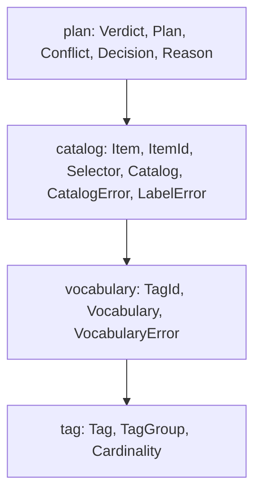

# General-Purpose Tag Crate: 04 Plan

> [!NOTE]
> **Status: APPROVED (Phase 3)** — API, done criteria, and commit plan for `tagonomy`, derived from [03_design.md](03_design.md). Questions Q1–Q4 are resolved (§3).

---

## 1. Definition of Done

Each critical user journey (CUJ) has acceptance criteria that do not depend on how the crate is built.

| CUJ | Acceptance criteria |
| :--- | :--- |
| **CUJ1 — `omnicoach` behaves exactly as before** | Every existing test passes with unchanged expectations (including `E0308` for cross-group `Topic` parents and missing `scope_note`). Outputs of `omnicoach --list-tags`, `--list-rules`, and `--explain` for every rule under a fixed set of configs (no config, `select`/`ignore` exceptions in both directions, synonyms, per-file ignores) are byte-identical to a baseline captured before the migration. No file under `src/code_lint/rules/` or `src/command_lint/rules/` changes. |
| **CUJ2 — A new project adopts the crate** | A crate-level doctest declares a vocabulary with a diamond (`ebpf` implies `linux` and `kernel`, both imply `os`) and an exclusive group, builds a catalog of three items, decides a plan, and prints the explanation, in under 60 lines with no `omnicoach` concepts. |
| **CUJ3 — Mistakes are reported loudly and completely** | Building a `Vocabulary` or `Catalog` returns *every* violation at once, each naming the offending tag, group or item. A cycle in `implies` and a cross-group implication through a wrapper are compile errors. |

Design invariants: every rule, facet, and tag has a single source of truth; group confinement, single-parent topic chains, required documentation, and acyclicity remain compile-time type errors (`E0308`, `E0391`, `E0063`); `tagonomy`'s public API exposes no third-party types or `omnicoach` concepts; and `Plan::decide` evaluates precomputed bitsets without heap allocation.

---

## 2. Decisions

| ID | Decision | Reason |
| :--- | :--- | :--- |
| **D1** | Tags are `const`, `Copy`, `'static` structs with public fields; no runtime vocabulary builder. | Every consumer declares its vocabulary at compile time; struct literals keep `E0063`/`E0062` checks ([03_design.md](03_design.md) §3). |
| **D2** | Hierarchy is a polyhierarchy: `implies: &'static [Tag]`. | Standard in SKOS / ISO 25964 and FCA; `E0391` still rejects cycles (§1). |
| **D3** | Tag and group identity is the label / name. Two different `Tag` values with the same label are a vocabulary error. | Labels are what users type; structural equality alone would let two diverging definitions coexist. |
| **D4** | Group confinement is the consumer's job: a consumer wraps `Tag` in its own type per group (as `omnicoach`'s `Topic` does), so its constructors and item slots reject another group's tags (`E0308`), while `Tag::implies` supports multi-parent and cross-group DAGs. | Preserves `E0308` without `const` panic workarounds (`E0080`), `unsafe`, or a type-level group marker in the crate. A derive that generates such typed groups is planned ([ROADMAP.md](../../../ROADMAP.md) §5). |
| **D5** | `Cardinality` counts the group's tags in the item's *effective* set; `AtMostOne` means those tags form a chain. | An exclusive group may itself be hierarchical (`os = {unix > linux, windows}`): `linux` with `unix` is fine, `linux` with `windows` is not. |
| **D6** | `Vocabulary` (tags only) and `Catalog<T = ()>` (vocabulary + named items with optional domain payload `T`) are separate validated types. | Mirrors FCA's attributes vs. context; `Catalog<T>` eliminates parallel item registries (`values(&self) -> &[T]`, `catalog[item]`). |
| **D7** | Items are identified by a unique name in the same label namespace as tags; the catalog returns dense `ItemId`s in insertion order. No generic key type. | Item names are selectors (Ruff, `omnicoach`); a generic key would spread a type parameter over every API for no consumer. |
| **D8** | `Plan` = default verdict + `(Selector, Verdict)` directives; per-source dominance; `Exclude` wins ties. No `TieBreaker` parameter. | Semantics S from §1.3. Deny-overrides is the only policy any consumer uses; add the parameter with the second policy. |
| **D9** | `Decision` carries the verdict and its reason: the default, the item's own directive, or the deciding tag with the explicit tag it applies through (`Vocabulary::chain` lists the implications between them). Formatting stays with the caller. | `omnicoach` prints TOML-flavored explanations; another consumer will not. |
| **D10** | No fuzzy matching in the crate: resolution returns "unknown label" or "group name, here are its tags", and `Catalog::labels()` exposes the registry. | `omnicoach` already owns `closest_match`, also used by rule options; one derivation per fact ([ADR 012](../decisions/012_module_placement_by_abstraction.md) P6). |
| **D11** | Closures are private dense bitsets, with no width cap. | Implication is one bit test, and per-source dominance in `Plan::decide` runs over precomputed bitsets with no 64-tag limit and no bitset type in the public API. |
| **D12** | Conjunctive directive specificity is deferred ([03_design.md](03_design.md) §5); config-layer precedence (CLI over file, `per-file-ignores`) stays caller composition. | No use case yet. |

---

## 3. Resolved Questions

- **Q1 — `Expr` now or with its first consumer?** With its first consumer. [03_design.md](03_design.md) §2.3 keeps it in the design, but nothing in `omnicoach` filters by boolean expressions today (`rules_tagged` is the single-tag case). It lands in the same change as a consumer such as `--list-rules --filter "python & heuristic"`.
- **Q2 — Plan lints now or with the config warning?** With the warning: a second chain right after the migration (C8–C9), closing the "shadowed-selector config warning" item of [ROADMAP.md](../../ROADMAP.md).
- **Q3 — Publishing.** `tagonomy` will be published to crates.io. Its manifest carries the metadata crates.io requires, `omnicoach` depends on it by path *and* version, and `tagonomy` is published before the first `omnicoach` release that depends on it.
- **Q4 — Crate name.** `tagonomy` (`tag` + `taxonomy`; unclaimed on crates.io and free of `omni*` branding).

---

## 4. Module DAG and API

Dependencies only point down. `lib.rs` re-exports the public items and holds the CUJ2 doctest.

The rustdoc of [crates/tagonomy](../../../crates/tagonomy/src/lib.rs) documents the API and holds the CUJ2 example. The shape, by module:

- **`tag`**: `Tag { label, group, implies, aliases, description, scope_note }` with `const` builders, `TagGroup { name, cardinality }`, and `Cardinality`.
- **`vocabulary`**: `Vocabulary::new(tags) -> Result<Vocabulary, Vec<VocabularyError>>` closes the tags over `implies` in the order first reached; queries by id, label or alias, loose group name, group members, implication, and shortest implication paths (`chain` and `root_chain`).
- **`catalog`**: `Catalog::new(vocabulary, items) -> Result<Catalog<T>, Vec<CatalogError>>`; stores domain payloads `T` (`values`, `value`, `Index<ItemId>`), queries for explicit and carried tags, selection, unused tags, label resolution (`Result<Selector, LabelError>`) and every accepted label.
- **`plan`**: `Plan::new(&catalog, default, directives) -> Result<Plan<'_, T>, Vec<Conflict>>`, allocation-free bitset `Plan::decide(item) -> Decision { verdict, reason }`, and `Plan::ineffective()` for the directives that change no verdict.

### 4.1 How `omnicoach` Maps onto It

| `omnicoach` today | With `tagonomy` |
| :--- | :--- |
| `Topic { label, parent, description, scope_note, synonyms }` | `Topic` wrapping a `Tag`, built by `Topic::root` / `Topic::sub` from a label, a `&'static Topic` parent and a `TopicDoc { description, scope_note }` struct literal, enforcing group membership and a single parent (`E0308`) and a required `scope_note` (`E0063`). The `Topic::*` consts keep their names, so rule files do not change. |
| `Precision`, `Consensus`, `ImpactedQuality` enums | `strum`-derived enums (`IntoStaticStr`, `EnumMessage`) lowering to `Tag::new` in groups `ExactlyOne`, with zero duplicated strings. |
| `Derived` enum, `Facet` enum | `Tag::new` constants in groups `Languages` (`Any`), `Analyzed input` (`ExactlyOne`), `File scope` (`AtMostOne`); `Facet` is replaced by `TagGroup`. |
| `REGISTERED_RULES`, `branches()`, `matches()` | Single unified `LazyLock<Catalog<RegisteredRule>>` (`registered_rules()` returns `CATALOG.values()`), with explicit tags ordered topics → declared facets → derived and paths queried via `Vocabulary::root_chain`. |
| `Plan::decide` (Model B), `RuleStatus` | `tagonomy::Plan` with `default = Include` iff `select` is absent; `RuleStatus` formats `Decision`. CLI/file merging stays in `rule_selection`. |
| `lookup`, `labels()`, `FacetLabel` error | `Catalog::resolve`; `closest_match` over `Catalog::labels()`. |
| Invariant tests (`every_rule_has_a_topic`, no ancestor/duplicate, unique labels, `every_tag_has_a_rule`) | Construction errors (`Topic` is `AtLeastOne`, `RedundantTag`, `RepeatedTag`, `DuplicateLabel`, `NameCollision`), checked by one test that builds the catalog; `unused_tags()` stays an `omnicoach` test. Kebab-case and non-empty documentation stay `omnicoach` policy tests. |

---

## 5. Commit Chain and Tasks

Each task runs Audit → RED (failing test) → GREEN (minimal implementation) → Verify (§6).

| # | Commit | Audit | RED → GREEN |
| :--- | :--- | :--- | :--- |
| C0 | No commit: capture the CUJ1 baseline outputs outside the repository. | List the configs that cover every `Reason` and both exception directions. | — |
| C1 | `build(tagonomy): add zero-dependency workspace crate` | Workspace lints apply (`[lints] workspace = true`); `tests/architecture_conformance.rs` ignores paths outside `src/`. | Empty crate builds under `cargo clippy --all-targets`. |
| C2 | `feat(tagonomy): add const tag definitions` | — | `compile_fail,E0391` doctest for a cycle through `implies`; `const` test for `implies_only_within_group`. |
| C3 | `feat(tagonomy): validate and close vocabularies` | Topological order, alias resolution, group-name collisions. | Duplicate label/alias/group name, unsatisfiable diamond, chain rule of D5, `implies` reflexive and transitive. |
| C4 | `feat(tagonomy): add validated item catalogs` | Error ordering is deterministic. | Each `CatalogError`, effective closure, `unused_tags`, `resolve` for item/tag/alias/group/unknown. |
| C5 | `feat(tagonomy): decide include/exclude plans by specificity` | Port the cases of `the_nearest_selector_decides_and_ignore_wins_across_branches` from [src/rule_selection.rs](../../src/rule_selection.rs). | Ported tree cases, both diamond examples of [03_design.md](03_design.md) §1.3, item directive beats tags, chain contents, `Conflict`. CUJ2 doctest. |
| C6 | `refactor(taxonomy): build the rule taxonomy on tagonomy` | One commit: `Topic`'s shape and every consumer of it (`rule_selection`, `rule_catalog`) must change together to compile. Check the playground crate. | Existing tests stay green; CUJ1 baseline diff is empty; the cross-group `compile_fail` doctest moves to `E0080`. |
| C7 | `docs: record the tagonomy extraction` | — | ADR 013 (crate boundary, D1–D12), [ADR 007](../decisions/007_rule_taxonomy_and_selection.md) §2.3 states Model B as per-source dominance, [crate_split_roadmap.md](../crate_split_roadmap.md) §3.3 status, [tag_guide.md](../tag_guide.md) wording. |

Second chain, if Q2 is accepted:

| # | Commit | RED → GREEN |
| :--- | :--- | :--- |
| C8 | `feat(tagonomy): report plan directives with no effect` | `select = ["vcs", "jj"]` reports `jj`; `ignore = ["vcs"], select = ["jj"]` reports nothing. |
| C9 | `feat(config): warn about selectors with no effect` | Closes the [ROADMAP.md](../../ROADMAP.md) shadowed-selector item. |

---

## 6. Verification

After every task:

1. `cargo fmt --all --check`
2. `cargo clippy --workspace --all-targets`
3. `cargo test --workspace` (includes `compile_fail` doctests)
4. For C2–C5 and C8: `cargo mutants --cap-lints=true -f <changed file> -- --lib` and `cargo +nightly llvm-cov --lib --branch -p tagonomy`
5. For C6: the CUJ1 baseline diff and `cargo check -p omnicoach-playground`

---

## 7. Risks

| Risk | Mitigation |
| :--- | :--- |
| Explanations name a different selector than today when several tie. | Explicit tags keep the current branch order (§4.1) and ties scan sources in that order; the CUJ1 baseline diff catches any change. |
| `LazyLock<Catalog>` must panic at first use if a static registration is invalid, and the workspace denies `clippy::panic`. | One `#[expect(clippy::panic, reason = "...")]` at that site; the same construction runs in a unit test, so an invalid registration fails `cargo test` with the full error list before any release. |
| Bitset closure is premature for tens of tags. | It makes implication a single bit test and costs one small private type that stays replaceable. |
