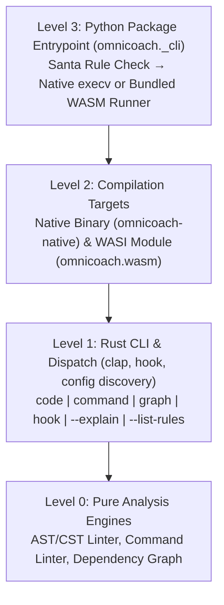

# Running `omnicoach` Under macOS Santa Lockdown Without Per-Repo Shims

> [!NOTE]
> Historical problem report captured before investigation. Empirical prototyping in [02_references.md](02_references.md) rejected the `santactl` + `node:wasi` fallback below in favor of a thin `pyo3` (`cp310-abi3`) extension wheel paired with standalone GitHub Release binaries; see [03_design.md](03_design.md). (The `wasm-bindgen` import leak noted at `DEFAULT_WASM_URL` affected unreleased `main` builds on GitHub Pages, not `v0.3.0`.)

## TL;DR

On macOS machines running Santa in `Lockdown` mode, executing `omnicoach` fails because `maturin` (`bindings = "bin"`) installs an ad-hoc-signed Mach-O binary directly as the `omnicoach` entrypoint, which Santa blocks at `execve`. Working around this with per-repository Python shims that call `omnicoach_playground.wasm` duplicates `omnicoach`'s CLI parser, file walker, and config loader in Python and omits `hook`, `command`, `graph`, and `--diff`. The root fix belongs in the `omnicoach` Python wheel: replace the direct Mach-O `bin/omnicoach` entrypoint with a thin Python console-script launcher that `execv`s the bundled native binary when Santa allows it and otherwise runs a wheel-bundled WebAssembly build (`wasm32-wasip1` via Node's built-in `node:wasi`) exposing the full Rust CLI.

---

## Problem Statement

`omnicoach` is distributed as a Python wheel on PyPI and installed either into project virtual environments (`uv sync` / `uv run omnicoach`) or globally (`uv tool install omnicoach`). When built with `maturin` `bindings = "bin"`, the wheel places a compiled Rust Mach-O executable directly at `bin/omnicoach` with ad-hoc code signing (`Code-signed: Yes, but ad-hoc`, `Rule: None`).

On corporate macOS workstations where Santa runs in `Lockdown` mode, any `execve` call targeting an unallowlisted Mach-O executable is terminated by the kernel endpoint security hook before `main()` runs:

- **Agent lifecycle hooks (`hooks.json`)**: Every `PreInvocation` and `PreToolUse` event invokes `omnicoach hook antigravity ...`, failing or triggering Santa block notifications on every tool call.
- **VCS pre-push hooks (`jj-pre-push.sh`)**: `command -v omnicoach` succeeds because the file is present and `+x`, causing `jj push` to fail when it invokes `omnicoach code .`.
- **Per-version allowlist churn**: Because Santa allowlists unsigned binaries by SHA-256 / CDHash, every `omnicoach` release requires a new Santa upvote before the binary can run natively.

---

## Evaluation of Execution Strategies Under Santa Lockdown

### Context

We inspected Santa's policy decisions (`santactl fileinfo`) across native Mach-O binaries, Python C/Rust extension modules (`.so`), and WebAssembly modules executed via already-allowlisted runtimes (`/opt/homebrew/bin/python3` and `/opt/homebrew/bin/node` v26.5.0) on a Lockdown-mode macOS workstation, and compared them against the existing `omnicoach_playground.wasm` shim used in `PolyBot`.

| Execution Strategy | Santa Decision | CLI Surface Coverage | Consumer Setup Cost | Failure Mode / Tradeoff |
| :--- | :--- | :--- | :--- | :--- |
| **Native Mach-O wheel (`bindings = "bin"`)** | Blocked at `execve` (`Rule: None`) | 100% (`code`, `command`, `graph`, `hook`, `--explain`) | None when allowlisted | Breaks on every new release until SHA-256 is allowlisted |
| **Per-repo Python shim + remote `omnicoach_playground.wasm`** | Allowed (`python3` + `node`) | Partial (`code`, `--explain`, `--list-rules` only) | Copy ~440-line script into each repo and `~/.local/bin` | Re-implements CLI/walker/config in Python; misses `hook`, `command`, `graph`, `--diff`; requires network fetch |
| **Wheel-bundled launcher + `omnicoach_playground.wasm` JSON bridge** | Allowed (`python3` + `node`) | Partial unless JSON bridge adds `hook` and `command` | Zero (`uv tool install` / `uv sync` works out of the box) | Still splits CLI flag parsing and file traversal between Rust and Python |
| **Wheel-bundled launcher + `wasm32-wasip1` (`node:wasi`)** | Allowed (`python3` + `node`) | ~100% (full Rust CLI, `clap`, config discovery, `hook`) | Zero (`uv tool install` / `uv sync` works out of the box) | Requires host import shim only when spawning `jj`/`git` subprocesses |
| **PyO3 extension wheel (`bindings = "pyo3"`, `.so`)** | Allowed via `dlopen` (`Type: Dynamic Library`) | 100% (full Rust CLI and `std::process::Command`) | Zero (`uv tool install` / `uv sync` works out of the box) | Relies on Santa allowing ad-hoc `.so` `dlopen` inside Homebrew Python |

### Analysis & Interpretation

- **Why Santa blocks the current wheel but allows Python/Node wrappers**: Santa's Lockdown rule intercepts `execve` on `Type: Executable (arm64)` Mach-O binaries whose signing certificate or hash has no allow rule. It does not block `execve` on allowlisted interpreters (`python3`, `node`), nor does it block user-space WebAssembly instantiation (`WebAssembly.instantiate`) or `dlopen` of ad-hoc-signed Python extension libraries (`Type: Bundle/Plugin` / `Dynamic Library`, verified against `pydantic_core` and `markupsafe` `.so` wheels on the same host).
- **Where the per-repository `omnicoach_playground.wasm` shim backfires**: `omnicoach_playground.wasm` was designed for the browser playground (`wasm32-unknown-unknown`), where no filesystem, environment, `stdin`, or CLI arguments exist. Its export surface (`prepare_input`, `execute_request`, `output_pointer`) accepts stateless `{action: "lint" | "explain" | "catalog"}` payloads. Using it as a CLI fallback forces the Python wrapper to re-implement `clap` argument parsing, directory walking, `.omnicoach.toml` discovery, and plain/JSON output formatting, causing immediate feature drift (`omnicoach hook`, `omnicoach command`, `omnicoach graph`, `omnicoach code --diff`, and ancestor config resolution are all absent or stubbed). In addition, `omnicoach_playground.wasm` at `DEFAULT_WASM_URL` imports five `wasm-bindgen` symbols under `__wbindgen_placeholder__` and `__wbindgen_externref_xform__`, causing `WebAssembly.instantiate(wasmBytes, {})` to fail with `TypeError` unless the host passes a stub `Proxy` import map or strips `wasm-bindgen` from the build.
- **Why moving the launcher into the `omnicoach` wheel is the single-source-of-truth fix**: Every consumer (`chezmoi`, `PolyBot`, CI) already installs `omnicoach` via `uv`. Making `bin/omnicoach` a standard Python console script (`#!/.../python3`) inside the `omnicoach` package eliminates per-repo shims entirely while still `os.execv`-ing the native Mach-O binary with zero overhead whenever Santa allows it.

---

## Target Architecture in the `omnicoach` Repository

Following a strict downward dependency DAG across abstraction levels:

1. **Level 0 — Pure Analysis Engines (`wasm32`-compatible)**: Code linting, command linting, rule catalog/explanations, and graph computation operate on parsed syntax trees and in-memory structures.
2. **Level 1 — Rust CLI & Hook Protocol (`clap` + `stdin`/`stdout` + filesystem)**: Handles all argument parsing, `.omnicoach.toml` ancestor traversal, `~/.config/omnicoach/config.toml` precedence, and `PreToolUse` / `PreInvocation` JSON serialization in one place (Rust).
3. **Level 2 — Dual Targets (`native` + `wasm32-wasip1`)**:
   - **Native target**: Compiled as `omnicoach-native` (bundled inside package data).
   - **WASI target (`wasm32-wasip1`)**: Compiles the exact same Rust `main()` entrypoint with `std::fs`, `std::env::args`, `std::io::stdin`, and `std::io::stdout` mapped to WASI Preview 1 (`node:wasi` with `preopens: {"/": "/"}`).
   - **Subprocess adapter for WASI**: Isolate `std::process::Command` calls (`jj` / `git` diff and workspace revset queries) behind a single internal `ProcessRunner` trait. On native targets it calls `std::process::Command`; on `target_os = "wasi"` it calls an imported host function (`env.host_run_command`) backed by `child_process.spawnSync` in the 25-line Node WASI host script.
4. **Level 3 — Wheel Console-Script Facade (`omnicoach._cli:main`)**:
   - Installed by `uv` as a Python script (`#!/.../python3`), which always passes Santa `execve`.
   - Checks `santactl fileinfo --key Rule <omnicoach-native>` on macOS:
     - If `Allowed` (or on Linux/Windows), calls `os.execv(native_bin, [native_bin, *sys.argv[1:]])`.
     - If `Blocked`, invokes `node --no-warnings` with the bundled `omnicoach.wasm` (`wasm32-wasip1`) from package data—requiring no network access or external cache.

---

## Prioritized Suggestions / Next Steps

1. **Short-term (in `omnicoach` repo — extend JSON WASM or switch to PyO3)**:
   - Either expose `omnicoach` via a thin PyO3 entrypoint (`bindings = "pyo3"`, calling `omnicoach::run_cli(sys.argv)` via `dlopen`, which bypasses Santa's `Type: Executable` block while keeping native speed and `std::process::Command`), **or** bundle `omnicoach_playground.wasm` inside the wheel with a `[project.scripts]` Python launcher and add `"action": "hook"` and `"action": "command"` handlers to the Rust WASM entrypoint.
2. **Medium-term (in `omnicoach` repo — full `wasm32-wasip1` CLI target)**:
   - Put `jj`/`git` subprocess execution behind a `ProcessRunner` adapter in Rust, build `omnicoach.wasm` for `wasm32-wasip1`, and run it via Node's built-in `node:wasi` when `santactl` reports the native binary is blocked.
3. **Clean up consumer repositories (`PolyBot` and `chezmoi`)**:
   - Once the `omnicoach` wheel ships its own Python entrypoint and fallback, delete `dev/linting/run_omnicoach.py` (`--install-shim`) in `PolyBot` and remove the temporary `~/.local/bin/omnicoach` shim in `chezmoi`.
