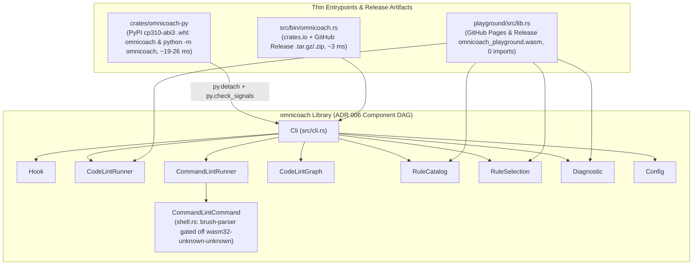

# Phase 3 — Design: Universal `abi3` Wheel, Standalone Release Binaries & Zero-Import Playground WASM

Target architecture, component boundaries, and release contracts grounded in [01_understand.md](01_understand.md), [01b_macos_santa_probe.md](01b_macos_santa_probe.md), and [02_references.md](02_references.md).

---

## 1. User Journeys & Acceptance Criteria

1. **Corporate macOS Santa `Lockdown` execution**: After `uv tool install --managed-python omnicoach` or `uv sync`, both VCS pre-push checks (`omnicoach code .`) and agent hooks (`omnicoach hook antigravity pre-tool-use`) run via the allowlisted Python interpreter and `dlopen` of `_omnicoach.abi3.so`, with zero SHA-256 voting, zero `/usr/bin/codesign` calls, and zero repository shims.
2. **Single-implementation CLI and `python -m` parity**: `omnicoach` and `python -m omnicoach` produce identical `stdout`, `stderr` (with TTY color detection), and exit codes (`0`, `1`, `2`) to the standalone binary across all subcommands and `.omnicoach.toml` discovery.
3. **Low-latency hooks, multi-core linting, and pipe/signal hygiene**: Hook calls stay within $\le 50\text{ ms}$ ($p_{50}$) and $\le 150\text{ ms}$ ($p_{99}$); `omnicoach code` releases the GIL so `rayon` uses all cores; `Ctrl-C` raises `KeyboardInterrupt` (exit `130`); and closed stdout pipes (`| head`) exit cleanly with empty `stderr`.
4. **Cross-minor CPython compatibility**: One `cp310-abi3` wheel per platform ($\le 5\text{ MB}$ compressed) installs without recompilation on CPython `3.10`–`3.15+`, and `--locked` builds from `sdist` succeed cleanly.
5. **Prebuilt standalone native binaries**: Unconstrained Linux (`musl`), macOS, and Windows hosts can install ~3 ms standalone executables from GitHub Releases (`cargo binstall omnicoach`) or build from crates.io (`cargo install omnicoach --locked`).
6. **Zero-import browser playground WASM**: `omnicoach_playground.wasm` compiles for `wasm32-unknown-unknown` with `0` host imports, lints Python and Rust without drop-thread panics, preserves `Topic::JJ` and command selectors in `.omnicoach.toml`, and is verified in CI.

### Target Budgets

| Metric | Target | Prototype Result ([02_references.md](02_references.md)) |
| :--- | :--- | :--- |
| Standalone binary cold latency (`p50` / `p95`) | $\le 5\text{ ms}$ / $\le 10\text{ ms}$ | `2.5–3.1` / `3.1–4.0 ms` |
| Wheel cold hook latency (`p50` / `p95`) | $\le 50\text{ ms}$ / $\le 150\text{ ms}$ | `18.8` / `23.7 ms` (macOS `uv` Py 3.15); `26.3–32.2` / `28.8–34.4 ms` (Linux Py 3.13) |
| Compressed platform `.whl` size | $\le 5\text{ MB}$ | `3.31 MiB` |
| CLI/hook parity & `BrokenPipe` exit | `100%` match; empty `stderr` | Exact match across all 11 cases; `BrokenPipe` exit `0` |
| `omnicoach_playground.wasm` import count | `0` imports | `0` imports (`4.36 MiB`, `-380 KB`) |
| Workspace `unsafe` exemptions added | `0` | `0` |

---

## 2. Architecture & Component Contracts

### 2.1 `Cli` Component (`src/cli.rs`), `src/bin/omnicoach.rs` & `src/diagnostic.rs`

1. **Architectural DAG ([src/architecture.rs](../../../src/architecture.rs), [src/lib.rs](../../../src/lib.rs))**: Register `Cli` depending on `[CodeLintGraph, CodeLintRunner, CommandLintRunner, Config, Diagnostic, Hook, RuleCatalog, RuleSelection]`, keeping [src/lib.rs](../../../src/lib.rs) a pure `pub mod` router ([ADR 006](../decisions/006_architectural_dag_and_conformance.md)) and ordering `src/cli.rs` top-down ([ADR 011](../decisions/011_colocated_abstraction_ordering.md)).
2. **In-process CLI entrypoint (`src/cli.rs`)**: Expose `run_from_args` returning `EXIT_SUCCESS` (`0`), `EXIT_VIOLATIONS` (`1`), or `EXIT_ERROR` (`2`) without calling `std::process::exit`. Parse with `CliArgs::try_parse_from` (`bin_name = "omnicoach"`) and render `clap` help/version/errors via `clap::Error::print` (preserving TTY color detection and ignoring `BrokenPipe`).
3. **Closed-pipe output ([src/diagnostic.rs](../../../src/diagnostic.rs), `src/cli.rs`)**: Write both JSON and plain diagnostics in `diagnostic::print_diagnostics` directly through `io::stdout().lock()`, ignoring `io::ErrorKind::BrokenPipe` across diagnostics, discovery flags, `graph`, hook responses, and summary footers.
4. **Thin native binary ([src/bin/omnicoach.rs](../../../src/bin/omnicoach.rs))**: Delegate `main` directly to `ExitCode::from(omnicoach::cli::run_from_args(std::env::args_os()))`.

### 2.2 Thin PyO3 `abi3-py310` Wheel (`crates/omnicoach-py` & `pyproject.toml`)

1. **Workspace version sharing ([Cargo.toml](../../../Cargo.toml), [releasing.md](../releasing.md))**: Share `[workspace.package]` metadata across `omnicoach` and `crates/omnicoach-py` while keeping `default-members = ["."]`.
2. **Extension crate (`crates/omnicoach-py`)**: Configure `_omnicoach` as `crate-type = ["cdylib"]` (`publish = false`, `test = false`, `doctest = false` so `cargo test --workspace` avoids unresolved CPython linker symbols on macOS/Windows) using `pyo3 = "0.30.1"` (`abi3-py310`, `extension-module`). `run_cli` detaches from the GIL around `omnicoach::cli::run_from_args` and calls `py.check_signals()?` on return.
3. **Python package (`crates/omnicoach-py/python/omnicoach/`)**: `_cli.py` normalizes `argv[0]` to `"omnicoach"`, delegates to `run_cli`, and translates `KeyboardInterrupt` to exit code `130` (Rust writes straight to file descriptors `1` and `2` and handles closed pipes itself). `__main__.py` exposes `python -m omnicoach`, and `_omnicoach.pyi` + `py.typed` type `run_cli(args: Sequence[str]) -> int`.
4. **Packaging & verification ([pyproject.toml](../../../pyproject.toml), `scripts/verify_wheel.py`, [ci.yml](../../../.github/workflows/ci.yml))**: Switch `[tool.maturin]` to `bindings = "pyo3"` (`maturin>=1.15,<2.0`) with `sdist` includes covering workspace `Cargo.lock` members and benchmark fixtures so `MATURIN_PEP517_ARGS="--locked"` source builds succeed; verify wheels across Linux, macOS, and Windows in CI.

### 2.3 Standalone Native Release Binaries ([Cargo.toml](../../../Cargo.toml) & [release.yml](../../../.github/workflows/release.yml))

1. **Release matrix ([release.yml](../../../.github/workflows/release.yml))**: Build standalone archives (`x86_64` and `aarch64` static Linux `musl`, `aarch64` and `x86_64` macOS on `macos-15`, `x86_64` Windows `.zip`), smoke-test runnable targets with `--version`, and upload under `binaries-*` so `publish-pypi` uploads only `wheels-*` while `github-release` publishes wheels, `sdist`, standalone binaries, and `omnicoach_playground.wasm` before `publish-crates` runs.
2. **`cargo-binstall` metadata ([Cargo.toml](../../../Cargo.toml))**: Configure `[package.metadata.binstall]` (mapping Linux `gnu` hosts to the static `musl` archives and Windows to `zip`) so `cargo binstall omnicoach` fetches prebuilt GitHub Release binaries directly.

### 2.4 Zero-Import Browser Playground WASM ([Cargo.toml](../../../Cargo.toml), [.cargo/config.toml](../../../.cargo/config.toml), [shell.rs](../../../src/command_lint/command/shell.rs))

1. **Target-scoped `brush-parser`**: Gate `brush-parser` behind `cfg(not(all(target_arch = "wasm32", target_os = "unknown")))` in [Cargo.toml](../../../Cargo.toml) and move its adapter unchanged into `shell/brush_backend.rs` paired with a `wasm32-unknown-unknown` stub in [shell.rs](../../../src/command_lint/command/shell.rs), keeping `COMMAND_RULES` and `Topic::JJ` in `REGISTERED_RULES`.
2. **Workspace `wasm32` `rustflags`**: Set `rustflags = ["--cfg", "no_salsa_async_drops"]` for `cfg(target_arch = "wasm32")` in `.cargo/config.toml` and drop duplicate `RUSTFLAGS` overrides in [pages.yml](../../../.github/workflows/pages.yml) and [release.yml](../../../.github/workflows/release.yml).
3. **CI enforcement (`playground/tests/verify_wasm.mjs`)**: Verify zero WebAssembly imports and end-to-end Python, Rust, `jj`-config, `explain`, and `catalog` execution through [playground/www/omnicoach.js](../../../playground/www/omnicoach.js) in CI, Pages, and Release workflows.

---

## 3. Deferred Options & Landed Commit Chain

- Deferred options and their adoption triggers (standalone `wasm32-wasip1` CLI, public `import omnicoach` SDK, playground `command`/`graph`/multi-file actions, and notarized macOS standalone binaries) are tracked in [ROADMAP.md](../../../ROADMAP.md) §4.
- The landed atomic commit chain and verification measurements are recorded in `04_execution_log.md`.
